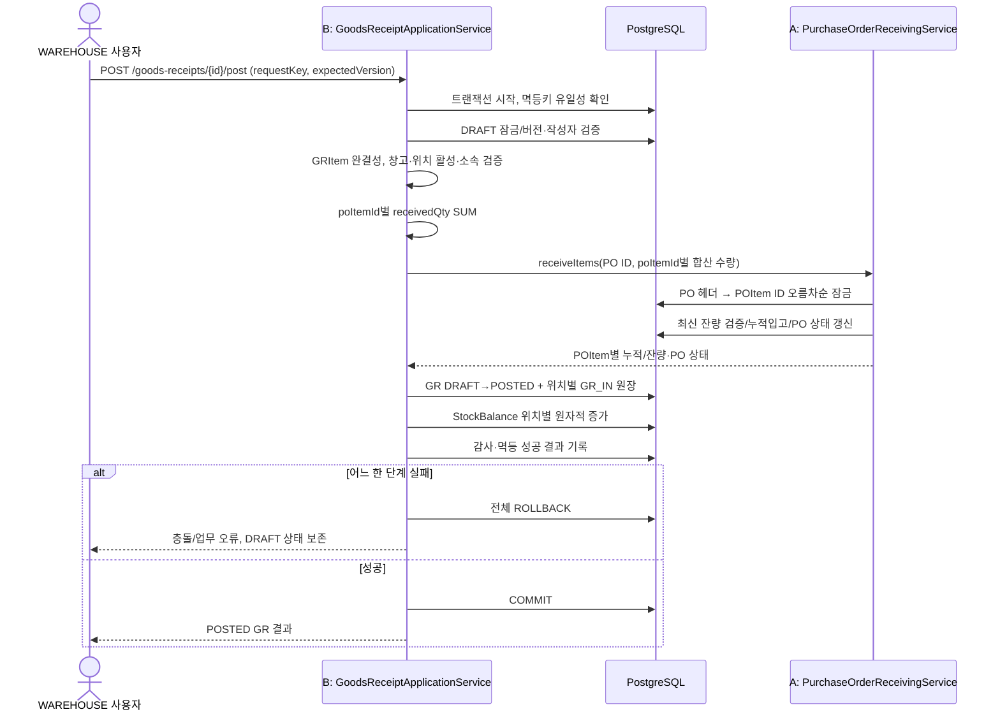

# 차곡ERP — PO ↔ GR 내부 서비스·데이터 계약

> v0.3 · 2026-11-18 · **B 피드백 수용 설계안 / A+B 최종 코드 계약 리뷰 전**  
> A: PO/누적입고 내부 서비스 · B: GR DRAFT/POSTED·StockMovement·StockBalance·트랜잭션 조정. 실제 Java 소스/DB 마이그레이션 실행 전.

## 1. 핵심 업무 불변조건

- **1 PR → N PO**, 각 PO는 공급업체 하나. PR 승인 범위는 헤더 전체 일괄 승인, PO 품목은 각각 `pr_item_id`를 참조한다.
- 동일 PR 안에서 같은 `material_id`를 가진 PRItem 여러 행을 허용하며 각각 고유 `pr_item_id`가 있다. 발주 가능 잔량은 **각 PRItem별** 계산한다.
- **1 GR → 1 PO · 1 창고.** 동일 `po_item_id`가 다른 저장위치에 여러 번 등장할 수 있다. 예: POItem-1, 위치 A-01: 40 EA / 위치 B-02: 60 EA.
- `orderedQty`는 보존, `remainingQty=orderedQty-receivedQty`, 모든 경우 `0 ≤ receivedQty ≤ orderedQty`.
- **DRAFT는 임시 문서**이고 PO 누적량·재고 원장·현재고를 변경하지 않는다. **POSTED는 확정된 불변 문서**이며 취소·수정·삭제는 P0 밖이다.
- POSTED 확정 시 POItem별 위치 배분 수량을 합산하여 A의 PO 서비스에 전달하고, B는 위치별 각각 GRItem/원장/현재고를 반영한다.
- `StockBalance` 유니크 기준은 `(material_id, storage_location_id)`이며 창고는 StorageLocation의 부모로 조회한다. `(material,warehouse,location)` 중복 필드 저장을 강제하지 않는다.

## 2. 권한·서비스 경계

| 업무 | 구현/트랜잭션 책임 | 금지/검증 |
|---|---|---|
| GR DRAFT 생성/수정/조회 | B `GoodsReceiptApplicationService` | WAREHOUSE/ADMIN, **DRAFT 작성자 본인** 접근, `expectedVersion` 확인. PO 수량/재고 변경 금지 |
| GR POSTED 확정 | B `GoodsReceiptApplicationService`가 트랜잭션 시작 | DRAFT 상태·권한·최신 PO/창고/위치 재검증, 멱등키·버전 검사 |
| PO 입고 누적·상태 | A `PurchaseOrderReceivingService` | B가 A Repository 직접 갱신 금지, 동일 트랜잭션 참여(REQUIRED), 별도 커밋/REQUIRES_NEW/외부 HTTP 금지 |
| 원장/현재고 | B | POSTED 배분행 1개당 `GR_IN` 원장 1건, DRAFT 원장 0건 |
| 창고·위치 | B | 모두 같은 창고 소속+active; 비활성 위치는 신규 확정 불가. 거래 이력 물리 삭제 불가 |
| AI/Document | A/B 각 Tool | PR DRAFT 외 승인/PO/GR/재고 확정 Tool 미제공 |

## 3. REST API 계약 (`openapi.yaml`이 경로·필드의 기준)

| 동작 | Method/경로(공통 `/api/v1`) | 효과 |
|---|---|---|
| 임시저장 생성 | `POST /goods-receipts` | DRAFT 생성. 최소 `purchaseOrderId`+인증 작성자+`requestKey`; 창고/행은 추후 채울 수 있음 |
| 상태별 조회 | `GET /goods-receipts?status=DRAFT` 또는 `GET /goods-receipts?status=POSTED` | 초안은 소유자만, 게시문서는 권한 범위 내 |
| 상세 조회 | `GET /goods-receipts/{id}` | 상태/품목/위치/버전 반환 |
| 임시저장 수정 | `PATCH /goods-receipts/{id}` | `requestKey`, `expectedVersion`; `items` 제공 시 **전체 행 목록 교체**; POSTED 수정 불가 |
| 명시적 입고 확정 | `POST /goods-receipts/{id}/post` | `requestKey`, `expectedVersion` 검사 후 POSTED. PO/재고 변경은 **여기서만** 수행 |

**호환성 주의:** 이전 버전의 `POST /goods-receipts`는 즉시 POSTED였으나 이번 계약에서는 DRAFT 생성으로 변경한다. 이전 React Mock·API Client·Controller·테스트를 그대로 사용하면 잘못 동작한다. 양쪽 담당자가 함께 변경해야 한다.

### 초안 최소 데이터와 완료 데이터

```text
GR DRAFT header:
  id, poId, createdBy, status=DRAFT, version, grNumber
  warehouseId?, note?, postedBy=null, postedAt=null
GR DRAFT items:
  [ { displayOrder, poItemId?, storageLocationId?, receivedQty?, unit? } ]
GR POSTED:
  warehouseId, postedBy, postedAt 필수
  items 1행 이상, 각 행 poItemId/storageLocationId/receivedQty>0/unit 필수
```

- PO ID는 초안 생성 후 변경할 수 없다. PO 변경이 필요하면 별개 초안을 만든다.
- DRAFT 행은 아직 미완성일 수 있으므로 최종 잔량/활성 검증을 저장 시 확정 판정으로 대신하지 않는다. 단, 가능한 입력 형식 오류·권한 오류는 조기에 표시할 수 있다.
- DRAFT의 작성자와 `version`은 Spring Security 사용자와 DB 상태로 검증한다. 사용자가 요청 본문에 넣은 사용자 ID를 신뢰하지 않는다.

## 4. POSTED 확정 — 단일 PostgreSQL 트랜잭션



**잠금 순서 후보:** 같은 PO에서는 `PO header → POItem ID 오름차순 → StockBalance (materialId,storageLocationId 정렬)` 순서를 유지한다. 확정 대상 GR DRAFT 잠금과 멱등성 키 선점도 일관된 순서를 정의한다. 실제 데드락·경합 동작은 PostgreSQL 통합 테스트에서 확정한다.

## 5. A/B 내부 서비스 데이터 계약

```text
B receives: PostGoodsReceiptCommand
  draftId: ID
  requestKey: String
  expectedVersion: long
  actor: AuthenticatedPrincipal

B loads draft allocations:
  { grItemId, poItemId, storageLocationId, receivedQty, unit }
  e.g. { GI-1, POI-1, LOC-A, 40, EA }
       { GI-2, POI-1, LOC-B, 60, EA }

B aggregates by poItemId (BigDecimal):
  PurchaseOrderReceivingCommand
    purchaseOrderId: ID
    items: [{poItemId: POI-1, receivedQty: 100, unit: EA}]

A returns:
  ReceivingResult
    purchaseOrderId, poStatus
    items: [{poItemId, orderedQty, cumulativeReceivedQty, remainingQty}]

B posts:
  GR POSTED + StockMovement(grItemId=GI-1, LOC-A, +40)
            + StockMovement(grItemId=GI-2, LOC-B, +60)
            + StockBalance(materialId, LOC-A, +40)
            + StockBalance(materialId, LOC-B, +60)
```

A는 POItem이 해당 PO에 소속되며 입고 가능한 상태·기준단위·잔량인지 검증한다. B는 DRAFT 소유자·상태·창고/위치 활성·소속 관계 및 배분 유효성을 검증한다. 동일 POItem+동일 위치 중복 배분 행은 **거부 권고, B 최종 확인 전**이다. GR 확정은 모든 항목이 성공하거나 전체 롤백한다.

## 6. 멱등성·버전·오류

- **초안 생성:** `(actor, operation=CREATE_GR_DRAFT, requestKey)` 유일성. 동일 키·동일 요청은 기존 DRAFT 반환, 동일 키·다른 요청은 409.
- **초안 수정:** `expectedVersion` 불일치 409. 변경 입력과 구별되는 새 사용자 행위에는 새 `requestKey`; 동일 본문 네트워크 재전송에만 같은 키 유지. `operation=UPDATE_GR_DRAFT`는 처리 결과/버전을 보존해 반복 호출에 중복 수정을 막는다.
- **확정:** `(actor, operation=POST_GR, requestKey)` 유일성. 지문은 `draftId + expectedVersion + 확정 당시 저장된 배분 스냅샷`을 정규화하여 만든다. 동일 키·동일 지문은 **기존 POSTED 성공 결과**, 동일 키·다른 지문은 409. 성공 후 같은 키 재요청은 먼저 멱등 성공 이력을 조회한 뒤 기성공 결과로 종료한다.
- **DRAFT 경합:** 다른 버전으로 PATCH/POST하면 409. 이미 POSTED를 다른 새 키로 확정하면 409. 비정상 입력·수량 등 업무 위반은 422. 타인 DRAFT 403/404, 미인증 401, 잘못된 JSON 400.
- **동시 입고:** 서로 다른 초안 두 개가 같은 PO 잔량 100에 대해 60+60 요청하더라도 잠금 이후 최신 합산 잔량을 검증하므로 모두 성공할 수 없다.
- **실패:** PO 누적량을 갱신한 뒤 원장/현재고 저장에 실패하면 전체 롤백. DRAFT는 POSTED가 되지 않으며 기성공 멱등 결과도 없어야 한다. 타임아웃으로 성공 여부를 모르면 **같은 키·같은 요청**을 재시도한다.

## 7. 창고·저장위치 및 PR 설계 연계

- 창고/저장위치는 이력·재고 참조 시 물리 삭제 금지, `active=false`를 통한 비활성화. 과거 원장은 계속 조회 가능. 비활성 창고/위치는 신규 확정 입고 불가. **현재고>0 위치의 비활성화는 B 검토 전(차단 권고)**.
- PR에 동일 materialId를 가진 다른 `pr_item_id` 행 여러 개가 있을 수 있다. PO Item은 `pr_item_id`로 정확히 참조하며, GR은 POItem ID로만 집계한다.
- `PRItem`별 필요일/사용 목적 필드는 공동 미확정. Plant 마스터는 P0에 추가하지 않는다.

## 8. 통합 테스트 계약 (실행 전)

| ID | 시나리오 | 기대 결과 |
|---|---|---|
| CON-01 | GR 초안 생성/수정/재조회 | PO 누적·원장·현재고 변화 0; version 갱신 |
| CON-02 | POItem 100을 A-01 40/B-02 60으로 확정 | PO 누적 +100, 원장 2건/위치별 현재고 +40/+60 |
| CON-03 | PO 잔량 100에 서로 다른 DRAFT 60+60 동시 POST | 둘 다 성공 불가; 누적 ≤100 |
| CON-04 | POST 확정 동일 요청키·같은 내용 2회 | GR 1건만 POSTED; 추가 원장/재고 효과 0 |
| CON-05 | POST 확정 동일 키 다른 초안/본문 | 409; 기존 결과 불변 |
| CON-06 | POST 후 원장 저장 강제 실패 | PO/GR/원장/현재고 모두 롤백, DRAFT 유지 |
| CON-07 | DRAFT 생성 뒤 다른 사람이 해당 PO 일부 입고 | 확정 시 최신 잔량 초과면 409/422 정책에 따라 거부, 재조회 권장 |
| CON-08 | GRItem 다른 PO 참조·다른 창고 위치·비활성 위치 | POST 거부, 변경 없음 |
| CON-09 | 같은 PR에서 동일 품목 다른 prItemId 두 행 | PO 발주 잔량은 각 prItemId별 정확히 계산 |
| CON-10 | 거래 이력 있는 창고 삭제 시도 | 삭제 금지, 비활성화/과거 조회 유지 |
| CON-11 | 다른 작성자의 GR DRAFT 수정/확정 | 403/404, DB 무변경 |
| CON-12 | 같은 POItem·같은 위치 배분 2행 | B 확정 정책(거부 권고)에 맞게 검증 |

## 9. 팀 최종 리뷰 항목

- [ ] B: DRAFT 접근 범위·만료/유지 정책, 최소 저장 가능한 항목 확인
- [ ] B: 현재고>0 창고/위치 비활성화 정책, 동일 POItem+동일 위치 중복 배분 처리 확정
- [ ] A+B: PRItem별 필요일/용도 필드 채택 여부, POItem별 집계 DTO·잠금 순서 검토
- [ ] A+B: GR POSTED 확정의 요청키/버전/공통 오류 계약, PostgreSQL 통합 테스트 검증

**문서 작성은 구현·테스트 완료를 의미하지 않는다.**
