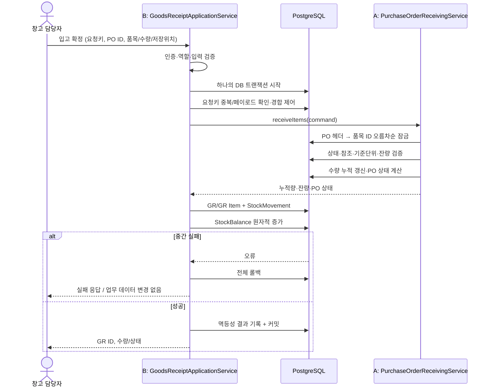

# 차곡ERP — 5일 차 PO ↔ GR 공통 서비스·데이터 계약 초안

> 버전: v0.2 / 2026-11-17  
> 계약 당사자: **A(PO 소유), B(GR·재고 소유)**  
> 기준: `PO-01~03`, `GR-01/02`, `ST-01`, BR-005~012/019~022, ERP-WORKFLOW v0.3.  
> 상태: **2주 차 DB/API·코딩 전 팀 합의 필요**. 아래 타입·필드명은 인터페이스 설계 예시이며 실제 Java 코드·스키마·REST URL이 아니다.

## 1. 경계와 도메인 불변조건

| 범위 | 책임 | 변경 가능한 정보 | 직접 수정 금지 |
|---|---|---|---|
| 구매발주(A) | PO/PO Item의 생성·상태·발주량·누적 입고량 및 입고 허용 판단 | `receivedQty`, PO 입고 상태(입고 처리 시) | B가 PO Repository/Entity를 임의 갱신 |
| 입고(B) | 입고 요청의 인증/권한, 멱등성·입고 문서, 트랜잭션 조정 | GR 헤더/항목 및 처리 결과 | A가 GR/재고 Repository를 직접 변경 |
| 재고(B) | StockMovement 원장, StockBalance 현재고, 저장위치 검증 | 원장 추가·현재고 원자적 증가 | Agent·Document AI가 재고 직접 갱신 |
| 공통(B 인프라, 각자 도메인) | 인증·업무 권한 | 요청 컨텍스트 | 클라이언트가 임의 지정한 userId 신뢰 |

**항상 성립:** `orderedQty > 0`, `0 <= receivedQty <= orderedQty`, `remainingQty = orderedQty - receivedQty`. 성공한 GR의 수량만 PO 수령량과 재고에 반영한다. **PO 헤더 `RECEIVED`는 모든 PO 품목의 `remainingQty == 0`일 때만** 성립한다. 단위가 다른 품목 수량을 합산하여 완료 여부를 판단하지 않는다.

**분할 발주와 입고는 별도 불변식:** `PR 품목 승인 수량 ≥ Σ(해당 PR 품목을 참조하는 유효 PO 품목 orderedQty)`는 **A의 PO 생성 서비스가 검증**한다. GR은 만들어진 각 PO의 `orderedQty - receivedQty`만 검증한다. PO 2개가 같은 PR 품목을 참조해도 GR 트랜잭션은 서로 독립적으로 PO별 수량을 관리한다.

### P0 단순화(확정 전 권장안)

- 한 GR 요청에는 **한 PO의 하나 이상 품목**만 포함한다. 같은 `purchaseOrderItemId`가 두 번 나오면 중복으로 거부한다.
- PO 품목의 기준단위로 GR 수량을 보낸다. 복잡한 단위 환산·초과납품 허용오차는 없다.
- 등록 즉시 게시(`POSTED`)된 GR만 다룬다. 입고 취소/반품·역이동은 P1.
- **D-01 확정 방향:** 한 PR에서 여러 PO를 생성할 수 있으나 **GR 요청은 한 PO를 기준**으로 처리한다. A가 PR 품목별 발주량 합계를 관리하고 B는 개별 PO 품목별 입고 수량을 관리한다. PR 미발주 잔량과 PO 미입고 잔량을 혼용하지 않는다.
- `StockBalance`는 `(materialId, warehouseId, storageLocationId)`별로 유일해야 한다. 시연용 개시 재고는 `OPENING` 원장 기록과 현재고 갱신을 함께 수행하는 방향을 적용한다(D-04).

## 2. 호출 구조와 단일 트랜잭션



**중요:** 같은 **Spring Boot 프로세스의 하나의 PostgreSQL 트랜잭션**에서 호출한다. `GoodsReceiptApplicationService`가 트랜잭션의 최상위 경계를 소유한다. PO 서비스는 기존 트랜잭션에 참여한다(예: Spring `REQUIRED`); `REQUIRES_NEW`·비동기 분리·외부 HTTP로 PO를 반영하지 않는다. 자세한 `@Transactional` 위치와 전파 정책은 구현/통합 테스트에서 확정한다.

### 동시성·잠금 정책(팀 검토용 제안)

1. GR 멱등 요청 식별 및 DB 유일성 보호.
2. **같은 PO 내에서는 PO 헤더 먼저**, 그다음 `purchaseOrderItemId` 오름차순으로 잠금(간단한 P0 정책).
3. 잠금 이후 최신 수령량과 PO 상태를 다시 읽어 남은 수량 검증. 잠금 전 화면 표시 잔량은 참고용일 뿐이다.
4. 저장위치에 대한 현재고 행은 유니크 제약과 DB 원자적 증가(또는 충돌 안전한 upsert)로 갱신. 성공한 각 GR Item에는 해당 입고 `StockMovement`가 **정확히 한 번** 연결되도록 참조키/유일성 제약을 둔다. 잠금/갱신 순서를 모든 입고 코드 경로에서 일관되게 사용한다.
5. 모든 항목 검증·변경을 한 트랜잭션으로 처리한다. **일부 품목만 성공한 GR은 P0에서 허용하지 않는다.**

> 위 순서는 구현 전략 후보이며, 실제 JPA/SQL 동작·락 대기·데드락 여부는 PostgreSQL 통합 테스트에서 확인한다. PO 헤더 잠금은 병렬성을 낮출 수 있으나 2인 P0에서 일관성을 우선한 선택이다.

## 3. 서비스 계약(개념적 DTO)

### B가 접수하는 GR 명령

```text
PostGoodsReceiptCommand
  idempotencyKey: UUID/String          # 같은 사용자 행위의 재시도에는 같은 키
  purchaseOrderId: ID
  items: [
    { purchaseOrderItemId: ID, quantity: Decimal, unit: Code,
      warehouseId: ID, storageLocationId: ID }
  ]
  authenticatedActor: Principal       # 서버 인증에서 확보, 클라이언트 userId 미신뢰
```

**A 서비스가 제공할 동작(개념):** `receiveItems(PurchaseOrderReceivingCommand)` → `ReceivingResult`.

```text
PurchaseOrderReceivingCommand
  purchaseOrderId: ID
  items: [{ purchaseOrderItemId: ID, receivedQuantity: Decimal, unit: Code }]

ReceivingResult
  purchaseOrderId: ID
  poStatus: OPEN | PARTIALLY_RECEIVED | RECEIVED
  items: [{ purchaseOrderItemId: ID, orderedQty: Decimal,
            cumulativeReceivedQty: Decimal, remainingQty: Decimal }]
```

**B 처리 성공 결과(개념):**

```text
GoodsReceiptResult
  goodsReceiptId: ID
  postedAt: Timestamp
  purchaseOrderId: ID
  poStatus: ...
  items: [{ goodsReceiptItemId: ID, purchaseOrderItemId: ID,
            postedQty: Decimal, cumulativeReceivedQty: Decimal,
            remainingQty: Decimal }]
```

**A 서비스의 전제:** B는 `warehouseId` 및 `storageLocationId`의 유효성을 검증하고, A는 PO 품목 ID·재고 기준단위·잔량·PO 상태를 검증한다. 두 영역 모두 같은 사용자 업무 권한과 상태가 유효한지 확인하며 최종 업무 권한 검증을 한 곳에서 누락하지 않는다.

**인터페이스 주의:** A의 내부 서비스는 **GR을 생성하거나 커밋하지 않는다**. A가 누적량 갱신에 실패하면 예외를 발생시켜 전체 트랜잭션을 롤백한다. B는 A 내부 Repository에 접근하지 않는다.

## 4. 멱등성 계약 — 반드시 합의할 정책

| 경우 | 제안 동작 | DB 변경 |
|---|---|---|
| 최초 유효 요청키 K + 페이로드 P | GR 한 번 생성, 성공 결과 및 K/P 식별 저장 | 1회 |
| 동일 인증 주체·업무의 K + 동일 P 재시도 | 기존 GR 성공 결과를 반환(또는 관련 GR 재조회) | 추가 변경 0 |
| 같은 K + 다른 P | 충돌 오류, 기존 GR 불변 | 0 |
| 같은 PO, **다른 K**의 경쟁 요청 | 잠금 후 최신 잔량 기준으로 각 요청 판정 | 허용되는 요청만 |
| 이전 요청이 롤백된 뒤 재시도 | 해당 키의 미완료 상태가 영구 차단하지 않도록 재처리 가능 | 성공 시 1회 |

- 멱등성 키는 일회성 **입고 확정 행동**에 묶는다. 브라우저 재시도/타임아웃에서는 **새 키를 만들지 않고 기존 키**를 재사용한다.
- 요청 본문을 정규화해 해시(예: 항목 ID 정렬 후 수량·위치 포함)를 비교하며, **보호 범위는 인증 주체 + 작업 종류 + 키** 등으로 확정한다.
- 단순 `SELECT` 후 `INSERT`는 동시 요청에서 충분하지 않으므로 **PostgreSQL UNIQUE 제약과 경합 처리**를 사용한다. 같은 키를 경쟁 제출한 요청 하나가 커밋되기 전에는 다른 요청이 추가 효과를 만들지 않도록 구현한다.
- 성공 결과 저장과 GR 생성은 같은 트랜잭션에 속한다. 롤백된 작업이 성공한 것처럼 캐시되지 않도록 한다.
- 키가 같아도 현재 인증·조회 권한은 검증한다.

## 5. 실패·응답 의미(HTTP 코드 확정 전)

| 오류 분류 | 발생 예 | 기대 결과 |
|---|---|---|
| `AUTH_REQUIRED` / `FORBIDDEN` | 미로그인/창고 권한 없음 | GR/PO/재고 무변경 |
| `PO_NOT_RECEIVABLE` | PO가 완료/유효하지 않음 | 전체 요청 거부 |
| `PO_ITEM_MISMATCH` | 다른 PO 품목 또는 품목 불일치 | 전체 요청 거부 |
| `INVALID_UOM` / `INVALID_QTY` | 기준단위 불일치/0 이하 수량 | 전체 요청 거부 |
| `STORAGE_LOCATION_INVALID` | 다른 창고에 속한 위치 | 전체 요청 거부 |
| `OVER_RECEIPT` | 최신 잔량 초과 | 전체 요청 거부 |
| `IDEMPOTENCY_CONFLICT` | 같은 키 다른 요청 내용 | 전체 요청 거부 |
| `CONCURRENT_STATE_CHANGE` | 승인/입고 경쟁으로 상태 변경 | 재조회 안내(업무 오류) |
| `PERSISTENCE_FAILURE` | 원장/현재고 저장 실패 | **PO 포함 전체 롤백** |

실제 REST 경로·상태코드/에러 DTO는 2주 차 OpenAPI에서 결정한다. 내부 Java 예외와 외부 HTTP 오류는 1:1일 필요가 없다.

## 6. 테스트 계약(향후 PostgreSQL 통합 테스트)

| 테스트 ID | 입력·조건 | 성공/거부 결과 |
|---|---|---|
| CON-GR-01 | PO 100, GR 60 후 GR 40 | GR 2건·입고 원장 2건, 누적 100·잔량 0, 해당 위치 현재고 +100 |
| CON-GR-02 | PO 잔량 40, GR 41 | 거부·모든 데이터 변화 없음 |
| CON-GR-03 | PO 잔량 100, K1/K2 서로 다른 GR 60+60 동시 | 둘 다 성공하지 못하고 PO 누적 ≤100 |
| CON-GR-04 | 동일 K + 동일 페이로드 2회 | GR 한 건만 생성; 동일 성공 결과 참조 |
| CON-GR-05 | 동일 K + 다른 페이로드 | 충돌; 추가 수량 반영 없음 |
| CON-GR-06 | PO 누적 갱신 직후 원장 저장 오류 강제 | PO/GR/원장/현재고 모두 롤백 |
| CON-GR-07 | 다른 PO의 품목 ID, 잘못된 저장위치/단위 | 전체 요청 실패 |
| CON-GR-08 | 여러 품목을 가진 PO, 마지막 한 품목만 미입고 | PO `PARTIALLY_RECEIVED` 유지; 각 품목 잔량으로 상태 판정 |
| CON-GR-09 | 처음 입고하는 위치로 경쟁 요청 | 현재고 행 중복 없음, 원장 합계와 일치 |
| CON-GR-10 | 다른 사용자가 같은 성공 요청키 재조회 | 권한 없으면 기존 GR 정보 노출 금지 |

| CON-GR-11 | 승인 PR 품목 100 EA를 PO-A 60, PO-B 40으로 분할 발주 | 두 PO에 각각 GR 60/40 성공, 원장·현재고 총 +100, 각 PO `RECEIVED`, PR 미발주 잔량 0 |

## 7. 팀에서 승인해야 하는 사항

- [ ] GR 한 요청은 **한 PO의 품목 목록**으로 제한할지
- [ ] P0에서는 PO 헤더 → PO Item 순으로 DB 락을 잡을지
- [ ] GR 재시도 응답: 기존 결과 반환 / 별도 조회 지시
- [ ] 키 유일 범위(사용자+작업+키 등), 키/페이로드 저장 방식
- [ ] `StockBalance` 초기 생성·원장·개시 재고 정책
- [ ] 수량 정밀도·단위·소수점 허용 여부
- [ ] 내부 서비스 공개 DTO의 실제 타입·이름·예외 모델

**A 확인:** __________  **B 확인:** __________  **날짜:** __________  **상태:** 합의 전
