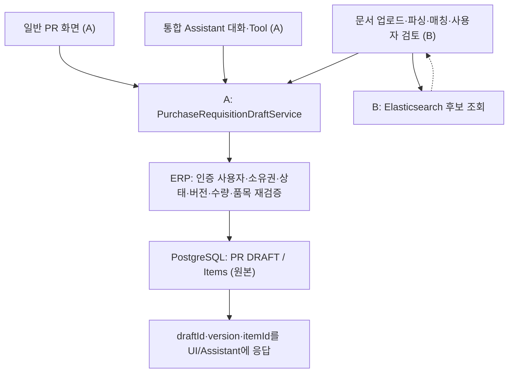

# 차곡ERP — 5일 차 Agent·Document AI ↔ PR DRAFT 공통 계약 초안

> 버전: v0.2 / 2026-11-17  
> 계약 당사자: **A(PR 저장/Agent), B(Document AI·매칭·인증)**  
> 기준: `PR-01/02`, `AG-01~07`, `DOC-01~05`, `MATCH-01~03`, `SEC-01/02` 및 ROLE-AGREEMENT v0.3.  
> 상태: **서비스 계약 초안**. API URL·DTO 이름·물리 서비스 배치는 Rust 채택/인증 방식/ERD가 확정된 뒤 결정한다.

## 1. 한 개의 PR 저장 원본



- `PurchaseRequisitionDraftService`(가칭)를 **A가 소유**하고 일반 UI·Agent·Document AI가 동일 업무 검증을 거쳐 사용한다.
- Agent/Document AI는 PR을 `DRAFT`까지만 생성·수정할 수 있다. `SUBMITTED` 전환·승인·내부 PO·GR·재고 변경 Tool은 AI에 제공하지 않는다.
- PostgreSQL의 활성 Material이 원본이다. Elasticsearch ID·문서 원문·모델 추측만으로 ERP 품목을 확정하지 않는다.
- 사용자에게는 하나의 Assistant 화면을 제공하되 A의 채팅 Shell과 B의 파일·검토 패널은 내부 구현 소유권이 다르다.

## 2. 필수 데이터·검증 원칙

| 필드(예시) | 입력 책임 | 검증·원본 | 오류 시 |
|---|---|---|---|
| `materialId` | A Agent 도구 선택 또는 B 검토에서 확정 | A Material 원본에서 존재·활성·업무 허용 확인 | PR 저장 거부/재선택 요청 |
| `quantity` | 사용자·검토한 문서 항목 | `> 0`, 품목별 기준단위, `NUMERIC`/`BigDecimal`; `EA` 정수 검증. 세부 precision/scale은 DB/API에서 확정 | 전체 명령 거부, 필드 오류 |
| `unit` | 품목 원본의 기준단위를 사용 | ERP Material의 기준 UOM과 일치(환산 P0 제외) | 오류/재질문/검토 재진행 |
| `requiredDate` | 필요 시 사용자 입력 | PR DRAFT에서는 선택값. 제출 시 필수 여부·미래 날짜 검증은 업무 명세에서 확정 | 제출 단계에서 누락 시 검증/안내 |
| `draftId` | 저장 결과·기존 DRAFT 조회 | ERP에서 소유권·상태 검증 | 찾을 수 없음/권한 거부 |
| `itemId` | PR 저장/조회 응답 | 실제 PR 품목 ID, 채팅 표시 행번호와 분리 | 모호한 수정 거부 |
| `version` | ERP 응답 | DRAFT 변경 때마다 증가; 조건부 수정 | 이전 버전이면 충돌 |
| `idempotencyKey` | 사용자 행위/Tool 요청 생성 레이어 | (사용자, 작업 유형, 키) 범위 DB 제약·요청 동일성 | 중복이면 기존 결과, 내용 다르면 충돌(제안) |
| 인증된 사용자 | B 인증 인프라 → A 업무 서비스 | **서버에서 인증한 Principal**; request.userId 신뢰하지 않음 | 권한 없음/로그인 요구 |
| `source` | UI / AGENT / DOCUMENT 출처 표시 | 업무 감사용 메타데이터; **권한 판단 근거 아님** | 출처 오류가 권한을 높이지 않음 |

**중요:** 파일의 사용자 검토 완료는 B 화면/파이프라인의 **UX 게이트**다. `reviewed: true` 같은 클라이언트 플래그 자체를 권한·품목 검증의 증거로 삼지 않는다. ERP는 어떤 입력 경로든 동일한 Material·수량·사용자 검증을 한다. 파일 검토 기록의 저장 범위는 후속 DB 설계에서 합의한다.

## 3. 생성 계약 — 세 경로 공통

```text
CreatePurchaseRequisitionDraftCommand
  items: [
    { materialId: ID, quantity: Decimal, unit: Code,
      requiredDate?: Date }
  ]
  idempotencyKey: UUID/String
  source: UI | AGENT | DOCUMENT         # 추적 메타데이터
  sourceReferenceId?: ID                # 문서/대화 추적용, 선택
  authenticatedActor: Principal        # 서버 인증에서 획득

CreateDraftResult
  draftId: ID
  status: DRAFT
  version: Integer
  items: [{ itemId: ID, materialId: ID, quantity: Decimal,
            unit: Code, displayOrder: Integer }]
```

- **전체 성공 또는 전체 실패:** 일부 품목만 유효한 요청을 조용히 부분 저장하지 않는다.
- 필수값이 부족한 Agent 요청은 **호출 전 재질문**을 하고, Document AI는 **품목 검토가 완료된 후** 생성한다.
- 요청이 네트워크 문제로 성공 여부가 불분명한 경우 **동일 키로 재시도**한다. 같은 키·동일 본문은 동일 DRAFT를 반환하고 새 PR을 만들지 않는 정책을 추천한다.
- DRAFT 생성 직후 PO를 자동 생성하거나 승인하지 않는다. 제출·승인은 일반 ERP 화면에서 사용자 권한으로 처리한다.

- **D-01/D-02 연결:** 본 계약은 PR **DRAFT 생성·수정**까지만 처리한다. 제출 후 PR **헤더 전체**를 일괄 승인하고, 구매 담당자가 **별도의 PO 생성 서비스**에서 같은 PR 품목을 여러 PO로 분할 발주한다. AI는 해당 발주 작업을 자동 실행하지 않는다.

## 4. 수정 계약 — Agent 후속 대화·일반 UI

```text
UpdatePurchaseRequisitionDraftCommand
  draftId: ID
  expectedVersion: Integer
  operations: [
    { type: UPDATE_QUANTITY, itemId: ID, quantity: Decimal },
    { type: REMOVE_ITEM, itemId: ID }
  ]
  idempotencyKey: UUID/String
  authenticatedActor: Principal

UpdateDraftResult
  draftId: ID
  status: DRAFT
  newVersion: Integer
  items: [{ itemId: ID, materialId: ID, quantity: Decimal,
            unit: Code, displayOrder: Integer }]
```

- **P0 최소 수정 범위:** 품목 추가·제거, 수량 변경 등 `PR-01`이 원래 지원하는 편집 작업만 공통으로 제공한다. 위 `operations`는 예시이며 실제 명령 설계는 필요 동작으로 확정한다.
- **동일 DRAFT와 정확한 itemId 지정:** “두 번째 품목”은 사용자가 직전에 확인한 `displayOrder → itemId` 매핑을 바탕으로 처리. 정렬/삭제 등으로 불분명하면 재질문.
- **낙관적 버전 검증:** 현재 DRAFT 버전이 `expectedVersion`과 다르면 거부하고 다시 조회하도록 안내한다. `SUBMITTED/APPROVED/REJECTED` 상태에서는 DRAFT 수정 불가. 반려 후 명시적 재작업 시작으로 `DRAFT`로 돌아온 경우 허용.
- **버전과 멱등성의 우선순위:** 이미 성공한 동일 키·동일 요청의 재시도는 저장된 결과를 반환할 수 있어야 한다. **새 수정 명령**은 최신 버전을 요구한다. 요청키 식별·버전 검사 순서를 구현 전에 결정해야 한다.
- 멀티 조작(수량 변경 + 품목 제거) 중 하나라도 실패하면 **전부 롤백**한다.

## 5. 각 호출자의 책임

| 단계 | A 대화형 Agent | B Document AI·매칭 | A의 PR 서비스 |
|---|---|---|---|
| 사용자 입력 | 요청 의도·재질문·대화 참조 | 파일 형식/행 파싱·구조화 | 입력값·권한 최종 검증 |
| 품목 식별 | ERP 조회 Tool로 후보 조회 | 규칙→BM25→필요 시 LLM, 사용자 선택 | `materialId` 유효성/활성 상태 확인 |
| 수량·단위 | 모호하면 재질문 | 사용자 테이블 검토·수정 | 기준단위 및 양수/정밀도 검증 |
| DRAFT 생성 | `Create` 계약 호출 | **검토 후** 같은 `Create` 계약 호출 | 저장·멱등성·DB 트랜잭션·감사 |
| DRAFT 수정 | `Update`로 `itemId + version` 전달 | P0 문서 흐름은 신규 PR DRAFT 생성 중심; 일반 UI 수정 가능 | 소유권·DRAFT 상태·버전 확인 |
| 실패 | 대화에서 재질문·재조회 | 검토 UI에서 오류·선택 유지 | 안정된 오류 분류·부분 저장 금지 |

**주의:** Document AI가 나중에 생성된 DRAFT를 수정하는 기능까지 반드시 구현하는 것은 아니다. P0 문서 경로는 **검토 완료 후 신규 PR 초안 생성**만 약속한다. 다만 데이터 저장/수정 업무 규칙은 동일한 공통 PR 서비스에 모인다.

## 6. Agent·문서 파이프라인과 인증 신뢰 경계

- **Java 한 프로세스**에서 호출한다면 같은 Spring 서비스 계약 사용 가능; **Rust AI 별도 서비스**를 채택하면 Java ERP의 인증된 내부 REST API 계약을 사용한다. 어느 방식이든 **Rust가 ERP DB를 직접 업데이트하지 않는다.**
- **D-09 방향:** B는 Spring Security **서버 세션·HttpOnly 쿠키**를 우선 설계한다. 브라우저→Spring Boot 인증 후 내부 AI 서비스를 중계하는 방향이며, 세션 CSRF 대응과 Rust 서비스 간 인증·권한 위임은 PoC/기술 설계에서 확정한다. AI 요청에서 **클라이언트 제공 임의 userId를 신뢰하지 않는다**.
- 문서 원문, RAG 검색 내용, 모델 답변은 **신뢰할 수 없는 데이터**다. 도구 선택·사용자 권한·ERP 상태 검증을 대체하지 않는다.
- `sourceReferenceId` 등은 추적용이지 외부 사용자가 다른 사람의 문서·대화를 참조할 수 있는 권한을 주지 않는다.
- 오류/로그에는 민감한 문서 원문·토큰을 무단으로 남기지 않는다.

## 7. 실패 분류·수용 테스트(초안)

| 분류/테스트 | 조건 | 기대 결과 |
|---|---|---|
| CON-PR-01 | UI/Agent/Document 각각 동일한 유효 품목·수량 | 같은 ERP 규칙으로 `DRAFT` 생성, source만 추적 |
| CON-PR-02 | `materialId` 없음/비활성 | 저장 거부, 새 PR 없음 |
| CON-PR-03 | 2개 품목 중 하나가 잘못된 단위/0 이하 | PR 일부 생성하지 않음 |
| CON-PR-04 | 타인 PR DRAFT 수정 | 권한 거부, 버전/수량 무변경 |
| CON-PR-05 | `expectedVersion` 오래됨 | 충돌, 무단 덮어쓰기 없음 |
| CON-PR-06 | 같은 키·같은 Create 재시도 | PR 1건 생성, 기존 `draftId` 반환(제안) |
| CON-PR-07 | 같은 키·다른 Create 요청 | 충돌, 기존 PR 무변경 |
| CON-PR-08 | “두 번째 삭제·첫 번째 수량 20” | 정확한 itemId 변경/삭제, 버전 +1 |
| CON-PR-09 | “두 번째” 기준 불명확 | 재질문, 저장 변경 없음 |
| CON-PR-10 | Agent 승인/PO/GR/결제 명령 | 허용 Tool 없음; ERP 데이터 무변경 |
| CON-PR-11 | 문서에서 미확정 품목 발견 | 검토 UI에서 수동 확인 전 PR 저장 진행 안 됨 |
| CON-PR-12 | 추출 후 품목 비활성화/삭제 | ERP 최종 검증 실패, PR 저장 안 됨 |
| CON-PR-13 | `SUBMITTED` 상태에서 Update 요청 | 상태 충돌, 변경 없음 |
| CON-PR-14 | Agent/Document API 오류·타임아웃 | 성공 확인 전 재시도는 같은 키, 중복 초안 없음 |

**오류 의미 후보:** `UNAUTHORIZED`, `FORBIDDEN`, `MATERIAL_NOT_ACTIVE`, `INVALID_QUANTITY`, `UNIT_MISMATCH`, `NOT_DRAFT`, `VERSION_CONFLICT`, `IDEMPOTENCY_CONFLICT`, `DOCUMENT_REVIEW_REQUIRED`, `UPSTREAM_FAILURE`. 실제 HTTP 상태코드/DTO는 OpenAPI에서 합의.

## 8. 팀에서 승인해야 하는 사항

- [ ] `requiredDate` 필수 여부·수량 정밀도/기준단위
- [ ] DRAFT 생성·수정의 요청키 범위와 저장 방법
- [ ] `itemId`/`displayOrder` 반환 규칙과 초안 수정 명령 범위
- [ ] Rust 서비스 채택 시 ERP 내부 API·인증 신원 전달 방식
- [ ] B 문서 검토 데이터 보존 범위 및 UI Shell↔패널 인터페이스
- [ ] 응답 에러 코드, 통합 AI Assistant 로딩/실패 표시 방식

**A 확인:** __________  **B 확인:** __________  **날짜:** __________  **상태:** 합의 전
