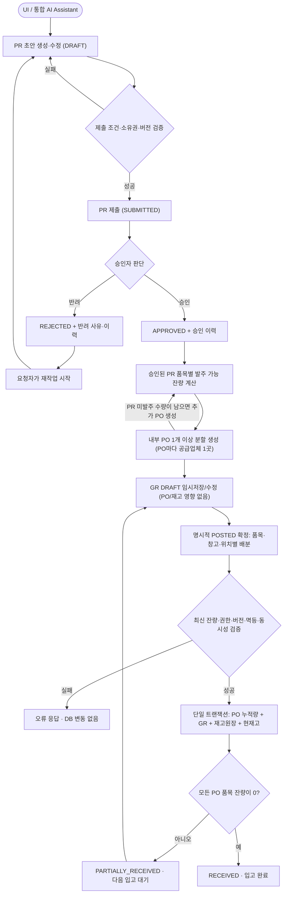
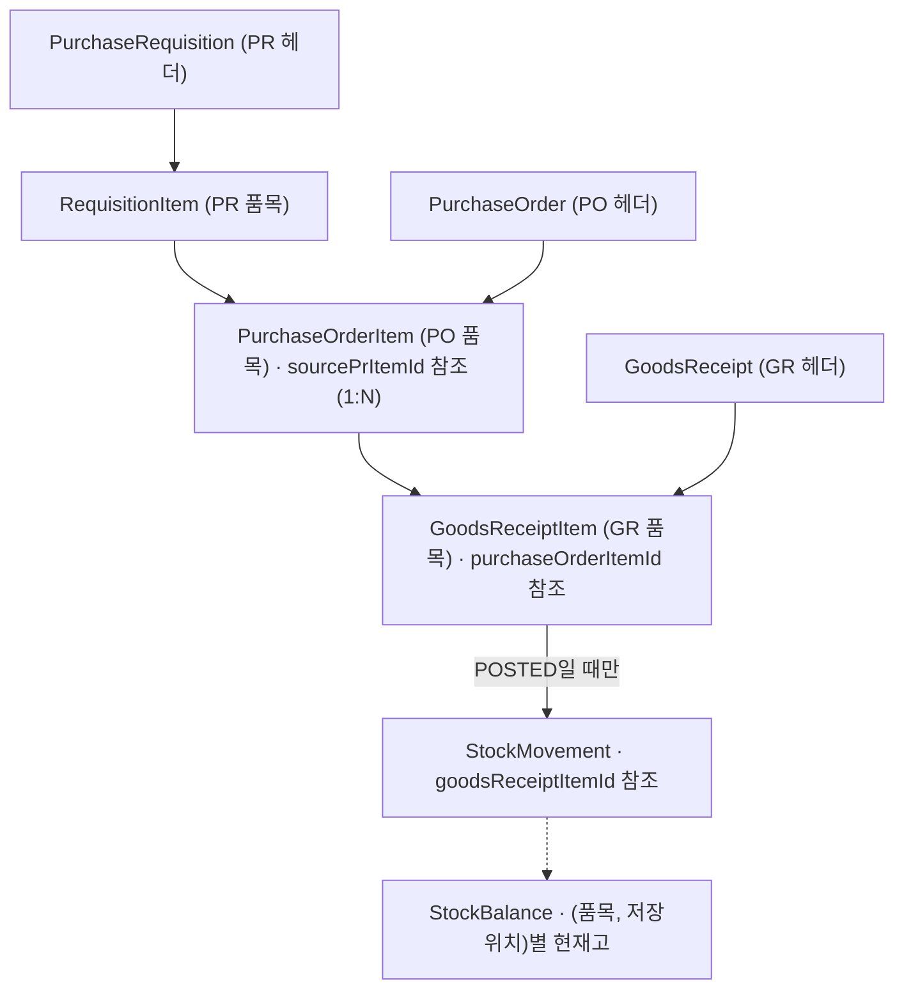
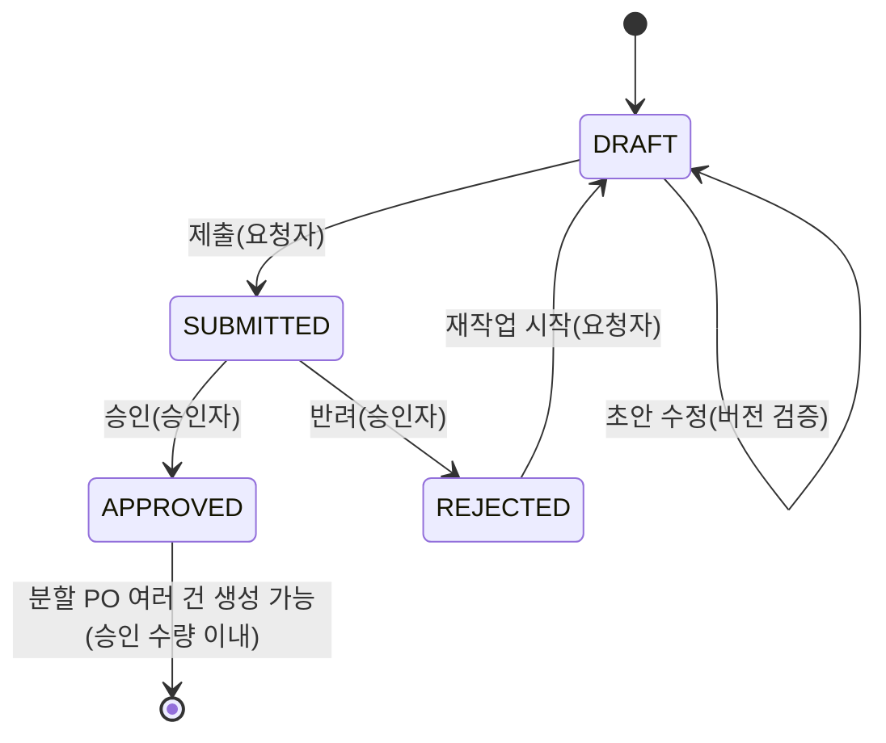
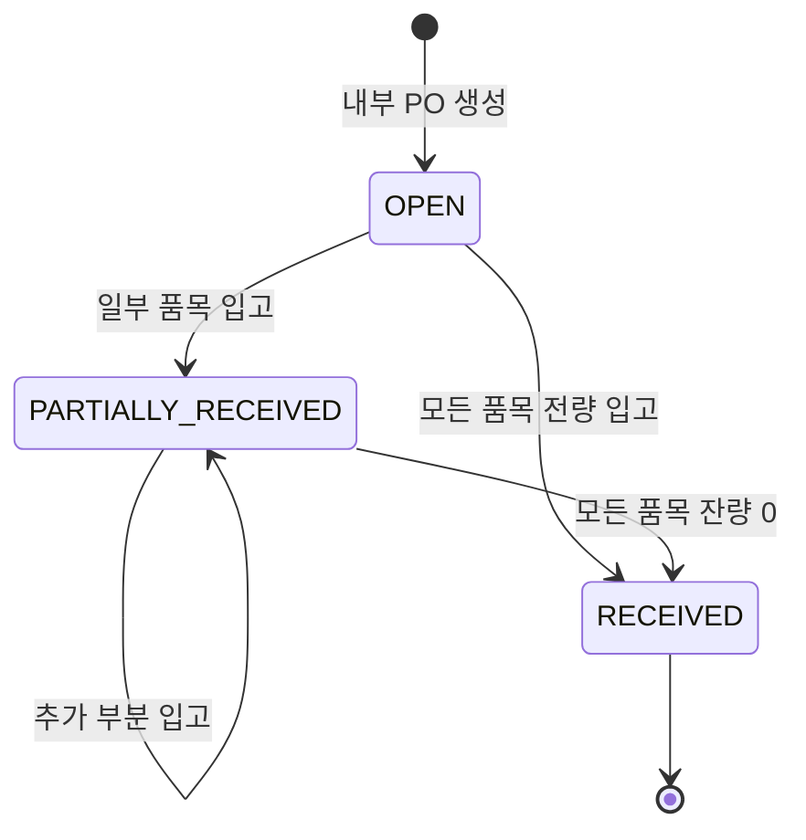
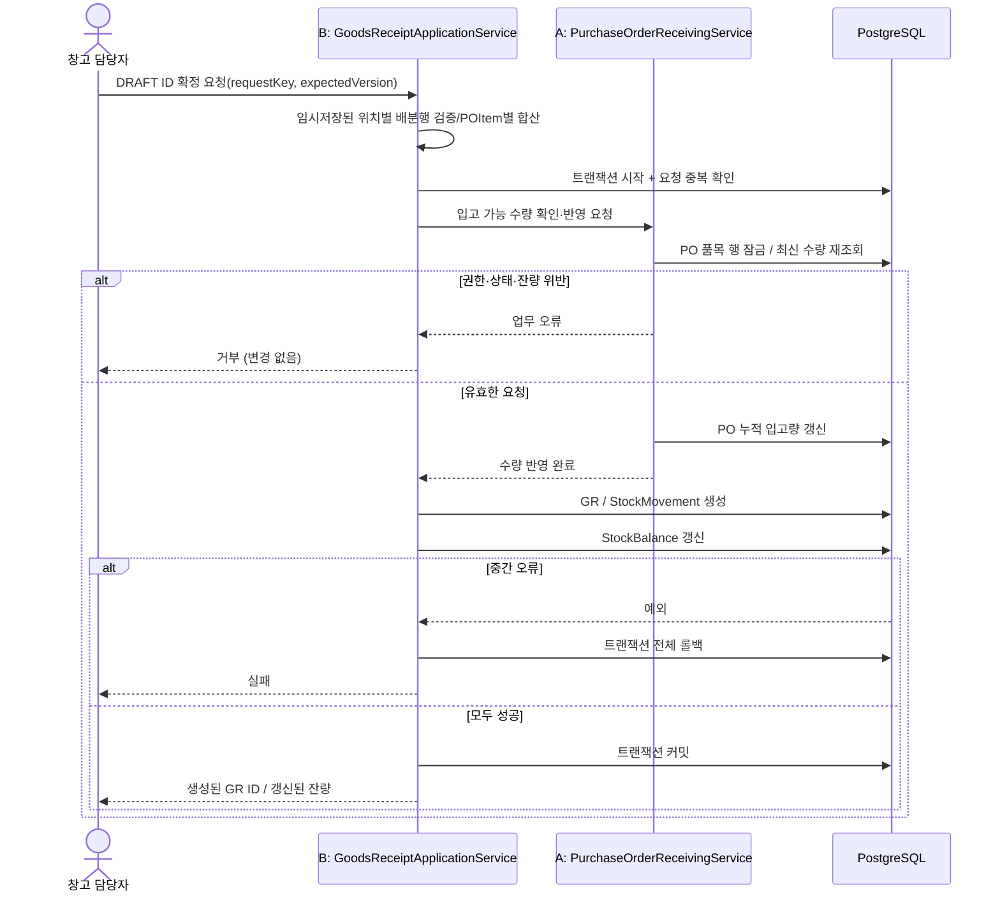

# 차곡ERP — ERP 업무 흐름도

> 버전: v0.4 (2026-11-18, B 피드백 수용) | 기반: 기획서 v3.3, PRD v0.3, MVP v0.3, 역할 분담 v0.3
> 상태: **업무 흐름 설계 초안**. 이 문서의 상태명은 **차곡ERP 자체 제안**이며 SAP의 상태 코드와 동일하다고 주장하지 않는다.
> 범위: **PR → 헤더 일괄 승인 → 분할 PO(1:N) → PO별 수동/부분 GR → StockMovement 및 StockBalance**. 실주문·송장·결제·MES 제외.

## 1. 종단 간 업무 흐름

### 역할별 절차

| 단계 | 실행 주체 | 시스템 동작 | 종료·검증 기준 | 소유 |
|---|---|---|---|---|
| 1. PR 초안 | 요청자 / Agent / 문서 검토 UI | 동일 PR 저장 서비스로 DRAFT 생성 | 유효한 품목 ID, 양수 수량, 소유권, 버전 | A |
| 2. PR 제출 | 요청자 | 필수값 확인 후 SUBMITTED | 누락·권한/상태 위반 시 제출 불가 | A |
| 3. 승인/반려 | 승인자 | APPROVED 또는 REJECTED + 이력 | 권한 확인, 중복 승인·버전 충돌 차단 | A |
| 4. PO 분할 생성 | 구매 담당자 | 승인 PR의 품목을 공급업체별 또는 수량별로 **여러 내부 PO**로 배분 | **PR 품목별 누적 발주 합계 ≤ 승인 수량**, 동일 요청 중복 방지 | A |
| 5. GR DRAFT | 창고 담당자 | PO·창고·품목별 위치·수량 임시저장 및 재개 | 초안 소유권·버전 검증, PO/원장/현재고 무변경 | B |
| 5-1. GR 확정 | 창고 담당자 | 같은 POItem을 여러 위치에 분배, 명시적 POSTED 확정 | POItem별 SUM ≤ 최신 잔량, 멱등·활성·위치 검증 | B, A의 PO 서비스 |
| 6. 재고 반영 | 서버 내부 | POSTED 확정 시 GR/PO누적/원장/현재고 동시 갱신 | 단일 커밋 또는 전체 롤백 | B 조정, A PO 갱신 |
| 7. 후속 입고 | 창고 담당자 | 잔량만큼 반복 가능 | 품목별 잔량 0이 되면 완료 | B, A |

## 1.1 문서 헤더와 품목별 참조 구조 — EDMX 기반 보완

SAP API는 문서 헤더 외에 **품목 단위 식별자와 참조 필드**를 제공한다. 차곡ERP에서도 문서 간 연결을 헤더만으로 처리하지 않는다.

- **PR 품목 → PO 품목:** 업로드한 `CE_PURCHASEORDER_0001.edmx`의 `PurchaseOrderItem_Type`에는 `PurchaseRequisition` 및 `PurchaseRequisitionItem` 참조 필드가 있다. 차곡ERP의 `sourcePrItemId`는 이를 참고한 **자체 설계 이름**이다.

- **분할 발주 D-01:** `RequisitionItem` 한 행을 **여러 `PurchaseOrderItem`**이 참조할 수 있다. 각 PO 헤더는 공급업체 한 곳에 속한다. 같은 PR의 여러 PO 생성은 정상 업무이므로 PR 헤더에 'PO는 단 1개'라는 UNIQUE 제약을 두지 않는다.
- **발주 가능 잔량:** PR 품목별 `requestedQty - Σ(유효 PO 품목 orderedQty)`; 현재 P0는 PO 취소·승인 수량 재조정을 제공하지 않으므로 발주 합계 계산이 단순하다. PO 생성 시 PR 품목 잠금·최신 잔량 확인과 요청키 중복 방지를 적용한다.
- **PO 품목 → GR 품목:** `API_MATERIAL_DOCUMENT_SRV.edmx`의 `A_MaterialDocumentItemType`에는 `PurchaseOrder`, `PurchaseOrderItem`, `Material`, `StorageLocation`, `QuantityInBaseUnit`이 있다. 차곡ERP는 GR 품목별 PO 항목 참조를 보존한다.
- **GR 품목 → 원장 → 현재고:** `StockMovement` 및 `StockBalance`는 차곡ERP가 직접 설계하는 테이블로, SAP API의 Entity와 일대일 대응하지 않는다.
- **저장위치:** 한 GR에 하나의 PO·창고를 지정하며, 동일 POItem은 해당 창고의 여러 활성 StorageLocation에 40/60 등 배분할 수 있다. PO 누적은 해당 품목 합계, 원장은 위치별로 기록한다. 비활성 창고/위치로는 신규 확정 불가. SAP의 `Plant`와 차곡ERP의 `Warehouse`는 같은 객체라고 단정하지 않는다.
- **단위:** P0에서는 품목의 기준단위 하나로 비교하며 복잡한 단위 환산은 제외한다. SAP 원본에 구매단위·기본단위가 모두 존재한다는 사실과 구분한다.

## 2. 상태 전이 — 구현 제안

### PR 상태 (P0)

- `REJECTED`에 바로 재제출하지 않는다. 반려 사유를 보존하고 `DRAFT`로 재작업한 뒤 제출한다.
- **D-02: PR 헤더 전체 일괄 승인/반려.** 품목별 부분 승인·승인 수량 조정은 없다. `APPROVED`인 PR의 P0 수정은 금지한다. 구매발주가 이미 생성된 PR의 재승인/수정은 이번 범위가 아니다.
- 승인 이력은 별도 레코드로 보존한다. 하나의 PR에 대한 최종 승인 여부와 PO 생성 여부는 별개의 개념이다.

### PO 상태 (P0)

- `OPEN`은 외부 공급업체가 주문을 수락했다는 뜻이 아니라 **내부 발주 기록이 생성된 상태**다.
- PO 헤더 `RECEIVED`는 **모든 PO 품목 각각에서 `remainingQty == 0`**일 때만 성립한다. 단위가 다른 품목 수량은 합산하지 않는다. 품목별로 `orderedQty`, `receivedQty`, `remainingQty`를 추적한다.
- `RECEIVED` 후에는 추가 입고를 허용하지 않는다. GR 취소·역처리는 P1이므로 P0에서 임의로 수량을 직접 수정하지 않는다.
- **GR은 DRAFT로 임시저장 후 명시적으로 POSTED 확정한다.** DRAFT는 PO 누적 수량·재고 원장·현재고를 전혀 바꾸지 않는다. POSTED 전환은 단일 DB 트랜잭션이며 수정·취소·삭제는 P0에서 지원하지 않는다.

## 3. 정상·반려·부분 입고 예시

**정상 흐름:** 요청자 A가 PR(P-1)에 품목 M-1을 100 EA로 입력 → 제출 → 승인자 승인 → 구매 담당자가 공급업체 S-1을 선택하여 내부 PO(O-1) 생성 → 창고 담당자가 GR DRAFT를 저장하고 100 EA를 명시적으로 POSTED 확정 → 재고 이동 +100 EA, 현재고 +100 EA, PO 입고 완료.

**분할 발주 흐름:** PR(P-2)의 M-1 승인 수량 100 EA → PO(O-2, S-1) 60 EA + PO(O-3, S-2) 40 EA 생성 → PR 품목 발주 가능 잔량 0. 추가 1 EA PO는 거부. 두 PO는 각각 독립적으로 GR을 게시하며, **PR 발주 잔량(미발주 수량)**과 **PO 입고 잔량(미입고 수량)**은 구분한다.

**반려 흐름:** PR 수량 누락 또는 구매 필요성 불충분 → 승인자 반려 사유 기록 → 요청자가 DRAFT로 전환하여 수정·재제출 → 재승인. 반려된 PR에서는 PO를 생성하지 않는다.

**부분 입고 (초기 재고 0 EA 가정):**

| 처리 | PO 발주 | 이번 입고 | 누적 입고 | 남은 수량 | 현재고 | PO 상태 |
|---|---:|---:|---:|---:|---:|---|
| PO 생성 | 100 | 0 | 0 | 100 | 0 | OPEN |
| 첫 GR | 100 | 60 | 60 | 40 | 60 | PARTIALLY_RECEIVED |
| 두 번째 GR | 100 | 40 | 100 | 0 | 100 | RECEIVED |
| 추가 1 EA 시도 | 100 | 1(거부) | 100 | 0 | 100 | RECEIVED |

> 실제 현재고는 기존 재고와 다른 입출고를 포함할 수 있다. 위 표는 **다른 이동이 전혀 없는 시연용 품목**을 가정한 예시다.

## 4. GR 처리 — 트랜잭션·동시성 흐름

**설계 원칙:** B의 GR Application Service가 *하나의 Spring Boot 애플리케이션·하나의 PostgreSQL DB 트랜잭션*을 연다. 같은 트랜잭션 안에서 A가 제공한 PO 서비스 호출 후 GR·StockMovement·StockBalance를 처리한다. **A의 PO Repository를 B가 직접 수정하지 않는다.** 멱등 요청키의 유니크 제약, 여러 PO 품목의 잠금 순서, 잔액 행 생성/갱신 경쟁은 세부 기술 설계에서 합의한다. 외부 HTTP 호출은 이 DB 트랜잭션 경계에 포함시키지 않는다.

## 5. 원본 문서·데이터 흐름

- **PR Header/Item → PO Header/Item → GR Header/Item → StockMovement**: 앞 문서와 품목 참조를 보존한다.
- **StockBalance**: (품목, 창고, 저장위치) 단위로 현재고를 관리하는 설계안. 품목 단위·초기고 정책은 최종 ERD에서 확정한다.
- **PO 항목:** 최초 발주 수량을 보존하고 누적 입고 수량을 별도 저장한다. `remainingQty = orderedQty - receivedQty`.
- **StockMovement:** 입고 확정 시 양수 수량 이동 기록을 남긴다. P0에서 입고를 삭제해 현재고를 되돌리는 기능을 만들지 않는다.
- **Agent/Document AI:** PR DRAFT에 들어오는 입력 경로일 뿐, 승인·PO 확정·입고·재고 직접 변경 권한은 없다.

### SAP EDMX 6종과 업무 단계 대응

| 업무 단계 | SAP 업로드 파일 | 확인한 모델의 핵심 필드 | 차곡ERP 반영 위치 |
|---|---|---|---|
| 품목 선택 | `API_PRODUCT_SRV.edmx` | `A_ProductType.Product`, `BaseUnit`, `PurchaseOrderQuantityUnit`; `A_ProductDescriptionType.ProductDescription` | Material 기준정보(A) |
| 공급업체 선택 | `API_BUSINESS_PARTNER.edmx` | `A_SupplierType.Supplier`, `SupplierName`; 주소 관계를 거친 `PhoneNumber`·`EmailAddress` | Supplier·연락처(A) |
| PR 생성 | `CE_PURCHASEREQUISITION_0001.edmx` | `PurchaseReqnItemType.Material`, `RequestedQuantity`, `BaseUnit` | PR/Item(A) |
| PO 생성 | `CE_PURCHASEORDER_0001.edmx` | `PurchaseOrderItem_Type.PurchaseRequisition`, `PurchaseRequisitionItem`, `OrderQuantity`, `BaseUnit` | PO/Item(A) |
| GR 게시 | `API_MATERIAL_DOCUMENT_SRV.edmx` | `A_MaterialDocumentItemType.PurchaseOrder`, `PurchaseOrderItem`, `StorageLocation`, `QuantityInBaseUnit` | GR/Item·StockMovement(B) |
| 현재고 조회 | `API_MATERIAL_STOCK_SRV.edmx` | **`A_MatlStkInAcctModType`**의 `Plant`, `StorageLocation`, `MatlWrhsStkQtyInMatlBaseUnit` | StockBalance 조회(B) |

> 중요한 차이: SAP `A_MaterialStockType` 자체에는 `Plant`/`StorageLocation`과 재고 수량이 없다. 구체적 수량은 연관된 `A_MatlStkInAcctModType`에서 확인한다.

## 6. 확정 방향 및 다음 설계 단계의 세부 결정

| 항목 | A가 수용한 방향·남은 설계 사항 | 반영 시점 |
|---|---|---|
| 한 PR로 여러 공급업체 PO 가능 여부 | **확정 방향: PR 1:N PO, PO마다 공급업체 1곳, 동일 PR 품목 수량 분할 허용** | ERD·API 상세화 |
| PR 헤더 단위 승인 vs 품목별 승인 | **확정 방향: PR 헤더 전체 일괄 승인·반려, 품목별 승인 제외** | 권한 매트릭스 상세화 |
| 0이 아닌 개시 재고 | 테스트 시드에 초기 재고 이동 기록을 함께 남기는 방식 | ERD 설계 |
| 수량 소수점·단위 환산 | **품목별 기준단위 + Decimal 수량 + 환산 제외** 수용; 세부 NUMERIC precision/scale은 ERD/API에서 지정 | ERD/API 설계 |
| PO 취소·PR 취소 | P0에서 직접 취소 미지원; 확장 시 역거래 규칙 설계 | 기능 명세 |
| 발주 품목의 기본 공급업체 지정 | 공급업체는 PO 생성 시 한 번 선택 | 화면·기능 명세 |
| 행 잠금·중복키·오류 응답 규약 | PO 품목 행 기준 직렬화 + 유니크 요청키 | 기술·API 설계 |
| 자기 PR을 본인이 승인 가능한지 | **자기 승인 금지 권장**, 역할 겸직 세부 규칙은 팀 B 검토 필요 | 권한 매트릭스 |

## 7. SAP 참고 사항

이 흐름은 SAP의 구매 문서·입고 참조 개념을 참고한 **차곡ERP 자체 제안**이다. SAP는 구성에 따라 품목별 승인, 조건부 다단계 워크플로, 납품 허용오차, GR 취소 및 기타 재고 이동을 지원한다. 현재 MVP에서 제외한 기능을 SAP가 지원하지 않는다고 해석하면 안 된다.

관련 출처·업로드 EDMX 검증 결과: [05-SAP-REFERENCE.md](05-SAP-REFERENCE.md). 실제 ERD는 이 문서가 아니라 후속 `DB-SPEC.md`에서 확정한다.

## 5. B 피드백 수용 후 추가 업무 사례

**같은 PR의 같은 품목 두 행:** 요청자가 볼트 A를 첫 번째 생산 일정용 100 EA, 두 번째 일정용 200 EA로 서로 다른 PRItem에 입력. 각 항목의 `pr_item_id`가 달라 발주 잔량도 따로 계산한다. PRItem별 필요일/사용 목적 필드 자체는 공동 검토 전이며 공장 마스터는 P0에 추가하지 않는다.

**입고 임시저장:** 창고 담당자가 특정 PO의 GR DRAFT를 만들고 품목·위치를 입력하다 중단한다. 이후 다시 이어서 입력해도 PO·원장·현재고는 변하지 않는다. 확정 전에 다른 입고가 게시되었다면 최신 잔량을 기준으로 재검증한다.

**동일 POItem의 여러 선반 입고:** POItem 100 EA를 GRItem(위치 A-01, 40 EA) + GRItem(위치 B-02, 60 EA) 두 행으로 기록. B가 이를 POItem별 100 EA로 합산해 A PO 서비스에 전달하고, B는 POSTED 후 원장과 현재고를 각각 40/60 기록.

**창고·위치 비활성화:** 재고·거래 참조가 있는 창고/위치는 물리 삭제하지 않는다. 비활성화된 창고/위치는 과거 이력에는 남으나 신규 POSTED 입고 대상에서 제외한다. 현재고가 양수인 위치의 비활성화 허용 여부는 B가 최종 결정한다.
