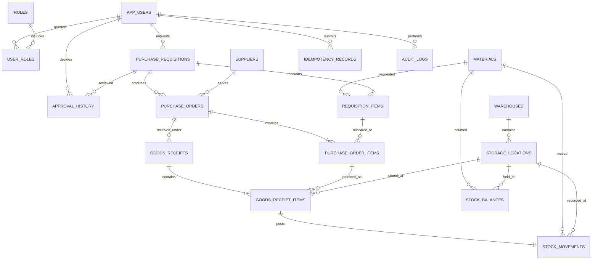

# 차곡ERP DB 명세 및 초기 ERD

> 버전: v0.2 / 2026-11-17 / 상태: **A 상세 정책 채택, B 교차 리뷰 전**  
> 원본: 기획서 v3.3, MVP v0.3, 09 PO↔GR 계약 v0.2, 10 AI↔PR 계약 및 화면 명세 v0.1.  
> 대상: PostgreSQL, Java `BigDecimal`, 모듈형 모놀리스. **아래 물리명·정밀도는 A 채택안이며 B 리뷰 전**이며 아직 마이그레이션을 실행하지 않았다.

## 1. 확정 업무 정책과 이번 DB 제안 구분

| 구분 | 상태 | 내용 |
|---|---|---|
| 1 PR → N PO, PO당 공급업체 한 곳 | 사용자 결정 | PR 품목 1개를 여러 PO 품목이 참조 가능 |
| PR 전체 일괄 승인 | 사용자 결정 | `purchase_requisitions.status`, 품목별 승인 테이블 없음 |
| GR 1회 = PO 1개, 부분 입고 | 사용자 수용 | GR 품목은 PO 품목을 참조, PO 원발주량 보존 |
| 최초 재고 `OPENING` 원장 | 사용자 수용 | 원장+현재고를 같은 트랜잭션에서 적재 |
| `NUMERIC(18,3)` 수량 / `NUMERIC(18,0)` KRW | **A 채택 / B 리뷰 전** | EA/SET 정수 제약은 단위별 애플리케이션 검증; 환산 없음 |
| `needed_by_date` DRAFT 선택, 제출 필수 | **A 채택 / B 리뷰 전** | UI·Agent·Document 입력 경로 일치 필요 |
| 공급업체 이메일 선택, 전화 필수 | **A 채택 / B 리뷰 전** | UI 필수 별표 수정 필요 |
| ADMIN 포함 자기 승인 금지 | **A 채택 / B 리뷰 전** | SoD 유지. 역할 겸직이어도 작성자=승인자면 불가 |
| PostgreSQL 시퀀스·UUID 기준 | **A 채택 / B 리뷰 전** | 내부 PK UUID, 대외 문서번호 별도 UNIQUE |
| DELETE 정책 | **A 채택 / B 리뷰 전** | 업무 문서/원장 물리 삭제 금지, 기준정보는 비활성화 |

## 2. 관계형 ERD (핵심 거래 구조)

> `STOCK_MOVEMENTS`는 `GR_IN`과 `OPENING` 둘 다 저장한다. 따라서 `goods_receipt_item_id`는 **GR_IN일 때만 채워지며 NULL 허용**이다. 그림의 `GOODS_RECEIPT_ITEMS ||--|| STOCK_MOVEMENTS`는 **GR_IN 한정 1:1**을 뜻한다. 원장 전체에 대한 필수 FK가 아님.

## 3. 핵심 데이터 사전

표기: `PK` 기본키, `FK` 외래키, `UQ` 유일, `NN` NOT NULL. `created_at`, `updated_at` 등 공통 시각 필드는 필요 엔티티에 적용(원장은 append-only, updated_at 생략 가능).

### 3.1 인증·기준정보 — B(A의 품목·공급업체 제외)

| 테이블 | 주요 컬럼 | 제약/설명 | 소유 |
|---|---|---|---|
| `app_users` | `id UUID PK`, `email VARCHAR(255) UQ NN`, `password_hash TEXT NN`, `display_name`, `active BOOLEAN NN` | 패스워드 평문 저장 금지. 세션은 인증 인프라 정책에 따라 별도 저장 | B |
| `roles` | `code VARCHAR(30) PK` | `REQUESTER`, `APPROVER`, `PURCHASER`, `WAREHOUSE`, `ADMIN` | B |
| `user_roles` | `user_id FK`, `role_code FK` | `(user_id,role_code) PK`; 겸직 가능하더라도 자기승인 검증 | B |
| `materials` | `id UUID PK`, `material_code VARCHAR(50) UQ NN`, `name NN`, `specification`, `base_unit`, `reference_unit_price NUMERIC(18,0)`, `safety_stock_qty NUMERIC(18,3)`, `active BOOLEAN NN` | 사용 단위(`EA`, `SET`, `KG`, `M`, `L`)는 업무 코드, 환산 없음. ES의 원본 | A |
| `suppliers` | `id UUID PK`, `supplier_code UQ NN`, `name NN`, `contact_name`, `phone NN`, `email NULL`, `active BOOLEAN NN` | 전화번호는 연락처 데이터, 실제 주문 전송 API 없음 | A |
| `warehouses` | `id UUID PK`, `warehouse_code UQ NN`, `name NN`, `active BOOLEAN NN` | SAP `Plant`와 동일시하지 않음 | B |
| `storage_locations` | `id UUID PK`, `warehouse_id FK NN`, `location_code`, `name NN`, `active BOOLEAN NN` | `UQ(warehouse_id,location_code)`; 창고·위치 계층 검증 | B |

### 3.2 구매·승인 — A

| 테이블 | 주요 컬럼 | 제약/설명 |
|---|---|---|
| `purchase_requisitions` | `id UUID PK`, `pr_number UQ NN`, `requester_id FK NN`, `title NN`, `needed_by_date DATE NULL`, `status NN`, `version BIGINT NN`, `source`, `created_at`, `updated_at` | 상태 `DRAFT/SUBMITTED/APPROVED/REJECTED`; 반려→재작업 후 `DRAFT`; 미발주 잔량은 **품목별** 계산 |
| `requisition_items` | `id UUID PK`, `pr_id FK NN`, `material_id FK NN`, `requested_qty NUMERIC(18,3) NN`, `unit NN`, `display_order INT NN` | `CHECK(requested_qty>0)`, `UQ(pr_id,display_order)`; 품목의 당시 기준단위 스냅샷 |
| `approval_history` | `id UUID PK`, `pr_id FK NN`, `actor_id FK NN`, `action NN`, `comment`, `occurred_at NN` | 제출/승인/반려/재작업 이력 append-only; 최종 상태는 PR에 보유 |
| `purchase_orders` | `id UUID PK`, `po_number UQ NN`, `pr_id FK NN`, `supplier_id FK NN`, `status NN`, `created_by FK NN`, `total_amount NUMERIC(18,0)`, `created_at` | PO마다 **한 PR, 한 supplier**; `UNIQUE(pr_id)` **금지**; 상태 OPEN/PARTIALLY_RECEIVED/RECEIVED |
| `purchase_order_items` | `id UUID PK`, `po_id FK NN`, `pr_item_id FK NN`, `ordered_qty NUMERIC(18,3) NN`, `received_qty NUMERIC(18,3) NN DEFAULT 0`, `unit NN`, `unit_price NUMERIC(18,0) NN` | `CHECK(ordered_qty>0)`, `CHECK(received_qty>=0 AND received_qty<=ordered_qty)`; `UQ(po_id,pr_item_id)` **P0 한 PO 내 동일 PR 품목 중복 금지 제안**, `pr_item_id` 전역 UQ 금지 |

**교차 테이블 검증(애플리케이션 트랜잭션 필수):** `purchase_order_items.pr_item_id`의 PR은 해당 PO의 `pr_id`와 같아야 한다. 단순 FK 두 개만으로는 이 제약을 보장하지 않으므로 도메인 서비스에서 재검증한다.

### 3.3 입고·재고 — B (A의 PO 입고 처리 계약 호출)

| 테이블 | 주요 컬럼 | 제약/설명 |
|---|---|---|
| `goods_receipts` | `id UUID PK`, `gr_number UQ NN`, `po_id FK NN`, `status='POSTED'`, `posted_by FK NN`, `posted_at NN`, `note` | 1 GR→1 PO, P0에서 수정·취소·삭제 없음 |
| `goods_receipt_items` | `id UUID PK`, `gr_id FK NN`, `po_item_id FK NN`, `storage_location_id FK NN`, `received_qty NUMERIC(18,3) NN`, `unit NN` | `CHECK(received_qty>0)`; 품목이 해당 GR의 PO에 속하는지 검증. P0 단일 GR의 같은 PO 품목은 한 행만 허용 **제안** |
| `stock_movements` | `id UUID PK`, `material_id FK NN`, `storage_location_id FK NN`, `movement_type NN`, `quantity_delta NUMERIC(18,3) NN`, `gr_item_id FK NULL UQ`, `reference_code NULL`, `occurred_at NN` | `GR_IN`은 `gr_item_id` 필수, `OPENING`은 NULL; append-only. 원장 레벨에서도 유형/참조 조합 체크 제안 |
| `stock_balances` | `id UUID PK`, `material_id FK NN`, `storage_location_id FK NN`, `on_hand_qty NUMERIC(18,3) NN`, `updated_at NN` | **`UQ(material_id,storage_location_id)`**; 위치가 창고에 종속되어 창고 ID 중복 저장 안 함. `CHECK(on_hand_qty>=0)` |

> 화면에서는 `warehouse_id`가 필요하지만 `stock_balances`의 위치 FK를 통해 JOIN한다. `storage_location_id`의 FK가 유효한 위치인지, 비활성인지, 해당 창고인지 서버에서 확인한다.

### 3.4 AI·공통 운영 — 양쪽 책임

| 테이블 | 주요 컬럼 | 제약/설명 | 소유 |
|---|---|---|---|
| `idempotency_records` | `id UUID PK`, `actor_id FK NN`, `operation VARCHAR(40) NN`, `request_key VARCHAR(100) NN`, `payload_hash VARCHAR(64) NN`, `resource_id UUID`, `result_code`, `created_at` | `UQ(actor_id,operation,request_key)`; 성공 결과/대상 리소스까지 동일 트랜잭션 저장. 타인 리소스 응답 금지 | 공동/각 서비스 |
| `audit_logs` | `id UUID PK`, `actor_id FK NULL`, `domain`, `action`, `resource_id`, `occurred_at NN`, `metadata JSONB` | 민감 원문·비밀번호·토큰 기록 금지 | 각 도메인 |
| `ai_conversations` | `id UUID PK`, `owner_id FK NN`, `created_at`, `updated_at` | 사용자 본인 대화만 조회 | A |
| `ai_messages` | `id UUID PK`, `conversation_id FK NN`, `role`, `content`, `created_at` | 원문 보존 기간 및 민감정보 마스킹은 후속 정책 | A |
| `policy_documents` | `id UUID PK`, `version`, `effective_from`, `source_name`, `active` | 구매 규정 1종, 조항·시행일·버전 인용. 조항 별도 `policy_clauses` 제안 | A |
| `policy_clauses` | `id UUID PK`, `policy_document_id FK NN`, `clause_code NN`, `body NN` | `UQ(policy_document_id,clause_code)` | A |
| `document_analysis_jobs` | `id UUID PK`, `owner_id FK NN`, `filename`, `status`, `created_at`, `expires_at` | 원본 파일 영구보관 미확정. 파싱 오류 추적 | B |
| `document_analysis_rows` | `id UUID PK`, `job_id FK NN`, `row_no`, `raw_name`, `raw_unit`, `raw_qty`, `selected_material_id FK NULL`, `confirmed_qty NULL`, `review_status` | 원본/후보는 사용자 확인 전 PR 저장 불가. `UQ(job_id,row_no)` | B |

**초기 우선순위:** 인증·기준정보·PR·PO·GR·원장·현재고·멱등성은 첫 번째 마이그레이션에서 분할 구현. AI 세션/문서/RAG 관련 테이블은 각 PoC 결과에 맞춰 후속 마이그레이션으로 조정 가능. Elasticsearch 색인은 PostgreSQL 원본 테이블이 아니므로 ERD에서 제외한다.

## 4. 동시성, 상태, 정합성 불변식

1. **PR 분할 발주:** `SUM(유효 purchase_order_items.ordered_qty WHERE pr_item_id=X) <= requisition_items.requested_qty`. 서로 다른 단위끼리 합산하지 않는다. PR 품목을 `FOR UPDATE`로 **ID 오름차순** 잠근 후 기존 발주 합계를 재조회하고 PO와 멱등 결과를 동일 트랜잭션 저장한다. P0에는 PO 취소가 없어서 생성된 모든 PO가 유효하다.
2. **GR:** B가 트랜잭션 개시 → A의 PO 헤더 잠금 → PO 품목 ID 오름차순 잠금/잔량 검증 및 누적량 변경 → B가 GR/Items/StockMovements/StockBalances/감사/멱등 결과 저장 → 커밋. A 내부 서비스에서 커밋하거나 별도 트랜잭션(`REQUIRES_NEW`) 생성하지 않는다.
3. **PO 상태:** 각 `purchase_order_items`의 `ordered_qty - received_qty`가 모두 0 → `RECEIVED`; 일부 입고가 있으면 `PARTIALLY_RECEIVED`; 모두 0개 입고면 `OPEN`.
4. **위치 현재고:** `stock_balances`의 `(material_id,storage_location_id)` 유니크, `INSERT ... ON CONFLICT ... DO UPDATE SET on_hand_qty=stock_balances.on_hand_qty + EXCLUDED.on_hand_qty` 등 원자적 갱신. 실제 SQL은 구현 시 잠금·음수 방지와 함께 검증.
5. **원장:** P0에서 직접 UPDATE/DELETE 불가. `GR_IN` 원장 1건은 GR item 1건과 매핑. 원장 합계 = 개시재고+입고 = 현재고(위치/품목 기준).
6. **PR DRAFT:** `version`을 낙관적 락으로 검사; 재시도는 인증·멱등키·페이로드 검증 후 기성공 결과 반환. 다른 요청키의 구버전 수정은 거부. UI/Agent/Document는 같은 A의 저장 서비스 사용.
7. **승인:** `SUBMITTED`만 승인/반려, `requester_id != actor_id`(ADMIN 포함 권장), 직렬화된 상태 변경. 이력 기록과 상태 변경은 같은 트랜잭션.
8. **금액:** `unit_price` KRW 정수, `line_amount=ordered_qty × unit_price` 계산 시 `HALF_UP` 원 단위 **제안**. 계산은 Java `BigDecimal`로 하고 프론트의 부동소수점 값을 최종 결산값으로 신뢰하지 않는다.
9. **검색:** PostgreSQL `materials`가 원본, Elasticsearch는 커밋 이후 색인(장애 시 재처리·전체 재색인)이며 ES 후보 선택 후 ERP에서 활성·단위·존재 여부 최종 재검증.
10. **권한:** 서버의 세션 사용자/역할을 근거로 수정·승인·입고, 다른 사용자의 PR DRAFT 수정/AI 문서 조회 거부. AI 경로가 권한 상승을 제공하지 않음.

## 5. 상태 전이와 P0 범위

| 객체 | 상태 | 허용 전이/효과 |
|---|---|---|
| PR | `DRAFT`, `SUBMITTED`, `APPROVED`, `REJECTED` | DRAFT→SUBMITTED→APPROVED 또는 REJECTED→(명시적 재작업)DRAFT. APPROVED는 여러 PO 생성 중에도 유지 |
| PO | `OPEN`, `PARTIALLY_RECEIVED`, `RECEIVED` | GR 누적량에 따라 결정. 원발주량은 변경하지 않음 |
| GR | `POSTED` | 생성 시 확정, P0 취소·삭제 없음 |
| StockMovement | `OPENING`, `GR_IN` | append-only. 출고·이동·취소는 P0 제외 |

## 6. 인덱스 및 FK·마이그레이션 계획

- PK 인덱스와 UQ는 위 데이터 사전에 명시. 조회 보조 인덱스 **제안**: `requisition_items(pr_id)`, `purchase_orders(pr_id)`, `purchase_order_items(pr_item_id)`, `goods_receipts(po_id,posted_at)`, `goods_receipt_items(po_item_id)`, `stock_movements(material_id,storage_location_id,occurred_at)`, `purchase_requisitions(requester_id,status,created_at)`.
- 통합 FK는 실제 참조 방향과 삭제 정책을 공동 검토 후 명시. 업무 이력 참조 엔티티에는 `ON DELETE CASCADE`를 기본 적용하지 않는다.
- 마이그레이션은 **단일 소유 디렉터리 + 파일명 중복 금지**(Flyway 후보); 공통 설정 변경 전 A/B 합의. 스키마 변경 PR에는 롤백·데이터 이행 영향을 기록한다.
- **첫 실행 순서:** B: `roles/users/warehouses/locations` 기초, A: `materials/suppliers/PR`, A: `PO`, B: `GR/stock`, 공동: 경합·멱등·시드 검증. 실제 파일명/순서는 팀이 합의 후 지정.

## 7. 설계 검증 케이스 (아직 실행 전)

| ID | 시나리오 | 기대 |
|---|---|---|
| DB-01 | PR 품목 100 EA → 서로 다른 PO 60+40 | 성공, 잔량 0, PO 2개 |
| DB-02 | 별도 키 PO 60+60 동시 | 초과 합계 금지, 최대 하나만 성공 |
| DB-03 | 같은 PO 기준 GR 60+40 | PO RECEIVED, GR 2개, 원장 2개, 증가량 100 |
| DB-04 | 같은 키·내용 두 번 POST | PO/GR/원장 변화 1회 |
| DB-05 | 다른 위치·비활성 위치/다른 PO 품목 | 전체 거부 |
| DB-06 | 원장 INSERT 강제 실패 | PO 수량·GR·현재고 모두 롤백 |
| DB-07 | DRAFT 구버전 수정/타인 수정 | 409/403(초안 코드), 변경 없음 |
| DB-08 | 문서 후보 품목이 저장 전 비활성화 | 초안 생성 거부 |
| DB-09 | 다품목 PO 중 한 품목 잔량 남음 | `PARTIALLY_RECEIVED` |

## 8. 결정 필요 / 리뷰 체크

- [ ] A/B: `NUMERIC(18,3)`, KRW 반올림, 기준단위 정수/소수 정책 확인
- [ ] A/B: PR 초안 필요일·공급업체 이메일 정책 확인
- [ ] A/B: 자기 승인 금지(ADMIN 포함)와 역할 겸직 정책 확인
- [ ] A/B: PO item 동일 PR item 중복 처리·GR item 동일 PO item 중복 처리 확정
- [ ] A/B: DB FK/시드/인덱스·실제 마이그레이션 파일 리뷰
- [ ] A/B: API 스키마 및 화면과의 정합성 검증

## 2주 차 A 채택안 v0.2 적용 보충 (X-01~X-10)

- 수량 `NUMERIC(18,3)` / Java `BigDecimal` / JSON Decimal 문자열. EA·SET는 정수, KG·M·L은 소수 최대 3자리. 단위 환산은 P0 제외.
- KRW 단가는 정수 원, 각 PO 품목의 `orderedQty * unitPrice`를 원 단위 `HALF_UP`으로 반올림하고 PO 총액은 반올림된 품목 금액의 합.
- PR `needed_by_date`는 DRAFT에서 선택, SUBMIT에서 필수. 공급업체 전화 필수, 이메일 선택·형식 검증.
- `user_roles(user_id,role_code)` 복수 역할 허용. 역할 겸직/ADMIN이라도 자기 PR 승인·반려 금지. 타인 DRAFT 수정/제출 금지.
- PR 품목 `(pr_id,material_id)` UNIQUE **A 제안**. PO 품목 `(po_id,pr_item_id)` UNIQUE; `pr_item_id` 전역 UNIQUE 금지(분할 발주 보장).
- **GR은 하나의 PO와 하나의 창고를 참조하되, `goods_receipt_items.storage_location_id`는 품목별로 다르게 지정 가능.** 모든 저장위치는 GR 헤더 창고 소속이고 활성 상태여야 함. 같은 PO 품목을 한 GR 내 중복 행으로 기록하지 않음.
- 원장/현재고/PO 누적입고/GR 문서 생성은 하나의 PostgreSQL 트랜잭션으로 확정.
- 위 항목은 A 채택안이며 B 검토 전 최종 팀 합의가 아니다. DB 마이그레이션/실행은 미완료.
