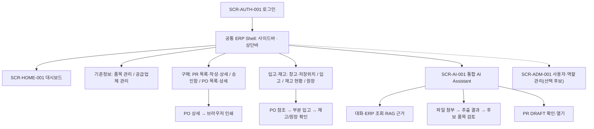

# 차곡ERP — 4일 차 사이트맵·화면 목록

> 버전: v0.2 / 2026-11-17  
> 기준: 통합 기획서 v3.3, PRD v0.3, MVP v0.3, 역할 분담 v0.3, FUNCTIONAL-SPEC v0.2, ERP WORKFLOW v0.3  
> 상태: **화면 기획 초안.** 실제 라우트, 픽셀 디자인, API/DB 컬럼은 미확정.  
> 소유: A = 공통 디자인·구매/Agent UI, B = 인증·입고/재고·문서 검토 UI.

## 1. 화면 기획 원칙

1. 사용자는 하나의 ERP 웹앱에서 업무를 수행한다. Agent와 Document AI는 **하나의 Assistant 화면**에서 사용한다.
2. **인증/업무 권한은 서버 기준**이다. 메뉴 숨김과 버튼 비활성화만으로 접근 통제 완료라고 주장하지 않는다.
3. AI Studio 시안은 화면 구성 검증용 프로토타입이다. Mock 데이터, URL, 내부 상태를 실제 API 계약으로 간주하지 않는다.
4. **내부 PO**를 생성·조회·인쇄하지만 외부 업체 주문·PG 결제·송장·MES 화면은 만들지 않는다.
5. `SCR-*`는 이번 문서의 **제안 화면 ID**이고, `MAT-01` 등은 이전에 정한 **기능 ID**다. 다수 화면↔다수 기능 연결을 허용한다.
6. PC 중심 웹이 기본이며 권한별 대시보드/메뉴 노출 정책은 세부 권한 매트릭스 확정 후 조정한다.

## 2. 사이트맵(제안)

**권한별 메뉴 기본 제안(확정 전):** 요청자=PR·Assistant; 구매 담당=PR/PO·기준정보 조회; 승인자=승인함; 창고 담당=입고·재고; 관리자=사용자/역할·기준정보. 한 계정의 복수 역할·메뉴 겸용 여부는 D-09 및 권한 매트릭스에서 결정한다. 사용자·역할의 초기 등록은 **테스트 계정 시드/관리자용 최소 API**로도 충족할 수 있다. 따라서 **별도 관리자 관리 화면은 P0 필수가 아니며 선택 후보**다.

## 3. 화면 목록(P0 17개 + 별도 관리자 화면 후보 1개)

| 화면 ID | 메뉴 / 화면명 | 주요 콘텐츠와 조작 | 연결 기능 ID | 기능 구현 | 중요 상태·예외 |
|---|---|---|---|---|---|
| SCR-AUTH-001 | 로그인 | 계정 입력, 로그인·로그아웃, 로그인 만료 안내 | SEC-01, UI-04 | B (디자인 A) | 인증 실패, 세션 만료, 접근 거부 |
| SCR-HOME-001 | ERP 대시보드 | 내 PR 상태, 승인 대기, 발주·입고 요약, 빠른 이동 | UI-01, UI-02, UX-01 | A/B 데이터 협의; Shell A | 권한별 카드, 빈 데이터, 조회 실패; 새로운 통계 API 필수 아님 |
| SCR-MAT-001 | 품목 목록·등록/수정 | 코드·이름·규격·기준단위·활성 상태 검색/편집 | MAT-01, UI-01 | A | 중복 코드·비활성 품목 |
| SCR-SUP-001 | 공급업체 목록·등록/수정 | 업체명·코드·전화·이메일·상태 | SUP-01, UI-01 | A | 형식 오류·비활성 업체 |
| SCR-PR-001 | 구매요청 목록 | 내 PR/권한 범위 PR, 상태 필터, 작성·상세 이동 | PR-01, PR-02, UI-01 | A | 본인 소유권, 검색 결과 없음 |
| SCR-PR-002 | PR 작성·초안 수정 | 품목 행 추가/삭제, 수량·단위·필요일, 임시 저장·제출 | PR-01, PR-02, MAT-01 | A | DRAFT만 수정, 버전 충돌, 필수값 오류 |
| SCR-PR-003 | PR 상세·이력 | 항목·작성자·상태, 반려 사유, 승인 이력, 재작업 시작 | PR-02, APR-01, AUD-01 | A | REJECTED 재작업, APPROVED 수정 불가 |
| SCR-APR-001 | PR 헤더 일괄 승인함·상세 | 제출된 PR 확인, 승인·반려(사유 필수) | APR-01, PR-02, AUD-01 | A | 역할 거부, 중복 승인, 경쟁 상태 변경 |
| SCR-PO-001 | 내부 PO 목록 | **PR별 여러 PO 목록**, 공급업체·금액·PO 미입고 잔량, PR별 미발주 잔량, PO 생성 진입 | PO-01, PO-03 | A | 승인 PR만 생성, 같은 PR에서 여러 PO 허용, 품목별 초과/중복 요청 차단 |
| SCR-PO-002 | PO 상세·인쇄 | PR 품목 참조, 이 PO의 발주 수량·누적 입고·**미입고 잔량**, 공급업체 연락처, 브라우저 인쇄 | PO-01, PO-02, PO-03 | A | **PR의 미발주 잔량과 PO의 미입고 잔량을 혼동하지 않음**, 외부 주문·결제 버튼 없음 |
| SCR-WH-001 | 창고·저장위치 | 창고/저장위치 생성·수정·조회, 활성 여부 | WH-01 | B (디자인 A) | 다른 창고 소속 위치 선택 금지 |
| SCR-GR-001 | PO 기준 입고 등록 | PO/품목 선택, 잔량, 저장위치·입고 수량, 입고 확정 | GR-01, GR-02, PO-03 | B | 초과·중복·경쟁·권한 오류, 재시도 처리 |
| SCR-GR-002 | 입고 내역·상세 | GR ID, 참조 PO·품목, 실제 입고량·위치·시각 | GR-01, AUD-01 | B | 성공한 GR 조회, P0 취소 버튼 없음 |
| SCR-STK-001 | 현재고 조회 | 품목·창고·저장위치 필터와 현재 수량 | ST-01 | B | 빈 재고와 조회 실패 구분 |
| SCR-STK-002 | 재고 원장 | 입고 이동 기록, 품목·위치·GR 참조 조회 | ST-01, AUD-01 | B | 기록 불일치 확인, P0 직접 수정 금지 |
| SCR-AI-001 | **통합 AI Assistant** | 채팅, ERP 조회·규정 근거, 파일 첨부, 처리 상태, PR 초안 확인/열기 | AG-01~06, UI-03, DOC-01~04, MATCH-01~03 | **Shell/채팅 A · 문서 패널 B** | 권한·Tool 실패, 업로드 오류, 매칭 미확정, 실행 중 상태 |
| SCR-AI-002 | Assistant 내 문서 검토 패널 | 원문 요약/행, 후보 품목·규격 비교, 수량 수정, 최종 확인→PR | DOC-02~04, MATCH-01~03 | B (디자인 A) | 미확정/오매칭 후보는 확정 불가, 사용자 검토 |
| SCR-ADM-001 **(선택 후보)** | 사용자·역할 기본 관리 | 데모 계정/역할 확인·변경(관리 UI가 실제로 필요할 때만) | SEC-01, SEC-02 | B (디자인 A) | P0 필수 아님; 테스트 계정 시드/관리 기능으로 대체 가능 |

**구현 단위 주의:** 위 표는 **P0 관련 논리 화면/화면 영역 17개와 선택 후보 1개(총 18개)**다. 화면 1개마다 React Route나 독립 컴포넌트를 반드시 1개씩 생성하라는 뜻이 아니다. 예: `SCR-AI-002`는 `SCR-AI-001` 내부 패널; PO 인쇄는 `SCR-PO-002`의 브라우저 인쇄 스타일로 처리한다. 승인 상세는 `SCR-APR-001` 내부 패널/페이지 중 선택한다.

## 4. 대표 화면 전환·상태

### 4.1 일반 구매 업무

`로그인 → PR 목록 → PR 작성(DRAFT) → PR 상세에서 제출(SUBMITTED) → PR 전체 승인(APPROVED/REJECTED) → PR 품목별 미발주 잔량 확인 → PO-A 생성 → 필요 시 PO-B 추가 분할 생성 → PO 상세/인쇄 → 각 PO 기준 입고 → 현재고/재고 원장`

반려 시: `PR 상세(REJECTED, 사유 확인) → 재작업(DRAFT) → 재제출 → 승인함`.

### 4.2 Agent 사용

`로그인 → 통합 Assistant → ERP 조회/규정 RAG(출처) → 추가 질문 → PR DRAFT 생성 → PR 상세 열기`.

후속 수정: `Assistant 내 동일 대화 → 표시 품목↔PR itemId 검증 → DRAFT 수정(version) → PR 상세 확인`.

### 4.3 문서 처리

`Assistant → Excel/텍스트 PDF 업로드 → 구조화 품목 표 → Rule-Based/ES/필요시 LLM 후보 → 사용자가 검토·수정 → PR DRAFT 저장 → PR 상세`.

### 4.4 부분 입고

`PO 상세 → 입고 등록 → 1차 GR 60 → PO 잔량 40 → 2차 GR 40 → PO RECEIVED → GR 내역/현재고/원장`.

## 5. AI Studio 입력·출력 경계

**입력:** PRD v0.3, MVP v0.3, FUNCTIONAL-SPEC v0.2, ERP-WORKFLOW v0.3, 본 화면 목록, 공통 디자인 의도. **분할 발주 시 PR 품목별 미발주 잔량/PO별 미입고 잔량을 분리 표시**.  
**요청:** PC 중심 React+TypeScript; 공통 Shell; 대표 화면(PR 작성/PO/GR/Assistant 파일 검토); 주요 상호작용·오류·빈 상태; Mock 데이터로만 시연; 외부 발주·실결제 기능 없음.  
**산출물 검토:** 빠진 P0 UI, 메뉴 혼동, 잘못된 상태 변경, 업무 용어, 접근 권한, 표 밀도, A/B 컴포넌트 경계를 확인한다.  
**금지:** AI Studio가 만든 임시 API URL·DB·상태명을 확정 계약으로 복사하거나 생성 화면만으로 업무 테스트 완료를 주장하지 않는다.

## 6. 다음 문서와 연결

- `SCREEN-SPEC.md`(2주 차): 화면별 입력 필드, 이벤트, 유효성 메시지, 로딩/빈/오류 상태, 권한, Figma 또는 AI Studio 시안 링크.
- `../api/openapi.yaml`(2주 차): 실제 REST Method/URL/DTO/상태코드. **현재 이 문서에 API 주소를 확정하지 않는다.**
- `../database/DB-SPEC.md`(2주 차): 화면에서 사용할 참조 ID·상태·단위가 저장 가능한지 검증.

**검토란:** A __________ / B __________ / 날짜 __________ / 화면 ID 변경 __________
