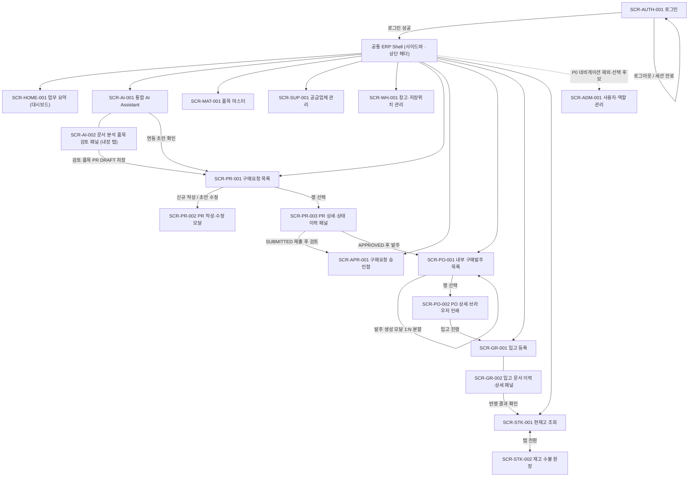

# 차곡ERP 화면 명세서 (SCREEN-SPEC.md)

> **문서 버전:** v0.3 (2주 차 설계 대조·수정 제안 반영본)  
> **작성 기준일:** 2026-11-17  
> **서비스명:** 차곡ERP (Chagok ERP) — *업무를 차곡차곡, 정확하게.*  
> **문서 성격:** 본 문서는 React + TypeScript 기반 화면 프로토타입과 1주 차 기획·계약 문서 사이의 추적성을 보장하기 위한 **화면 설계 명세서**입니다. 본 문서는 화면 설계 초안입니다. 병행 작성한 `openapi.yaml`, `DB-SPEC.md`, `RBAC-MATRIX.md` v0.1은 **제안**이며 A/B 리뷰 전까지 확정 계약이 아닙니다. **AI Studio의 실제 React 프로토타입 코드는 전달받지 않아 화면 동작 재검증은 하지 않았습니다.**

---

## 7.1 문서 개요

### 1) 목적 및 적용 범위
- 제조기업의 **구매요청(PR) → 헤더 일괄 승인 → 1:N 내부 분할 발주(PO) → 수동·부분 입고(GR) → 현재고 및 불변 수불 원장(Stock)** 흐름과 **통합 AI Assistant(대화형 Agent·RAG + Document AI 품목 매칭)**를 단일 PC 웹 ERP 환경에서 일관되게 정의한다.
- P0 범위(20주 내 구현·검증 대상 40개 기능 항목, 17개 P0 논리 화면/패널)를 기준으로 하며, P1(입고 취소/역거래, PO 정식 PDF, Vector/Hybrid Search 등)·P2(다단계 결재, 송장 대조, BOM/MRP, OCR 등)·완전 제외(외부 자동 발주, 실결제/PG, MES) 기능은 포함하지 않는다.
- AI Studio 프로토타입은 백엔드/DB 없이 Mock Data로 화면 동작 및 상태 전환을 시연하며, 실제 서비스에서는 Spring Boot ERP API, PostgreSQL(원본), Elasticsearch(검색 파생 인덱스), 인증 세션이 서버 측에서 최종 검증한다.

### 2) 참조 문서 및 기준 버전
| 구분 | 문서명 | 버전 | 주요 참조 내용 |
|---|---|---|---|
| 기획/범위 | `01-PRD.md` / `02-MVP-SCOPE.md` / `차곡ERP_통합기획서_v3.3.md` | v0.3 / v3.3 | 목표, 대상 사용자, P0/P1/P2·제외 범위, `FIX-01~05` |
| 역할 분담 | `03-ROLE-AGREEMENT.md` | v0.3 | A(디자인/구매/Agent)·B(인증/입고/재고/문서AI) 책임 경계 |
| 업무 흐름/규칙 | `04-ERP-WORKFLOW.md` / `06-ERP-BUSINESS-RULES.md` | v0.3 | 상태 전이, `BR-001~027`, `TC-01~25`, PO↔GR 트랜잭션 |
| SAP 참고 | `05-SAP-REFERENCE.md` | v0.2 | EDMX 참고(비복제 원칙, `Plant != Warehouse`) |
| 기능 명세 | `FUNCTIONAL-SPEC.md` / `FUNCTION-COVERAGE.md` | v0.2 | P0 40개 기능 ID, 입출력, 예외, 완료 기준 |
| 사이트맵/시나리오 | `07-SITEMAP-SCREEN-LIST.md` / `08-USER-SCENARIOS.md` | v0.2 | 17개 P0 논리 화면 ID(`SCR-*`), `US-01~06` |
| 서비스 계약/결정 | `09-PO-GR-CONTRACT.md` / `10-AI-PR-DRAFT-CONTRACT.md` / `11-WEEK1-REVIEW-DECISIONS.md` | v0.2 | PO↔GR 잠금·멱등, AI↔PR 공통 저장 계약, `D-01~11` |

### 3) 화면 ID 명명 규칙 및 추적성
- 화면 ID는 `SCR-{도메인}-{순번}` 형식을 따른다(`07-SITEMAP-SCREEN-LIST.md` v0.2 준수).
  - `AUTH`: 인증 / `HOME`: 대시보드 / `MAT`: 품목 / `SUP`: 공급업체 / `WH`: 창고·저장위치
  - `PR`: 구매요청 / `APR`: 승인함 / `PO`: 구매발주 / `GR`: 입고 / `STK`: 재고·원장 / `AI`: 통합 AI Assistant / `ADM`: 관리자(선택 후보)
- **개발자 추적 정보 비노출 원칙:** `SCR-*`, `MAT-01`, `BR-*`, `D-*`, 담당자(`A`/`B`) 표기는 실제 사용자 UI 문구에 노출하지 않고 코드 주석 및 DOM `data-screen-id`, `data-spec-id`, `data-owner` 속성에만 유지한다.

### 4) 사용자 역할 체계 (`SEC-01`, `SEC-02`)
| 역할 코드 | 역할명 | 주요 업무 범위 | 시연용 계정(Mock) |
|---|---|---|---|
| `REQUESTER` | 구매 요청자 | 구매요청 초안 생성/수정/제출, 반려 재작업, 통합 AI Assistant | 김요청 (`생산1팀`) |
| `APPROVER` | 승인자 | 제출된 구매요청 헤더 일괄 승인 및 사유 필수 반려 | 이승인 (`생산관리부`) |
| `PURCHASER` | 구매 담당자 | 품목/공급업체 마스터 등록·관리, 승인 PR 기반 1:N 분할 PO 생성·인쇄, AI Assistant | 박구매 (`자재구매팀`) |
| `WAREHOUSE` | 창고 담당자 | 저장위치 등록, PO 기준 부분/완납 입고 확정, 현재고·수불 원장 조회 | 최창고 (`물류창고팀`) |
| `ADMIN` | 시스템 관리자 | 전체 메뉴·승인·마스터·입고·AI 통합 점검 및 예외 검증 | 정관리 (`ERP운영팀`) |

### 5) 공통 UI/UX 정책 (`UX-01`)
- **PC 중심 레이아웃:** 좌측 고정 사이드바(`256px`, `#0F172A`) + 상단 헤더(`56px`, `#FFFFFF`) + 스크롤 워크스페이스(`#F8FAFC`, 최대 폭 `1360px`).
- **타이포그래피·색상:** `Plus Jakarta Sans` + `Noto Sans KR` + `JetBrains Mono`(코드/수량/금액 `tabular-nums`), 본문 `400/500`, 제목 `600`(`font-bold` 미사용). 브랜드 포인트 컬러 `#2563EB`(`brand-600`) · `#1D4ED8`(`brand-700`/`blue-700`), 상태별 시맨틱 컬러(승인/정상 Emerald, 대기/경고 Amber, 오류/부족 Red).
- **공통 화면 상태 전환:** 프로토타입 상단 `PageHeader`에서 각 화면의 `정상 / 로딩 / 빈 데이터 / 오류 / 권한 제한` 5가지 상태를 즉시 검증 가능.
- **실행 통제 정책:** AI Agent 및 Document AI는 오직 `DRAFT` 상태 구매요청 초안 생성·수정까지만 수행하며 승인, PO 생성, GR 확정, 결제 실행 기능은 UI/Tool 모두에서 제공하지 않는다.

---

## 7.1.1 2주 차 개정 메모 (기존 AI Studio 코드 미변경)

- **A 채택 정책(B 교차 리뷰 전)**: 공급업체 이메일 선택, PR 필요일은 DRAFT 선택·SUBMIT 필수, `ADMIN`도 자기 승인 불가, `EA`/`SET` 정수·`KG`/`M`/`L` 최대 소수 3자리.
- **기존 프로토타입과 불일치**: 위 정책 및 창고 등록/수정, `.xlsx`/텍스트 PDF만 허용, 매칭 신뢰도 % 대신 추천 순위 표시를 React 구현 단계에서 수정해야 한다. 원래 프로토타입이 이미 수정됐다고 주장하지 않는다.
- **API URL**: 2주 차 `openapi.yaml`에서는 `/api/v1`를 제안한다. 이 문서의 `/api/...` 표기는 기존 Mock의 연동 메모이며 구현 전 일괄 통일해야 한다.
- **업무 데이터**: 각 PR 품목의 미발주 잔량은 개별 계산하고, 서로 다른 단위를 합산해 발주 가능 여부를 판정하지 않는다.

---

## 7.2 전체 사이트맵

- **계층 및 라우팅 구조 참고:** 논리 화면 17개는 SPA 내부 상태(`activeScreen` + 패널/모달/탭)로 구성되며, `SCR-PR-002`(모달), `SCR-PR-003`(우측 상세 패널), `SCR-PO-002`(우측 상세+인쇄 모달), `SCR-GR-002`(우측 이력/상세 패널), `SCR-STK-002`(원장 탭), `SCR-AI-002`(우측 문서 검토 패널)는 사용자 동선 단절을 막기 위해 별도 URL 페이지 이탈 없이 마스터-디테일 또는 내장 패널로 통합 배치되어 있다.

---

## 7.3 화면 목록 (P0 17개 + 선택 후보 1개)

| 화면 ID | 화면명 | 목적 | 접근 가능 역할(프로토타입 기준) | 담당(디자인/기능) | 관련 기능 ID | 주요 동작 | 연결 화면 |
|---|---|---|---|---|---|---|---|
| `SCR-AUTH-001` | 로그인 | 사내 계정 인증 및 역할별 테스트 접속 | 전체(비인증 포함) | A / B | `SEC-01`, `UI-04` | 이메일·비밀번호 로그인, 역할별 빠른 접속 | `SCR-HOME-001` |
| `SCR-HOME-001` | 업무 요약 (대시보드) | 구매·승인·발주·안전재고 미달·감사 이력 요약 | 전체 로그인 역할 | A / A+B | `UI-01`, `UI-02`, `UX-01`, `AUD-01` | KPI 클릭 이동, 미달 자재→AI 초안 이동, 바로가기 | `SCR-PR-001`, `SCR-APR-001`, `SCR-PO-001`, `SCR-GR-001`, `SCR-STK-001`, `SCR-AI-001` |
| `SCR-MAT-001` | 품목 마스터 | 자재 기준정보 조회·정렬·신규 등록·활성 전환 | 전체 조회 / `PURCHASER`, `ADMIN` 편집 | A / A | `MAT-01`, `UI-01` | 검색·상태 필터·정렬, 품목 등록, 활성/비활성 토글 | `SCR-PR-002`, `SCR-AI-002` |
| `SCR-SUP-001` | 공급업체 관리 | 공급업체 연락처 조회·정렬·신규 등록 | `REQUESTER`, `APPROVER`, `PURCHASER`, `ADMIN` / 편집 `PURCHASER`, `ADMIN` | A / A | `SUP-01`, `UI-01` | 검색·상태 필터·정렬, 공급업체 등록 | `SCR-PO-001`, `SCR-PO-002` |
| `SCR-PR-001` | 구매요청 목록 | PR 목록 검색·필터·정렬 및 작성/상세 진입 | `REQUESTER`, `APPROVER`, `PURCHASER`, `ADMIN` | A / A | `PR-01`, `PR-02`, `UI-01` | 상태별 필터, 컬럼 정렬, 행 선택, 모달 열기 | `SCR-PR-002`, `SCR-PR-003`, `SCR-AI-001` |
| `SCR-PR-002` | PR 작성·초안 수정 | 다품목 PR 초안 신규 작성 및 버전 기반 수정 | `REQUESTER`, `PURCHASER`, `ADMIN` (본인 `DRAFT` 또는 `ADMIN`) | A / A | `PR-01`, `PR-02`, `MAT-01` | 활성 품목 행 추가/삭제, 수량 검증, `DRAFT` 저장 | `SCR-PR-001`, `SCR-PR-003` |
| `SCR-PR-003` | PR 상세·상태 이력 | 품목 내역, 미발주 잔량, 연결 PO, 감사 이력 확인 | `REQUESTER`, `APPROVER`, `PURCHASER`, `ADMIN` | A / A | `PR-02`, `APR-01`, `AUD-01`, `PO-01` | 초안 수정, 승인 요청 제출, 반려 재작업(`DRAFT` 전환) | `SCR-PR-002`, `SCR-APR-001`, `SCR-PO-001` |
| `SCR-APR-001` | 구매요청 승인함 | 제출된 PR 헤더 전체 일괄 승인 및 사유 필수 반려 | `APPROVER`, `ADMIN` | A / A | `APR-01`, `PR-02`, `AUD-01` | 대기/완료 탭, 헤더 일괄 승인, 사유 필수 반려 | `SCR-PR-003`, `SCR-PO-001` |
| `SCR-PO-001` | 내부 구매발주 목록 | PR 기반 1:N 분할 발주 생성 및 PO 목록 조회·정렬 | `PURCHASER`, `APPROVER`, `WAREHOUSE`, `ADMIN` / 생성 `PURCHASER`, `ADMIN` | A / A | `PO-01`, `PO-03`, `UI-01` | PR 미발주 잔량 배분, 공급업체 1곳 선택, 멱등키 발주 생성 | `SCR-PO-002`, `SCR-PR-003`, `SCR-GR-001` |
| `SCR-PO-002` | PO 상세·브라우저 인쇄 | PO 품목별 원발주/누적입고/미입고 잔량 및 인쇄 | `PURCHASER`, `APPROVER`, `WAREHOUSE`, `ADMIN` | A / A | `PO-01`, `PO-02`, `PO-03` | 분할 발주 이동, 공급업체 연락처 확인, 브라우저 인쇄 | `SCR-PO-001`, `SCR-GR-001` |
| `SCR-WH-001` | 창고·저장위치 관리 | 창고 조회 및 소속 저장위치 등록·상태 관리 | `WAREHOUSE`, `PURCHASER`, `ADMIN` / 편집 `WAREHOUSE`, `ADMIN` | A / B | `WH-01`, `UI-02` | 창고 선택 필터, 저장위치 목록 조회, 저장위치 추가 | `SCR-GR-001`, `SCR-STK-001` |
| `SCR-GR-001` | PO 기준 입고 등록 | PO 기준 수동·부분 입고 등록 및 원자적 반영 | `WAREHOUSE`, `ADMIN` | A / B | `GR-01`, `GR-02`, `PO-03`, `ST-01` | PO 선택, 창고/활성 저장위치 검증, 부분 입고 확정, 중복키 확인 | `SCR-GR-002`, `SCR-PO-002`, `SCR-STK-001`, `SCR-STK-002` |
| `SCR-GR-002` | 입고 문서 이력·상세 | 확정(`POSTED`)된 GR 검색 및 품목/위치 상세 조회 | `WAREHOUSE`, `ADMIN` | A / B | `GR-01`, `AUD-01` | GR 검색, 문서 선택, 상세 내역 확인(P0 취소 없음) | `SCR-GR-001`, `SCR-STK-002` |
| `SCR-STK-001` | 현재고 조회 | 창고·저장위치별 현재고 및 안전재고 부족 조회 | `WAREHOUSE`, `PURCHASER`, `REQUESTER`, `ADMIN` | A / B | `ST-01`, `UI-02` | 검색, 안전재고 미달 필터, 정렬, 재고 평가액 확인 | `SCR-STK-002`, `SCR-AI-001` |
| `SCR-STK-002` | 재고 수불 원장 | `OPENING`·`GR_IN` 불변 재고 이동 이력 조회 | `WAREHOUSE`, `PURCHASER`, `REQUESTER`, `ADMIN` | A / B | `ST-01`, `AUD-01`, `UI-02` | 검색, 컬럼 정렬, 참조문서(`GR`/`INIT-SEED`) 확인 | `SCR-STK-001`, `SCR-GR-002` |
| `SCR-AI-001` | 통합 AI Assistant | 대화형 ERP 조회, RAG 규정 근거, PR 초안 생성·수정 | `REQUESTER`, `PURCHASER`, `ADMIN` | A / A (Shell·채팅) | `AG-01~06`, `UI-03` | 질의/재질문, RAG 출처 카드, 후속 초안 수정, 실행 통제 | `SCR-AI-002`, `SCR-PR-001`, `SCR-PR-003` |
| `SCR-AI-002` | 문서 분석 품목 검토 패널 | 첨부 구매문서 파싱·매칭 후보 검토 및 PR 초안 저장 | `REQUESTER`, `PURCHASER`, `ADMIN` | A / B | `DOC-01~04`, `MATCH-01~03` | 파일 업로드/샘플 실행, 후보 선택·수량 수정, 체크 품목 저장 | `SCR-AI-001`, `SCR-PR-001` |
| `SCR-ADM-001` *(선택 후보)* | 사용자·역할 관리 | 테스트 계정/역할 확인 및 변경(P0 비필수) | `ADMIN` | A / B | `SEC-01`, `SEC-02` | P0에서는 계정 시드·상단 역할 전환으로 대체(네비 미노출) | `SCR-AUTH-001` |

---

## 7.4 화면별 상세 명세

### 1. `SCR-AUTH-001` — 로그인
1. **화면 ID / 화면명:** `SCR-AUTH-001` / 로그인 (사내 ERP 로그인)
2. **담당 개발자:** 디자인 A / 기능 구현 B (`UI-04`, `SEC-01`)
3. **관련 기능 ID / 시나리오 / 규칙:** `SEC-01`, `UI-04` / `US-01~06` 선행 인증 / `BR-002`
4. **접근 권한 및 역할 제한:** 비인증(로그아웃 상태) 사용자 전용 진입 화면. 로그인 성공 시 사용자 역할에 맞는 ERP 워크스페이스로 진입.
5. **화면 목적:** 사내 계정 인증을 통해 신뢰할 수 있는 사용자 컨텍스트(`userId`, `role`)를 설정하고, 시연 환경에서는 역할별 빠른 접속으로 RBAC 화면 차이를 즉시 검증한다.
6. **진입 경로:** 최초 미인증 접근, 상단 헤더 `로그아웃` 클릭, 세션 만료(실서버 환경).
7. **레이아웃 구조:** 중앙 집중 2단 카드(`max-w-4xl`) — 좌측(`5 cols`, `#0F172A`): 시스템 소개 및 4단계 역할 흐름 안내 / 우측(`7 cols`, `#FFFFFF`): 이메일·비밀번호 로그인 폼 + 역할별 빠른 접속(5개 계정 카드 그리드).
8. **표시 데이터 항목:** 서비스명(`차곡ERP`), 역할 체계 안내(4종), 5개 시연 계정(이름, 역할명, 부서, 이메일).
9. **입력 필드 및 유효성 검증 규칙:**
   - `사내 이메일` (`email`, 필수): 일반 이메일 형식(시연 계정 도메인 고정 강제하지 않음), 앞뒤 공백 제거 후 대소문자 무시 매칭.
   - `비밀번호` (`password`, 필수): 프로토타입 전용 최소 4자; 실제 서버는 안전한 비밀번호 정책 및 해시 검증 적용(TBD).
10. **사용자 액션 및 이벤트 흐름:**
    - `로그인` 제출 → 계정·비밀번호 검증 → 성공 시 `currentUser` 설정 및 토스트 알림(`{이름} ({역할}) 계정으로 전환됨`) → `SCR-HOME-001` 이동.
    - 역할별 빠른 접속 카드 클릭 → 해당 사용자로 즉시 로그인 및 워크스페이스 전환.
11. **상태 전이 및 업무 규칙 반영:** 클라이언트 임의 `userId` 조작을 신뢰하지 않으며(실서버 `SEC-01`), 로그인 후 모든 도메인 액션은 현재 인증 컨텍스트를 기준으로 권한 검사.
12. **화면 상태 정의:** 로딩(로그인 처리 대기 버튼 비활성화 — 실서버 연동 시), 빈 데이터(해당 없음), 오류(미등록 이메일 또는 4자 미만 비밀번호 시 상단 인라인 경고 박스), 권한 제한(미인증 상태 보호 화면 접근 시 본 화면으로 강제 복귀).
13. **연결 화면:** Outbound → `SCR-HOME-001`.
14. **예외 처리 및 메시지 기준:** `"등록된 사내 이메일과 비밀번호(4자 이상)를 확인해 주세요."`
15. **백엔드 연동 포인트 (TBD):** `POST /api/v1/auth/login`(세션/HttpOnly 쿠키 발급 안, D-09; 제안), `POST /api/auth/logout`, `GET /api/auth/me`.
16. **미확정 사항 및 주의점:** CSRF 토큰 정책, 세션 타임아웃 및 401 만료 안내 모달/리다이렉트 흐름(`D-09`), `SCR-ADM-001` 별도 제공 여부.

---

### 2. `SCR-HOME-001` — 업무 요약 (대시보드)
1. **화면 ID / 화면명:** `SCR-HOME-001` / 업무 요약 (ERP 대시보드)
2. **담당 개발자:** 디자인·Shell A / 데이터 구성 A+B 협의 (`DASH-01`)
3. **관련 기능 ID / 시나리오 / 규칙:** `UI-01`, `UI-02`, `UX-01`, `AUD-01` / `US-01~06` 허브 / `FIX-01~05`
4. **접근 권한 및 역할 제한:** 로그인한 모든 역할(`REQUESTER`, `APPROVER`, `PURCHASER`, `WAREHOUSE`, `ADMIN`) 접근 가능. `업무 메뉴 바로가기`에서 비허용 메뉴는 `접근 제한` 배지를 표시하며 클릭 시 해당 화면의 `권한 제한` 오버레이로 연결.
5. **화면 목적:** 현재 진행 중인 구매요청·승인 대기·입고 대기 발주·안전재고 미달 품목 현황 및 최근 변경 이력을 한 화면에서 파악하고 각 업무 화면으로 빠르게 이동한다.
6. **진입 경로:** 로그인 직후 기본 화면, 사이드바 `업무 요약`, 로고(`차곡ERP`) 클릭.
7. **레이아웃 구조:** 상단 `PageHeader`(CTA `통합 AI Assistant 열기`) → 4열 KPI 스트립(장식 아이콘 배제, 수치·상태 색상만 강조) → (향후 차트 확장 슬롯 주석 유지) → 중단 2열(`7:5`: 안전재고 미달 자재 테이블 + 최근 구매·입고 진행 문서) → 하단 2열(`7:5`: 주요 업무 변경 이력 + 업무 메뉴 바로가기).
8. **표시 데이터 항목:**
   - KPI 4종: `진행 중 구매요청`(DRAFT+SUBMITTED 건수), `승인 대기 건수`(SUBMITTED), `입고 대기 발주`(OPEN+PARTIALLY_RECEIVED), `안전재고 미달 품목`(활성 품목 중 현재고 < 안전재고 종수).
   - 안전재고 미달 표: 품목코드, 품목명, 현재고, 안전재고, 부족량(`-수량 단위`).
   - 최근 문서: 최근 PO 2건(누적/발주, 상태), 최근 PR 3건(요청자, 품목수, 버전, 상태).
   - 변경 이력(`AUD-01`): 최신 6건(문서번호, 행위, 상세, 행위자, 발생시각).
9. **입력 필드 및 유효성 검증 규칙:** 별도 입력 폼 없음(조회 전용 요약 화면).
10. **사용자 액션 및 이벤트 흐름:** KPI 카드 클릭 → 해당 업무 화면(`pr`, `approvals`, `po`, `inventory`) 전환 / `AI로 초안 요청` 클릭 → `SCR-AI-001` 이동 / 바로가기 버튼 클릭 → 각 화면 이동.
11. **상태 전이 및 업무 규칙 반영:** 새로운 통계 전용 API 없이 기존 PR/PO/Material/StockBalance/AuditLog 데이터에서 파생 계산(`07-SITEMAP` 원칙).
12. **화면 상태 정의:** 로딩(`LoadingSkeletonView`), 빈 데이터(`EmptyStateView` + `통합 AI Assistant 열기`), 오류(`ErrorStateView`), 권한 제한(`ForbiddenStateView`).
13. **연결 화면:** Inbound ← `SCR-AUTH-001`, 모든 화면 / Outbound → 전체 P0 업무 화면.
14. **예외 처리 및 메시지 기준:** 모든 활성 품목이 안전재고 이상일 경우 표 내부 `"모든 활성 품목이 안전재고 이상을 유지하고 있습니다"` 표시.
15. **백엔드 연동 포인트 (TBD):** 기존 목록 조회 API(`PR`, `PO`, `Stock`, `AuditLog`) 조합 또는 경량 요약 조회 `GET /api/dashboard/summary` (P0 필수 신규 API 아님).
16. **미확정 사항 및 주의점:** 역할별 대시보드 KPI·위젯 차등 노출 범위(`07-SITEMAP` 6항) 및 향후 구매·입고 현황/안전재고 대비 차트 추가 여부.

---

### 3. `SCR-MAT-001` — 품목 마스터
1. **화면 ID / 화면명:** `SCR-MAT-001` / 품목 마스터
2. **담당 개발자:** 디자인 A / 기능 구현 A (`MAT-01`)
3. **관련 기능 ID / 시나리오 / 규칙:** `MAT-01`, `UI-01` / `US-01`, `US-05` 선행 / `BR-013`, `BR-014`, `BR-022`
4. **접근 권한 및 역할 제한:** 전체 5개 역할 조회 가능. `품목 등록` 및 `활성화/비활성화` 조작은 `PURCHASER`, `ADMIN`만 활성화(타 역할은 버튼 비활성화 + 서비스 레벨 거부).
5. **화면 목적:** PR·PO·GR·문서 품목 매칭(Rule/ES/LLM)이 공통으로 참조하는 단일 원본 자재 마스터(코드, 명칭, 규격, 기준단위, 단가, 안전재고, 활성 여부)를 관리한다.
6. **진입 경로:** 사이드바 `기준정보 > 품목 마스터`, `SCR-HOME-001` 바로가기.
7. **레이아웃 구조:** `PageHeader`(CTA `품목 등록`) → `SearchToolbar`(검색창 + `전체/사용중/비활성` 필터 + 총 건수) → 전체 폭 데이터 테이블 + `신규 품목 등록` 모달.
8. **표시 데이터 항목:** 품목코드(정렬), 품목명(정렬), 규격, 분류, 기준단위(`EA`/`SET`/`M`/`KG`/`L`), 기준단위 단가(원, 정렬), 현재고 / 안전재고(미달 시 Red 강조, 정렬), 상태(`사용중`/`비활성`, 정렬), 관리(`비활성화`/`활성화`).
9. **입력 필드 및 유효성 검증 규칙 (등록 모달):**
   - `품목 코드` (필수): 영문 대문자 정규화, 기존 코드와 중복 시 등록 차단(`BR-013`).
   - `품목 분류`, `품목명`, `규격`, `기준단위` (필수): 단위 변환 없이 고정 기준단위 1개 선택(`BR-014`, `BR-022`).
   - `기준단가 (원)`, `안전재고 수량` (필수, 숫자 `>= 0`).
10. **사용자 액션 및 이벤트 흐름:** 검색·필터·컬럼 정렬 즉시 적용 / `품목 등록` → 모달 입력 → `등록 저장` → 중복·필수값 검증 → 목록 추가 + 감사 로그(`MASTER`) + 성공 토스트 / `비활성화/활성화` → 상태 즉시 토글 + 토스트.
11. **상태 전이 및 업무 규칙 반영:** 비활성(`active=false`)으로 전환된 품목은 `SCR-PR-002`, `SCR-PO-001`, `SCR-GR-001`, `SCR-AI-002`에서 신규 선택·저장 차단(`BR-013`). 실서버에서는 신규/수정 시 Elasticsearch 검색 색인 비동기 갱신 연동(`D-10`).
12. **화면 상태 정의:** 로딩/빈 데이터/오류/권한 제한(`ScreenStateGate` 공통 적용) + 검색 결과 없음 행 안내.
13. **연결 화면:** Inbound ← `SCR-HOME-001` / Outbound → 데이터 참조(`SCR-PR-002`, `SCR-AI-002`, `SCR-STK-001`).
14. **예외 처리 및 메시지 기준:** 중복 코드 시 `"품목 코드({CODE})가 이미 존재합니다. 중복 등록할 수 없습니다."`, 권한 부족 시 `"품목 등록 권한(구매 담당자 또는 관리자)이 없습니다."`.
15. **백엔드 연동 포인트 (TBD):** `GET /api/v1/materials`, `POST /api/v1/materials` (제안), `PATCH /api/materials/{id}/active` (+ 커밋 후 ES 색인 이벤트 발행).
16. **미확정 사항 및 주의점:** 제안한 `EA/SET` 정수·기타 소수 3자리 및 원화(`KRW`) 정밀도(`D-03`) A/B 확인, 품목 정보(규격/단가) 수정 UI 추가 범위.

---

### 4. `SCR-SUP-001` — 공급업체 관리
1. **화면 ID / 화면명:** `SCR-SUP-001` / 공급업체 관리
2. **담당 개발자:** 디자인 A / 기능 구현 A (`SUP-01`)
3. **관련 기능 ID / 시나리오 / 규칙:** `SUP-01`, `UI-01` / `US-01`, `US-01A` / `BR-013`, `BR-015`, `BR-023`
4. **접근 권한 및 역할 제한:** `REQUESTER`, `APPROVER`, `PURCHASER`, `ADMIN` 조회 가능(`WAREHOUSE`는 `SCREEN_PERMISSIONS`상 제한). `공급업체 등록` 버튼은 `PURCHASER`, `ADMIN`만 활성화.
5. **화면 목적:** 내부 PO 생성 및 발주서 인쇄 시 참조할 공급업체 정보와 연락처(담당자, 전화번호, 이메일)를 관리한다(외부 자동 발송/결제 연동 없음).
6. **진입 경로:** 사이드바 `기준정보 > 공급업체 관리`, `SCR-HOME-001` 바로가기.
7. **레이아웃 구조:** `PageHeader`(CTA `공급업체 등록`) → 안내 배너(내부 조회·인쇄 전용, 외부 자동 발송 없음 고지) → `SearchToolbar`(검색 + `전체/사용중/비활성` 필터 + 총 업체 수) → 7열 데이터 테이블 + `공급업체 신규 등록` 모달.
8. **표시 데이터 항목:** 업체코드(정렬), 공급업체명(정렬), 사업자등록번호, 담당자, 전화번호, 이메일, 상태(`사용중`/`비활성`, 정렬).
9. **입력 필드 및 유효성 검증 규칙 (등록 모달):**
   - `업체 코드` (필수, 대문자 정규화, 중복 차단), `공급업체명` (필수), `전화번호` (필수).
   - `담당자명`, `사업자등록번호`, `이메일` (선택 **제안**; 이메일을 입력했다면 형식 검증. 기존 프로토타입은 이메일 필수이므로 UI 수정 필요).
10. **사용자 액션 및 이벤트 흐름:** 검색·필터·정렬 / `공급업체 등록` → 모달 입력 → 중복·필수 검증 후 목록 추가 + 감사 로그(`MASTER`) + 성공 토스트.
11. **상태 전이 및 업무 규칙 반영:** 활성(`active=true`) 공급업체만 `SCR-PO-001` 발주 생성 드롭다운에 노출(`BR-013`, `BR-023`).
12. **화면 상태 정의:** 로딩/빈 데이터/오류/권한 제한(`ScreenStateGate`), 검색 결과 없음 행 안내.
13. **연결 화면:** Inbound ← `SCR-HOME-001` / Outbound → 데이터 참조(`SCR-PO-001`, `SCR-PO-002`).
14. **예외 처리 및 메시지 기준:** 중복 코드 시 `"공급업체 코드({CODE})가 이미 존재합니다."`, 필수값 누락 시 `"업체 코드, 업체명, 전화번호는 필수입니다."`.
15. **백엔드 연동 포인트 (TBD):** `GET /api/suppliers`, `POST /api/suppliers`, `PATCH /api/suppliers/{id}`.
16. **미확정 사항 및 주의점:** 공급업체 수정/비활성화 기능 추가, 이메일 필수/형식 검증 규칙 통일, `WAREHOUSE` 외 역할별 기준정보 열람 권한 재확인(`07-SITEMAP` 2항).

---

### 5. `SCR-WH-001` — 창고·저장위치 관리
1. **화면 ID / 화면명:** `SCR-WH-001` / 창고·저장위치 관리
2. **담당 개발자:** 디자인 A / 기능 구현 B (`WH-01`)
3. **관련 기능 ID / 시나리오 / 규칙:** `WH-01`, `UI-02` / `US-01`, `US-03` 선행 / `BR-013`, `BR-021`
4. **접근 권한 및 역할 제한:** `WAREHOUSE`, `PURCHASER`, `ADMIN` 조회 가능. `저장위치 추가` 버튼은 `WAREHOUSE`, `ADMIN`만 활성화.
5. **화면 목적:** 입고 등록(`SCR-GR-001`)과 현재고(`SCR-STK-001`)에서 사용하는 창고(Plant와 별개 엔티티) 및 소속 저장위치 계층과 활성 상태를 관리한다.
6. **진입 경로:** 사이드바 `기준정보 > 창고·저장위치`, `SCR-HOME-001` 바로가기.
7. **레이아웃 구조:** `PageHeader`(CTA `저장위치 추가`) → 좌우 2단 분할(`4:8`) — 좌측: 창고 선택 카드 목록(`전체 보기` 토글) / 우측: 선택 창고 소속 저장위치 테이블 + `저장위치 추가` 모달.
8. **표시 데이터 항목:**
   - 좌측 창고 목록: 창고 코드, 창고명, 공장명(`안산 1공장` 등), 소속 저장위치 개수, 활성 상태.
   - 우측 저장위치 테이블: 위치코드, 소속 창고, 저장위치명, 보관 구역(`zone`), 보관 품목수(현재고 > 0), 상태(`사용중`/`비활성`).
9. **입력 필드 및 유효성 검증 규칙 (저장위치 추가 모달):**
   - `소속 창고` (필수 Select), `저장위치 코드` (필수, 대문자 정규화, 중복 코드 차단), `보관 구역` (필수), `저장위치명` (필수).
10. **사용자 액션 및 이벤트 흐름:** 좌측 창고 클릭 → 우측 테이블 해당 창고 위치만 필터링 / `전체 보기` 클릭 → 전체 저장위치 표시 / `저장위치 추가` → 모달 저장 → 감사 로그 + 토스트.
11. **상태 전이 및 업무 규칙 반영:** 비활성 저장위치(`LOC-C9` 등)나 타 창고 소속 저장위치는 입고 확정 시 차단(`BR-021`, `TC-19`).
12. **화면 상태 정의:** 로딩/빈 데이터/오류/권한 제한(`ScreenStateGate`).
13. **연결 화면:** Inbound ← `SCR-HOME-001` / Outbound → 데이터 참조(`SCR-GR-001`, `SCR-STK-001`).
14. **예외 처리 및 메시지 기준:** 중복 코드 시 `"저장위치 코드({CODE})가 이미 존재합니다."`, 권한 오류 시 `"저장위치 등록 권한(창고 담당자 또는 관리자)이 없습니다."`.
15. **백엔드 연동 포인트 (TBD):** `GET /api/warehouses`, `GET /api/storage-locations`, `POST /api/warehouses`, `POST /api/storage-locations`.
16. **미확정 사항 및 주의점:** `WH-01` 명세의 창고 신규 생성·수정 및 저장위치 비활성화 토글 UI 추가 여부(`Plant != Warehouse` 정책 유지).

---

### 6. `SCR-PR-001` — 구매요청 목록
1. **화면 ID / 화면명:** `SCR-PR-001` / 구매요청 목록
2. **담당 개발자:** 디자인 A / 기능 구현 A (`PR-01`, `PR-02`)
3. **관련 기능 ID / 시나리오 / 규칙:** `PR-01`, `PR-02`, `UI-01` / `US-01`, `US-02`, `US-04`, `US-05` / `BR-002`, `BR-003`
4. **접근 권한 및 역할 제한:** `REQUESTER`, `APPROVER`, `PURCHASER`, `ADMIN` 접근 가능. `신규 요청 작성` 버튼은 `REQUESTER`, `PURCHASER`, `ADMIN`만 활성화(`APPROVER`는 조회 전용).
5. **화면 목적:** 직접 작성·AI 대화(`AGENT`)·문서 분석(`DOCUMENT_AI`)으로 생성된 모든 구매요청을 상태별로 검색·필터·정렬하고 상세 패널(`SCR-PR-003`) 또는 작성 모달(`SCR-PR-002`)로 진입한다.
6. **진입 경로:** 사이드바 `구매 관리 > 구매요청`, `SCR-HOME-001` KPI, `SCR-AI-001/002` `구매요청에서 확인` 링크.
7. **레이아웃 구조:** `PageHeader`(CTA `AI로 초안 작성`, `신규 요청 작성`) → `SearchToolbar`(검색 + `전체/초안/승인대기/승인됨/반려됨` 탭 + 총 건수) → 좌측 목록(`7 cols`, `SCR-PR-001`) + 우측 상세(`5 cols`, `SCR-PR-003`).
8. **표시 데이터 항목:** 요청번호(정렬), 요청 제목(정렬) + 생성 경로(`직접 작성`/`AI 대화 생성`/`문서 분석 생성`) · 품목 수 · 버전(`v{N}`), 요청자(정렬), 예상금액 합계(원, 정렬), 상태(`PrStatusLabel`, 정렬).
9. **입력 필드 및 유효성 검증 규칙:** 검색어(요청번호/제목/요청자), 상태 필터 버튼.
10. **사용자 액션 및 이벤트 흐름:** 상태 탭·검색·컬럼 정렬 즉시 목록 갱신 / 행 클릭 → 우측 `SCR-PR-003` 상세 동기화 / `AI로 초안 작성` → `SCR-AI-001` 이동 / `신규 요청 작성` → `SCR-PR-002` 모달 오픈.
11. **상태 전이 및 업무 규칙 반영:** 생성 경로 무관 동일 PR 테이블에 통합 노출(`UI`, `AGENT`, `DOCUMENT_AI`).
12. **화면 상태 정의:** `ScreenStateGate` 5상태 + 필터 결과 0건 테이블 빈 행(`"조건에 맞는 구매요청이 없습니다"`).
13. **연결 화면:** Inbound ← `SCR-HOME-001`, `SCR-AI-001/002` / Outbound → `SCR-PR-002`, `SCR-PR-003`, `SCR-AI-001`.
14. **예외 처리 및 메시지 기준:** 권한 없는 역할 접근 시 `ForbiddenStateView` 노출.
15. **백엔드 연동 포인트 (TBD):** `GET /api/purchase-requisitions?status=&q=&sort=` (소유권·역할 범위 필터는 서버 기준 적용).
16. **미확정 사항 및 주의점:** 실서버 적용 시 `REQUESTER`가 타 부서/타인의 `DRAFT`까지 볼 수 있는지, `SUBMITTED` 이상만 조회되는지 세부 가시성 정책 확정 필요(`D-02`, `SEC-02`).

---

### 7. `SCR-PR-002` — PR 작성·초안 수정
1. **화면 ID / 화면명:** `SCR-PR-002` / PR 작성·초안 수정 (모달)
2. **담당 개발자:** 디자인 A / 기능 구현 A (`PR-01`)
3. **관련 기능 ID / 시나리오 / 규칙:** `PR-01`, `PR-02`, `MAT-01` / `US-01`, `US-02` / `BR-013`, `BR-014`, `BR-017`
4. **접근 권한 및 역할 제한:** `REQUESTER`, `PURCHASER`, `ADMIN` 작성 가능. 수정 시에는 **작성자 본인(`requesterId === currentUser.id`) 또는 `ADMIN`**, 그리고 **`status === 'DRAFT'`** 인 경우에만 허용(`BR-002`).
5. **화면 목적:** 활성 품목 마스터를 참조하여 다품목 구매요청 `DRAFT`를 신규 생성하거나, 기존 `DRAFT`의 제목·납품 필요일·품목·수량을 낙관적 버전(`expectedVersion`) 검증과 함께 수정 저장한다.
6. **진입 경로:** `SCR-PR-001` `신규 요청 작성` 버튼 또는 `SCR-PR-003` `초안 수정` 버튼.
7. **레이아웃 구조:** `Modal`(`max-w-2xl`) — 상단 에러 배너 → 요청 제목(`2 cols`) + 납품 필요일(`1 col`) → 요청 품목 동적 행 목록(`품목 행 추가` + 순번 · 활성 품목 Select · 수량 Input · 기준단위 고정 표시 · 행 삭제) → 푸터(`취소`, `초안 저장`).
8. **표시 데이터 항목:** 편집 대상일 경우 제목에 기존 `PR 번호 · v{version}` 표시, 선택 품목의 기준단위 자동 연동.
9. **입력 필드 및 유효성 검증 규칙:**
   - `요청 제목` (필수, 공백 제외 문자열).
   - `납품 필요일` (DRAFT에서는 선택, SUBMIT 시 필수 **제안**. 기존 프로토타입은 필수·고정 기본값이므로 수정 필요).
   - `요청 품목 목록` (최소 1행 필수): 활성(`active=true`) 품목만 선택 가능(`BR-013`).
   - `요청 수량` (`requestedQty > 0`): 기준단위가 `EA`이면 정수만 허용, `KG`/`M`/`L`은 소수점 3자리까지 허용하고 `SET`은 정수만 허용하는 **제안**(`D-03`, `BR-014`).
   - 수정 시 `expectedVersion !== current.version`이면 버전 충돌 오류 반환(`BR-017`).
10. **사용자 액션 및 이벤트 흐름:** `품목 행 추가` / 행 삭제(최소 1행 유지) / `초안 저장` → 공통 `savePrDraft` 호출 → 버전 증가(`v+1`) 또는 신규 `v1 DRAFT` 생성 → 모달 닫힘 + 선택 PR 갱신 + 토스트.
11. **상태 전이 및 업무 규칙 반영:** 생성/수정 모두 `DRAFT` 상태 유지. UI/Agent/Document AI 모두 동일 `savePrDraft` 계약 사용(`10-AI-PR-DRAFT-CONTRACT`).
12. **화면 상태 정의:** 유효성·권한·버전 충돌 에러 시 모달 상단 인라인 경고 노출(입력 값 보존, 부분 반영 없음).
13. **연결 화면:** Inbound ← `SCR-PR-001`, `SCR-PR-003` / Outbound → `SCR-PR-003`.
14. **예외 처리 및 메시지 기준:** `"EA 단위 품목은 정수 수량만 입력할 수 있습니다."`, `"버전 충돌이 발생했습니다 (요청 v{N} ≠ 현재 v{M})."`, `"본인이 작성한 PR 초안만 수정할 수 있습니다."`.
15. **백엔드 연동 포인트 (TBD):** `POST /api/purchase-requisitions`(신규), `PUT /api/purchase-requisitions/{id}`(`expectedVersion`, `requestId` 포함).
16. **미확정 사항 및 주의점:** `DRAFT` 필요일 선택·`SUBMIT` 필수 **제안**(A/B 검토 전). AI Studio 기존 UI 필수·고정 날짜와 충돌, 동일 PR 내 동일 품목 중복 행 합산/차단 정책.

---

### 8. `SCR-PR-003` — PR 상세·상태 이력
1. **화면 ID / 화면명:** `SCR-PR-003` / PR 상세·상태 이력 (우측 상세 패널)
2. **담당 개발자:** 디자인 A / 기능 구현 A (`PR-02`, `AUD-01`)
3. **관련 기능 ID / 시나리오 / 규칙:** `PR-02`, `APR-01`, `AUD-01`, `PO-01` / `US-01`, `US-01A`, `US-02` / `BR-001~005`, `BR-018`
4. **접근 권한 및 역할 제한:** 열람 가능 역할 중 `초안 수정`·`승인 요청 제출`·`초안으로 재작업 시작` 버튼은 **본인 또는 `ADMIN`**에게만 노출.
5. **화면 목적:** 선택된 PR의 헤더 정보, 품목 내역, **PR 품목별 미발주 잔량**, 연결된 내부 분할 발주서 목록, 승인자 반려 사유 및 문서 상태 감사 이력을 확인하고 제출/재작업을 실행한다.
6. **진입 경로:** `SCR-PR-001` 목록 행 클릭(기본 첫 번째 PR 자동 선택).
7. **레이아웃 구조:** `SCR-PR-001` 우측 `5 cols` 패널 — 헤더(번호·버전·생성경로·제목·요청자·필요일·상태) → (반려 시) 반려 사유 경고 박스 → 요청 품목 테이블(승인 시 `미발주 잔량` 열 동적 표시) → (발주 존재 시) `연결된 내부 발주서` 카드 → 상태별 액션 버튼 → `문서 상태 이력` 타임라인.
8. **표시 데이터 항목:** PR 번호, 버전, 생성 경로, 요청자/부서, 필요일, 품목코드/명/규격, 요청수량, (`APPROVED` 시) 품목별 `미발주 잔량 = requestedQty - Σ(유효 PO orderedQty)`, 예상금액, 연결된 PO 번호/공급업체/금액/상태, 이력(`action`, `actorName`, `timestamp`, `comment`).
9. **입력 필드 및 유효성 검증 규칙:** 직접 입력 없음. 제출 시 `DRAFT` 상태·품목 1개 이상·소유권 검증.
10. **사용자 액션 및 이벤트 흐름:**
    - `초안 수정`(`DRAFT`) → `SCR-PR-002` 모달 오픈.
    - `승인 요청 제출`(`DRAFT`) → `DRAFT → SUBMITTED` + 이력(`SUBMITTED`) + 토스트.
    - `초안으로 재작업 시작`(`REJECTED`) → `REJECTED → DRAFT` (버전 `v+1`, 기존 반려 사유·이력 보존) + 토스트.
    - `승인함에서 검토하기`(`SUBMITTED`) → `SCR-APR-001` 이동 / `구매발주 화면으로 이동`(`APPROVED`) → `SCR-PO-001` 이동.
11. **상태 전이 및 업무 규칙 반영:** `APPROVED` 상태는 분할 발주 중에도 그대로 유지되며 발주 가능 여부는 `미발주 잔량`으로 분리 표현(`D-01`, `FIX-01`).
12. **화면 상태 정의:** 선택 PR 없을 시 안내 문구 표시.
13. **연결 화면:** Inbound ← `SCR-PR-001` / Outbound → `SCR-PR-002`, `SCR-APR-001`, `SCR-PO-001`.
14. **예외 처리 및 메시지 기준:** 타인 문서 제출 시도 시 `"요청자 본인만 구매요청을 제출할 수 있습니다."`.
15. **백엔드 연동 포인트 (TBD):** `GET /api/purchase-requisitions/{id}`, `POST /api/purchase-requisitions/{id}/submit`, `POST /api/purchase-requisitions/{id}/rework`.
16. **미확정 사항 및 주의점:** `REJECTED → DRAFT` 재작업 시 기존 `rejectionReason`을 UI에 참고용으로 계속 띄울지, 재제출 시 초기화할지 정책 확인 필요.

---

### 9. `SCR-APR-001` — 구매요청 승인함
1. **화면 ID / 화면명:** `SCR-APR-001` / 구매요청 승인함
2. **담당 개발자:** 디자인 A / 기능 구현 A (`APR-01`)
3. **관련 기능 ID / 시나리오 / 규칙:** `APR-01`, `PR-02`, `AUD-01` / `US-01`, `US-02`, `US-06` / `BR-002`, `BR-003`, `BR-004`, `BR-025`, `D-02`
4. **접근 권한 및 역할 제한:** `APPROVER`, `ADMIN`만 화면 진입 가능(타 역할은 `ForbiddenStateView`). `APPROVER`와 `ADMIN` 모두 본인이 작성한 PR을 자기 승인/반려할 수 없도록 차단(**제안**, 최종 A/B 검토 필요).
5. **화면 목적:** 제출(`SUBMITTED`)된 구매요청의 헤더와 전체 품목을 검토하고, 품목별 부분 승인 없이 **PR 헤더 전체를 일괄 승인하거나 사유를 필수 입력하여 반려**한다.
6. **진입 경로:** 사이드바 `구매 관리 > 승인함`(대기 건수 배지), `SCR-HOME-001`, `SCR-PR-003`.
7. **레이아웃 구조:** `PageHeader` → 상단 탭 바(`승인 대기 (N)` / `처리 완료 (M)`, 우측 `요청 헤더 일괄 승인` 안내) → 좌우 2단(`5:7`) — 좌측: PR 카드 목록 / 우측: 상세 검토 테이블 + (`SUBMITTED` 시) `승인 의견` 입력 및 `반려`/`헤더 일괄 승인` 버튼 + `반려 사유 모달`.
8. **표시 데이터 항목:** PR 번호, 상태, 제목, 요청자/부서, 납품 필요일, 품목코드/품목명/규격/요청수량/예상단가/예상금액, 처리 완료 건의 기존 반려 사유.
9. **입력 필드 및 유효성 검증 규칙:**
   - `승인 의견 (선택)` (단문 텍스트).
   - `반려 사유` (반려 모달, **필수**: 공백만 입력 시 반려 확정 차단).
10. **사용자 액션 및 이벤트 흐름:**
    - `헤더 일괄 승인` 클릭 → `SUBMITTED` 상태·권한·자기승인 여부 검증 → `APPROVED` 전이 + 이력(`APPROVED`) + 감사 로그 + 토스트.
    - `반려` 클릭 → 모달 오픈 → 사유 입력 후 `반려 확정` → `REJECTED` 전이 + 사유·이력 저장 + 감사 로그 + 토스트.
11. **상태 전이 및 업무 규칙 반영:** 품목별 체크박스/수량 조정 승인 UI를 의도적으로 제공하지 않음(`D-02`, `BR-025`). 경쟁 승인 시 1회만 반영(`BR-004`, `TC-04`).
12. **화면 상태 정의:** `ScreenStateGate` 5상태 + 대기/완료 목록 비어 있을 때 탭 내부 빈 메시지.
13. **연결 화면:** Inbound ← `SCR-HOME-001`, `SCR-PR-003` / Outbound → 승인 후 `SCR-PO-001` 연계 가능.
14. **예외 처리 및 메시지 기준:** 사유 미입력 반려 시 `"반려 시 사유 입력은 필수입니다."`, 자기 승인 시도 시 `"요청자 본인은 자신의 구매요청을 승인할 수 없습니다."`.
15. **백엔드 연동 포인트 (TBD):** `POST /api/purchase-requisitions/{id}/approve`, `POST /api/purchase-requisitions/{id}/reject` (서버 측 낙관적/비관적 잠금으로 중복 승인 방지).
16. **미확정 사항 및 주의점:** `ADMIN` 포함 자기 승인 전면 금지 제안 및 겸직 정책의 A/B 검토 필요.

---

### 10. `SCR-PO-001` — 내부 구매발주 목록 (분할 발주 생성)
1. **화면 ID / 화면명:** `SCR-PO-001` / 내부 구매발주 목록
2. **담당 개발자:** 디자인 A / 기능 구현 A (`PO-01`, `PO-03`)
3. **관련 기능 ID / 시나리오 / 규칙:** `PO-01`, `PO-03`, `UI-01` / `US-01`, `US-01A` / `BR-001`, `BR-005`, `BR-015`, `BR-019`, `BR-024`, `D-01`
4. **접근 권한 및 역할 제한:** `PURCHASER`, `APPROVER`, `WAREHOUSE`, `ADMIN` 열람 가능. `승인 요청으로 발주 생성` 및 멱등키 재전송 테스트 버튼은 `PURCHASER`, `ADMIN`만 활성화.
5. **화면 목적:** 승인(`APPROVED`) 완료되고 미발주 잔량이 남은 PR을 선택해 **공급업체 1곳씩, 품목별 잔량 이내 수량을 배분하여 여러 내부 PO를 분할 생성**하고 기존 PO를 조회·필터·정렬한다.
6. **진입 경로:** 사이드바 `구매 관리 > 구매발주`, `SCR-HOME-001`, `SCR-PR-003`.
7. **레이아웃 구조:** `PageHeader`(CTA `승인 요청으로 발주 생성 (N)`) → 내부 발주 정책 안내 배너(+ `직전 발주 키 재전송 확인` 버튼) → `SearchToolbar`(검색 + `전체/입고 대기/부분 입고/입고 완료` 필터 + 총 건수) → 좌측 목록(`6 cols`, `SCR-PO-001`) + 우측 상세(`6 cols`, `SCR-PO-002`) + `승인 요청 기반 내부 분할 발주 생성` 모달(`max-w-3xl`).
8. **표시 데이터 항목 (목록 & 분할 모달):**
   - 목록: 발주번호(정렬), 원본 PR 번호, 공급업체명(정렬), 예상 발주총액(원, 정렬), PO 상태(`입고 대기`/`부분 입고`/`입고 완료`, 정렬).
   - 분할 모달 테이블: 품목, 승인수량, 기발주 합계, **미발주 잔량**, `이번 발주` 수량 입력, `발주단가(원)` 입력, 실시간 예상 발주 합계.
9. **입력 필드 및 유효성 검증 규칙 (분할 발주 모달):**
   - `승인 완료 구매요청`: `status === 'APPROVED'`이고 **개별 품목 중 `remainingToOrder > 0`이 하나 이상 있는 PR**만 선택 가능(품목 간 수량 합산 금지)(`BR-001`).
   - `발주 요청 키` (`requestId`, 필수): 멱등성 식별 키.
   - `공급업체 선택` (필수): 활성 공급업체 1곳(`D-01`).
   - `품목별 이번 발주 수량`: 최소 1개 품목 `> 0` (`0` 입력 행은 해당 PO에서 제외), `EA`/`SET` 정수, `KG`/`M`/`L` 소수 3자리(설계 제안), **`orderedQty <= remainingToOrder` 엄수**(`BR-005`, `BR-024`).
   - `발주단가`: 숫자 `>= 0` (원화 정수 반올림).
10. **사용자 액션 및 이벤트 흐름:**
    - `내부 발주 생성` 클릭 → `requestId` + `payloadSignature` 멱등 검사 → 동일 키+동일 본문이면 기존 PO 반환(중복 생성 차단, info 토스트), 동일 키+다른 본문이면 멱등 충돌 차단 → 정상 시 `OPEN` 상태 신규 PO 생성 + 감사 로그(`PO`) + 성공 토스트.
11. **상태 전이 및 업무 규칙 반영:** 외부 주문 발송·실결제 기능 완전 배제(`BR-015`). 동일 PR의 서로 다른 요청키 분할 생성은 정상 허용하되 PR 품목 총합이 승인 수량을 넘지 못하도록 제한(`TC-05`, `TC-21~25`).
12. **화면 상태 정의:** `ScreenStateGate` 5상태 + 발주 가능한 승인 PR 0건 시 모달 내 안내.
13. **연결 화면:** Inbound ← `SCR-HOME-001`, `SCR-PR-003` / Outbound → `SCR-PO-002`, `SCR-GR-001`.
14. **예외 처리 및 메시지 기준:** 잔량 초과 시 입력란 붉은 강조 및 `"[{품목}] 미발주 잔량({N})을 초과하여 발주할 수 없습니다."`, 멱등 충돌 시 `"멱등 충돌: 요청 키({KEY})가 이미 다른 발주 내역({PO})에 사용되었습니다."`.
15. **백엔드 연동 포인트 (TBD):** `GET /api/purchase-orders`, `POST /api/purchase-orders` (단일 DB 트랜잭션 내 `PR Item` 오름차순 잠금 + `requestId UNIQUE`).
16. **미확정 사항 및 주의점:** `PO` 취소·미입고 잔량 재배분은 P0 미지원(`D-01`), 단가 수정 허용 범위 및 금액 반올림 기준(`D-03`).

---

### 11. `SCR-PO-002` — PO 상세·브라우저 인쇄
1. **화면 ID / 화면명:** `SCR-PO-002` / PO 상세·브라우저 인쇄 (우측 패널 + 인쇄 모달)
2. **담당 개발자:** 디자인 A / 기능 구현 A (`PO-02`, `FIX-02`)
3. **관련 기능 ID / 시나리오 / 규칙:** `PO-01`, `PO-02`, `PO-03` / `US-01`, `US-01A`, `US-03` / `BR-006`, `BR-007`, `BR-015`, `BR-023`, `FIX-01`, `FIX-02`
4. **접근 권한 및 역할 제한:** `PURCHASER`, `APPROVER`, `WAREHOUSE`, `ADMIN` 열람 및 브라우저 인쇄 가능.
5. **화면 목적:** 선택된 내부 PO의 공급업체 연락처, 품목별 **원발주·누적입고·미입고 잔량**(`PR 미발주 잔량`과 분리), 동일 PR에서 분할 생성된 형제 PO 목록을 확인하고, 브라우저 인쇄(`window.print()`)용 내부 발주서를 출력한다.
6. **진입 경로:** `SCR-PO-001` 목록 행 클릭 또는 분할 발주 링크 버튼 클릭.
7. **레이아웃 구조:** `SCR-PO-001` 우측 `6 cols` 패널 — 헤더(PO 번호, 참조 PR 번호, 생성일, 공급업체명/전화/이메일, PO 상태, `발주서 인쇄` 버튼) → 품목 테이블(`5열`) → (존재 시) `분할 발주 목록` 링크 바 → 푸터(담당 구매자, 비고, 총 예상 발주액) + `인쇄 미리보기` 모달(`#po-print-area` `@media print` 전용 스타일).
8. **표시 데이터 항목:** PO 번호, 참조 PR 번호, 공급업체 연락처(전화/이메일 — 조회·인쇄 전용), 품목별 `원발주`(`orderedQty`), `누적입고`(`receivedQty`), **`미입고 잔량`**(`orderedQty - receivedQty`), 예상금액, 총 예상 발주액.
9. **입력 필드 및 유효성 검증 규칙:** 별도 입력 필드 없음.
10. **사용자 액션 및 이벤트 흐름:** `분할 발주 목록` 버튼 클릭 → 동일 PR의 다른 PO 상세로 즉시 전환 / `발주서 인쇄` 클릭 → 인쇄 미리보기 모달 오픈 → `인쇄하기` 클릭(`window.print()`).
11. **상태 전이 및 업무 규칙 반영:** `orderedQty`는 입고 후에도 보존(`BR-006`), 모든 품목의 미입고 잔량이 `0`일 때만 `RECEIVED`(`FIX-01`). 정식 PDF 서버 발행은 P1 범위(`FIX-02`), 외부 전송/결제 버튼 없음(`FIX-03`).
12. **화면 상태 정의:** 선택된 PO가 없을 때 `"발주서를 선택하세요"` 안내.
13. **연결 화면:** Inbound ← `SCR-PO-001` / Outbound → 형제 `SCR-PO-002`, 인쇄 대화상자, `SCR-GR-001`(입고).
14. **예외 처리 및 메시지 기준:** 없는/권한 없는 PO 접근 시 403/404 처리(실서버 기준).
15. **백엔드 연동 포인트 (TBD):** `GET /api/purchase-orders/{id}` (형제 PO 요약 목록 포함 가능).
16. **미확정 사항 및 주의점:** P0 인쇄 양식 내 회사 직인/결재란 문구 등 세부 레이아웃 표준화 여부.

---

### 12. `SCR-GR-001` — PO 기준 입고 등록
1. **화면 ID / 화면명:** `SCR-GR-001` / PO 기준 입고 등록
2. **담당 개발자:** 디자인 A / 기능 구현 B (`GR-01`, `GR-02`, `PO-03` 서비스 호출)
3. **관련 기능 ID / 시나리오 / 규칙:** `GR-01`, `GR-02`, `PO-03`, `ST-01` / `US-01`, `US-03`, `US-06` / `BR-006~012`, `BR-020`, `BR-021`, `D-05`
4. **접근 권한 및 역할 제한:** `WAREHOUSE`, `ADMIN`만 접근 및 입고 확정 실행 가능(타 역할은 `ForbiddenStateView`).
5. **화면 목적:** 미완납(`OPEN` 또는 `PARTIALLY_RECEIVED`) PO를 대상으로 입고 창고·활성 저장위치·품목별 부분 입고 수량을 입력하여 PO 누적입고·GR 문서·재고 원장·현재고를 단일 트랜잭션으로 동시 반영한다.
6. **진입 경로:** 사이드바 `입고·재고 관리 > 입고 등록`, `SCR-HOME-001`.
7. **레이아웃 구조:** 좌우 2단 분할(`7:5`) — 좌측(`SCR-GR-001`): 부분 입고 등록 폼(대상 PO 선택, 요청 키, 창고/저장위치 종속 Select, 품목별 입고 수량 입력 테이블, 비고, `직전 키 중복 재전송 확인` + `입고 확정`) / 우측(`SCR-GR-002`): 입고 문서 이력·상세.
8. **표시 데이터 항목:** 선택 PO 상태, 품목별 `원발주`, `누적입고`, `미입고 잔량`, `이번 입고` 수량(기본값=잔량).
9. **입력 필드 및 유효성 검증 규칙:**
   - `대상 구매발주`: `status !== 'RECEIVED'`인 PO만 선택 가능.
   - `입고 요청 키` (`requestId`, 필수): 멱등성 키(`BR-010`, `D-05`).
   - `입고 창고` & `저장위치` (필수): 창고 선택 시 소속 저장위치만 목록에 표시되며, **해당 창고 소속이면서 `active=true`인 저장위치**만 허용(`BR-021`, `TC-19`).
   - `이번 입고 수량`: 최소 1개 품목 `> 0`, `EA`/`SET` 정수, `KG`/`M`/`L` 소수 3자리(설계 제안), **`0 < qty <= remaining` (허용오차 0%, `BR-008`)**.
10. **사용자 액션 및 이벤트 흐름:**
    - `입고 확정` 클릭 → 권한·멱등(`requestId` + `payloadSignature`)·PO/창고/저장위치·모든 라인 수량 선검증(실패 시 전체 롤백, 부분 변경 없음 `BR-009`, `BR-017`) → 성공 시 PO 누적량·상태(`PARTIALLY_RECEIVED` or `RECEIVED`) + GR(`POSTED`) + `StockMovement`(`GR_IN`) + `StockBalance` 동시 반영 + 감사 로그(`GR`) + 토스트.
    - `직전 키 중복 재전송 확인` 클릭 → 동일 키·동일 내용 재시도 시 기존 GR 반환 및 재고 중복 반영 차단 확인(`TC-10`), 내용 변경 후 동일 키 재시도 시 멱등 충돌 에러 확인(`TC-11`).
11. **상태 전이 및 업무 규칙 반영:** 100개 PO를 60개·40개로 나눠 입고 시 각각 독립 GR 문서 및 `GR_IN` 원장 2건 생성(`US-03`).
12. **화면 상태 정의:** `ScreenStateGate` 5상태 + 미완납 PO 0건 시 안내 메시지.
13. **연결 화면:** Inbound ← `SCR-HOME-001`, `SCR-PO-002` / Outbound → `SCR-GR-002`, `SCR-STK-001`, `SCR-STK-002`.
14. **예외 처리 및 메시지 기준:** 잔량 초과 시 `"[{품목}] 미입고 잔량({N})을 초과하여 입고할 수 없습니다."`, 비활성 위치 시 `"선택한 저장위치가 해당 창고 소속이 아니거나 비활성 상태입니다."`, 멱등 충돌 시 `"멱등 충돌: 요청 키({KEY})가 이미 다른 입고 내역({GR})에 사용되어 차단되었습니다."`.
15. **백엔드 연동 포인트 (TBD):** `POST /api/goods-receipts` (B `GoodsReceiptApplicationService` 트랜잭션 시작 → A `PurchaseOrderReceivingService` PO/품목 잠금·갱신 호출 `09-PO-GR-CONTRACT`).
16. **미확정 사항 및 주의점:** 동시 60+60 경합 시 잠금 대기 vs 즉시 실패 HTTP 상태 코드(`409` 등) 확정 필요(`09` 계약).

---

### 13. `SCR-GR-002` — 입고 문서 이력·상세
1. **화면 ID / 화면명:** `SCR-GR-002` / 입고 문서 이력 및 상세 (우측 패널)
2. **담당 개발자:** 디자인 A / 기능 구현 B (`GR-01`, `AUD-01`, `FIX-05`)
3. **관련 기능 ID / 시나리오 / 규칙:** `GR-01`, `AUD-01` / `US-01`, `US-03` / `BR-009`, `BR-012`, `BR-018`, `FIX-05`
4. **접근 권한 및 역할 제한:** `WAREHOUSE`, `ADMIN` 열람 가능.
5. **화면 목적:** 확정(`POSTED`)된 입고 문서(`GR`) 목록을 검색·선택하여 참조 PO, 멱등 요청 키, 입고 처리자, 확정 시각, 품목별 실제 입고량·창고·저장위치를 조회한다.
6. **진입 경로:** `SCR-GR-001` 화면 우측 패널, 입고 확정 직후 자동 선택 갱신.
7. **레이아웃 구조:** `SCR-GR-001` 우측 `5 cols` 패널 — 헤더(건수) → 검색 바 → 스크롤 가능한 GR 카드 목록 → 하단 `선택 입고 문서 상세` 영역(품목별 입고량·위치·비고).
8. **표시 데이터 항목:** GR 번호, 참조 PO 번호, 상태(`확정됨` / `POSTED`), 입고자, 확정 시각, 요청 키(`requestId`), 품목코드/품목명/창고/저장위치 코드/실제 입고량(`+수량 단위`), 비고.
9. **입력 필드 및 유효성 검증 규칙:** 검색어(입고번호, 발주번호, 품목코드/명, 요청키).
10. **사용자 액션 및 이벤트 흐름:** 검색어 입력 → 목록 즉시 필터링 / GR 항목 클릭 → 하단 상세 영역에 해당 문서의 전체 품목·위치·요청 키 표시.
11. **상태 전이 및 업무 규칙 반영:** P0에서는 입고 취소·역거래·GR 삭제/수정 버튼을 일절 제공하지 않는다(`FIX-05`, 취소는 P1 역이동).
12. **화면 상태 정의:** 검색 결과 없을 시 `"조건에 맞는 입고 문서가 없습니다"` 표시.
13. **연결 화면:** Inbound ← `SCR-GR-001` / Outbound → `SCR-STK-001`, `SCR-STK-002`.
14. **예외 처리 및 메시지 기준:** 조회 오류 시 `ErrorStateView`.
15. **백엔드 연동 포인트 (TBD):** `GET /api/goods-receipts?q=`, `GET /api/goods-receipts/{id}`.
16. **미확정 사항 및 주의점:** P1 입고 취소(`역거래`) 도입 시 `CANCELLED` 상태 배지 및 보정 원장 링크 추가 예정.

---

### 14. `SCR-STK-001` — 현재고 조회
1. **화면 ID / 화면명:** `SCR-STK-001` / 현재고 조회 (재고·수불 원장 `현재고` 탭)
2. **담당 개발자:** 디자인 A / 기능 구현 B (`ST-01`)
3. **관련 기능 ID / 시나리오 / 규칙:** `ST-01`, `UI-02` / `US-01`, `US-03` / `BR-009`, `BR-012`, `BR-026`
4. **접근 권한 및 역할 제한:** `WAREHOUSE`, `PURCHASER`, `REQUESTER`, `ADMIN` 조회 가능(`APPROVER` 제한).
5. **화면 목적:** 창고 및 저장위치 단위로 집계된 현재고(`StockBalance`)와 안전재고 대비 부족 여부를 검색·필터·정렬하여 파악한다.
6. **진입 경로:** 사이드바 `입고·재고 관리 > 재고·수불 원장` 기본 탭, `SCR-HOME-001` 안전재고 KPI 카드.
7. **레이아웃 구조:** `PageHeader` → `SearchToolbar`(검색 + `현재고 / 재고 원장` 탭 + `안전재고 미달만 보기` 체크박스 + `총 재고 평가액`) → 8열 정렬 가능 데이터 테이블.
8. **표시 데이터 항목:** 품목코드(정렬), 품목명/규격, 창고(정렬), 저장위치(코드·위치명), 현재고(정렬), 안전재고, 재고상태(`부족` Red / `적정` Emerald — 품목 전체 현재고 합계 대비 판정), 최종갱신 시각(정렬).
9. **입력 필드 및 유효성 검증 규칙:** 검색어(품목코드/명, 창고, 저장위치), `안전재고 미달만 보기` 토글. 직접 수량 편집 UI 없음(`BR-026`).
10. **사용자 액션 및 이벤트 흐름:** 검색·체크박스·컬럼 헤더 정렬 클릭 → 즉시 재집계/정렬 / `재고 원장` 탭 클릭 → `SCR-STK-002` 전환.
11. **상태 전이 및 업무 규칙 반영:** 입고 확정 시 `(materialId, warehouseId, storageLocationId)` 복합 키 단위로 원자적 Upsert 반영(`BR-009`, `BR-012`).
12. **화면 상태 정의:** `ScreenStateGate` 5상태 + 필터 조건 결과 0건 빈 행(빈 재고와 API 조회 오류 명확히 구분).
13. **연결 화면:** Inbound ← `SCR-HOME-001`, `SCR-GR-001` / Outbound ↔ `SCR-STK-002`, `SCR-AI-001`.
14. **예외 처리 및 메시지 기준:** 조회 실패 시 `ErrorStateView`와 재시도 버튼 제공.
15. **백엔드 연동 포인트 (TBD):** `GET /api/stock-balances?q=&lowStockOnly=` (`(materialId, warehouseId, storageLocationId)` UNIQUE).
16. **미확정 사항 및 주의점:** 창고 간 이동·출고(`ISSUE`) 기능은 P0 범위 밖이며 P1/P2 재고 역거래·출고 확장 시 별도 설계.

---

### 15. `SCR-STK-002` — 재고 수불 원장
1. **화면 ID / 화면명:** `SCR-STK-002` / 재고 수불 원장 (재고·수불 원장 `재고 원장` 탭)
2. **담당 개발자:** 디자인 A / 기능 구현 B (`ST-01`, `AUD-01`, `D-04`)
3. **관련 기능 ID / 시나리오 / 규칙:** `ST-01`, `AUD-01`, `UI-02` / `US-01`, `US-03` / `BR-012`, `BR-026`, `D-04`, `FIX-05`
4. **접근 권한 및 역할 제한:** `WAREHOUSE`, `PURCHASER`, `REQUESTER`, `ADMIN` 조회 가능.
5. **화면 목적:** 개시재고(`OPENING`) 및 입고 확정(`GR_IN`)으로 발생한 모든 불변 수불 원장(`StockMovement`)을 감사 추적 가능한 형태로 조회한다.
6. **진입 경로:** `SCR-STK-001` 상단 `재고 원장` 탭 전환.
7. **레이아웃 구조:** `SCR-STK-001`과 동일 `SearchToolbar` + 8열 정렬 가능 데이터 테이블.
8. **표시 데이터 항목:** 원장번호(`MOV-*`, 정렬), 유형(`입고 (+)`=`GR_IN` / `개시재고`=`OPENING`, 정렬), 참조문서(`GR-*` / `INIT-SEED`), 품목코드/품목명, 창고/저장위치 코드, 변동수량(`+수량 단위`, 정렬), 처리자, 발생시각(정렬).
9. **입력 필드 및 유효성 검증 규칙:** 검색어(원장번호, 품목코드/명, 참조문서번호). 직접 수정/삭제 기능 일절 없음(`BR-026`, `FIX-05`).
10. **사용자 액션 및 이벤트 흐름:** 검색 및 컬럼 정렬 클릭 → 불변 이력 필터·정렬.
11. **상태 전이 및 업무 규칙 반영:** 시연용 초기 재고는 임의로 `StockBalance`에만 넣지 않고 반드시 `OPENING` 원장과 정합성을 맞춰 기록(`D-04`, `BR-026`).
12. **화면 상태 정의:** `ScreenStateGate` 5상태 + 검색 결과 0건 빈 상태.
13. **연결 화면:** Inbound ← `SCR-STK-001` / Outbound → `SCR-STK-001`.
14. **예외 처리 및 메시지 기준:** 원장 수정/삭제 시도는 P0 지원 안 함.
15. **백엔드 연동 포인트 (TBD):** `GET /api/stock-movements?q=&sort=` (Append-Only 테이블).
16. **미확정 사항 및 주의점:** 실서버 시드 스크립트 실행 시 `OPENING` 원장의 기본 창고·저장위치 할당 규칙(`D-04`).

---

### 16. `SCR-AI-001` — 통합 AI Assistant (채팅 · RAG · PR 초안 연동)
1. **화면 ID / 화면명:** `SCR-AI-001` / 통합 AI Assistant
2. **담당 개발자:** 디자인·Shell·채팅/Agent A / 문서 패널 B 연동 (`UI-03`, `AG-01~06`)
3. **관련 기능 ID / 시나리오 / 규칙:** `UI-03`, `AG-01~06`, `PR-01` / `US-04`, `US-06` / `BR-016`, `BR-027`, `D-06`, `D-08`, `FIX-04`
4. **접근 권한 및 역할 제한:** `REQUESTER`, `PURCHASER`, `ADMIN` 접근 가능(`APPROVER`, `WAREHOUSE`는 `ForbiddenStateView`). Agent는 실행 허용 목록(조회·RAG·PR DRAFT 생성/수정)만 호출 가능하며 승인·PO·GR·결제 Tool 없음(`BR-016`).
5. **화면 목적:** 단일 화면에서 자연어 기반 ERP 재고/공급업체 조회, 구매 규정 RAG 질의(출처·조항·시행일 제시), 재고 임계값 확인 및 PR 초안 생성·후속 대화 수정과 파일 첨부 문서 검토(`SCR-AI-002`)를 함께 수행한다.
6. **진입 경로:** 사이드바 `통합 AI Assistant`, `SCR-HOME-001` CTA, `SCR-PR-001` `AI로 초안 작성`.
7. **레이아웃 구조:** 좌우 2단 분할(`5:7`, 고정 뷰포트 높이) — 좌측(`SCR-AI-001`): 대화 메시지 스트림(Tool 결과 카드, RAG 출처 카드, 실행 통제 경고, 연동 초안 링크) + 빠른 시나리오 버튼 5종 + 파일 첨부(클립 아이콘) & 메시지 전송 폼 / 우측(`7 cols`): 모드 탭(`문서 분석 품목 검토 테이블` = `SCR-AI-002` ↔ `연동 구매요청 초안`).
8. **표시 데이터 항목:**
   - 채팅 메시지, `toolCard`(조회 조건 기준·품목별 현재고/부족량), `citations`(규정명·조항·시행일·발췌), `linkedDraftId` & `version`, `연동 구매요청 초안` 탭(PR 번호, 버전, 최종 수정시각, 순번별 품목·수량·예상금액).
9. **입력 필드 및 유효성 검증 규칙:**
   - 채팅 입력(빈 문자열 전송 무시).
   - **재고 부족 임계값 규칙(`D-06`, `BR-027`):** 사용자가 `"재고 부족 품목 조회"`처럼 기준 수량이나 `"안전재고"`를 지정하지 않으면 임의 판단하지 않고 반드시 재질문으로 임계값 입력 요청.
   - 후속 수정(`"두 번째 품목 제외하고 첫 번째 품목 수량 20"`) 시 현재 대화의 `activeDraftId` · `expectedVersion` · 표시 순번 매핑 검증(`AG-05`).
   - 승인/결제/입고/발주 전송 요청 시 실행 통제 안내 카드(`isBlockedNotice`) 반환(`AG-06`).
10. **사용자 액션 및 이벤트 흐름:**
    - 질의 전송 / 빠른 시나리오 버튼 클릭 → Tool/RAG/실행 통제 분기 처리 → PR 초안 생성·수정 시 공통 `savePrDraft(..., source: 'AGENT')` 호출 → 우측 `연동 구매요청 초안` 탭 자동 반영 + 감사 로그(`AI`).
    - 클립 아이콘(`Paperclip`) 클릭 → 파일 업로드 트리거 → 우측 `SCR-AI-002` 탭 자동 전환.
    - `구매요청 화면에서 확인/제출` 클릭 → `SCR-PR-001` 이동.
11. **상태 전이 및 업무 규칙 반영:** 생성된 PR은 반드시 `DRAFT` 상태이며 제출·승인은 사용자가 `SCR-PR-003`/`SCR-APR-001`에서 직접 수행.
12. **화면 상태 정의:** `ScreenStateGate` 5상태 + 연동 초안 없음 빈 안내 + 권한/실행 차단 인라인 카드.
13. **연결 화면:** Inbound ← `SCR-HOME-001`, `SCR-PR-001` / Outbound ↔ `SCR-AI-002`(내장 탭), `SCR-PR-001`.
14. **예외 처리 및 메시지 기준:**
    - 임계값 누락: `"재고 부족 여부를 판단할 기준 수량(임계값)이 지정되지 않아 임의로 판정하지 않았습니다..."`
    - 실행 통제: `"승인 확정, 발주 처리, 입고 등록, 결제 실행은 AI 실행 통제 정책상 허용되지 않습니다..."`
15. **백엔드 연동 포인트 (TBD):** `POST /api/assistant/chat`, `GET /api/assistant/sessions/{id}`, 내부 ERP Tool 호출(`AG-02`, `AG-04`, `AG-05` — 인증 세션 전달, 클라이언트 임의 `userId` 신뢰 금지).
16. **미확정 사항 및 주의점:** Rust AI 서비스·LLM 모델 최종 선정(`D-10`), AI 서비스↔Spring Boot 간 인증 위임/CSRF(`D-09`), RAG 규정 다중 버전 관리(`D-08`).

---

### 17. `SCR-AI-002` — Assistant 내 문서 분석 품목 검토 패널
1. **화면 ID / 화면명:** `SCR-AI-002` / 문서 분석 품목 검토 패널 (`SCR-AI-001` 우측 내장 패널)
2. **담당 개발자:** 디자인 A / 기능 구현 B (`DOC-01~04`, `MATCH-01~03`)
3. **관련 기능 ID / 시나리오 / 규칙:** `DOC-01~04`, `MATCH-01~03`, `PR-01`, `UI-03` / `US-05`, `US-06` / `BR-013`, `BR-014`, `BR-016`, `D-07`
4. **접근 권한 및 역할 제한:** `SCR-AI-001`과 동일(`REQUESTER`, `PURCHASER`, `ADMIN`).
5. **화면 목적:** 사용자가 첨부한 Excel 또는 텍스트 PDF 구매문서를 파싱하고 Rule-Based → Elasticsearch BM25 → LLM Fallback 순으로 후보 품목을 제시하되, **모호·오류 행을 자동 확정하지 않고 사용자가 직접 품목과 수량을 검토·수정한 뒤 공통 PR 초안으로 저장**한다.
6. **진입 경로:** `SCR-AI-001` 우측 `문서 분석 품목 검토 테이블` 탭(기본 활성)에서 `파일 첨부`, 좌측 채팅창 클립 버튼, 또는 상단 샘플 문서 버튼 클릭.
7. **레이아웃 구조:** `SCR-AI-001` 우측 `7 cols` 패널 내부 — 샘플 문서/파싱 오류 테스트 바 → (오류 시) 파싱 오류 배너 → 분석 파이프라인 요약 헤더(파일명, 용량, 총 행수, 규칙/ES/LLM 단계별 건수) → 스크롤 가능한 6열 `품목 검토 테이블` → 하단 저장 푸터(초안 제목·납품 필요일 입력, 선택 건수·예상 총액 요약, `검토 완료 품목으로 초안 저장`).
8. **표시 데이터 항목:** 행 선택 체크박스, 원문(행 번호, 원문 품목명, 원문 코드, 규격, 원문 단위, 검증 안내 메시지), 매칭 단계(`코드 일치`/`유사어 규칙`/`ES BM25`/`LLM 비교`/`미매칭`), ERP 매칭 품목 Select(매칭 추천 후보 + 추천 순위/매칭 단계(검증되지 않은 신뢰도 % 제거) / 전체 활성 ERP 품목), 확정 수량 + 기준단위, 검증 상태(`확정 가능`/`검토 필요`/`오류 차단`).
9. **입력 필드 및 유효성 검증 규칙:**
   - 첨부 파일: 허용 확장자(P0 `.xlsx`, 텍스트 `.pdf` **제안**. 기존 AI Studio 프로토타입 `.xls`/`.csv` 허용은 범위 밖이므로 수정 필요), 빈 파일(0 byte) 및 스캔 이미지 PDF 오류 차단(`OCR` P2 제외).
   - 행 선택 체크박스: `selectedMaterialId` 존재 · `confirmedQty > 0` · `validationStatus !== 'ERROR'`일 때만 활성화.
   - 확정 수량: `> 0`, 선택된 ERP 품목의 기준단위가 `EA`이면 정수만 허용(`D-03`).
   - 초안 제목/납품 필요일 입력 후 최소 1개 행 선택 시 저장 가능.
10. **사용자 액션 및 이벤트 흐름:**
    - 파일 첨부 또는 샘플 클릭 → Mock 예시 분석 로딩(350ms는 실제 처리 성능 수치가 아님)(`문서 품목 추출 및 마스터 후보 대조 중`) → 검토 테이블 렌더링 + 채팅창에 분석 완료 요약 메시지 추가.
    - 사용자가 드롭다운에서 정확한 ERP 활성 품목 선택 및 수량 수정 → `확정 가능(READY)` 전환 및 체크 가능.
    - `검토 완료 품목으로 초안 저장` 클릭 → 공통 `savePrDraft(..., source: 'DOCUMENT_AI')` 호출 → `DRAFT v1` PR 생성 + 상단 완료 배너(`구매요청에서 제출하기`) + 채팅창 연동 메시지 추가.
11. **상태 전이 및 업무 규칙 반영:** 비활성 품목(`MAT-1011`), 미매칭 행(`UNMATCHED`), 수량 `<= 0` 행은 자동 선택 불가(`ERROR` 차단)이며, 사용자가 명시적으로 활성 품목·유효 수량을 확정한 행만 PR 초안에 반영(`US-05`).
12. **화면 상태 정의:** 분석 중 스피너, 미업로드 빈 상태(`구매문서를 첨부해 주세요`), 파싱 오류 배너(`파싱 오류 확인` 테스트 버튼 포함).
13. **연결 화면:** Inbound ← `SCR-AI-001` / Outbound → `SCR-PR-001` (`SCR-PR-003`).
14. **예외 처리 및 메시지 기준:** 미지원 형식 시 `"지원하지 않는 파일 형식(.{ext})입니다..."`, 빈 파일 시 `"빈 파일이 업로드되어 품목 행을 추출할 수 없습니다."`, 스캔 PDF 시 `"지원하지 않는 스캔 이미지 PDF 또는 손상된 파일입니다..."`, 비활성 품목 행 메시지 `"비활성(단종) 품목은 PR 초안에 추가할 수 없습니다."`.
15. **백엔드 연동 포인트 (TBD):** `POST /api/documents/analyze` (multipart 업로드 → 파싱·Rule·ES BM25·LLM Fallback 응답) → 확정 결과는 `POST /api/purchase-requisitions` (`PR-01` 공통 계약).
16. **미확정 사항 및 주의점:** P0 `.xlsx`/텍스트 PDF 범위 및 최대 업로드 용량(`D-07`, 확장자는 A/B 검토 전 제안), 단위가 다른 원문 단위(`L` vs `EA` 20L 페일캔 등)의 사용자 확인 UX 강화.

---

## 7.5 공통 컴포넌트 (`UX-01`)

| # | 컴포넌트명 | 구현 위치/역할 | 주요 Props / 상태 | 사용 화면 | 일관성 및 접근성 규칙 |
|---|---|---|---|---|---|
| 1 | `Sidebar` (`AppShell` 내부) | 256px 고정 좌측 네비게이션, 4개 그룹, 역할 제한 메뉴 잠금 아이콘, 대기 배지, 하단 사용자 프로필 | `activeScreen`, `hasScreenPermission`, `pendingApprovalsCount`, `openPosCount` | 로그인 제외 전체 | 비허용 메뉴도 회색+`Lock`으로 표시해 권한 오류 상태 테스트 가능 |
| 2 | `Header` (`AppShell` + `PageHeader`) | 상단 56px 3-Zone 헤더(현재 경로, 역할 전환, 로그아웃) + 화면별 제목·설명·상태 전환기·CTA | `viewStateMode`, `currentUser`, `title`, `subtitle`, `actions` | 로그인 제외 전체 | 개발자용 `specId`/`owner`는 `data-*` 속성에만 유지 |
| 3 | `DataTable` + `SortableHeader` | 고밀도 PC 업무 테이블 + 클릭 정렬(`asc`/`desc`/`none`) | `sortKey`, `sortDir`, `onClick`, `align` | `MAT`, `SUP`, `PR`, `PO`, `STK` | 숫자/코드 `font-mono tabular-nums`, 우측 정렬 일관성 |
| 4 | `SearchFilter` (`SearchToolbar`) | 검색 입력 + 좌측 상태 필터 탭/체크박스 슬롯 + 우측 건수/집계 슬롯 | `searchValue`, `onSearchChange`, `leftSlot`, `rightSlot` | `MAT`, `SUP`, `PR`, `PO`, `STK` | 1행 배치, `px-4 py-3` 카드형 툴바 |
| 5 | `Form` (`FormField`, `TextInput`, `SelectInput`) | 라벨, 필수 별표(`*`), 힌트/인라인 오류, 비활성 스타일 | `label`, `required`, `hint`, `error` | `AUTH`, `MAT`, `SUP`, `WH`, `PR`, `APR`, `PO`, `GR` | `focus:ring-2 focus:ring-brand-600/20` 통일 |
| 6 | `Modal` | ESC·배경 클릭 닫기, `maxWidthClass`, 스크롤 본문, 푸터 액션 슬롯 | `open`, `onClose`, `title`, `subtitle`, `footer` | `MAT`, `SUP`, `WH`, `PR-002`, `APR`, `PO` | `role="dialog"`, `aria-modal="true"` 필수 |
| 7 | `Toast` (`AppShell` 내부) | 우상단 고정 스택(4.5초 자동 소멸 + 수동 닫기) | `type('success'|'error'|'info')`, `title`, `detail` | 전체 | `role="alert"`, 1줄 제목+보조 설명 |
| 8 | `StatusBadge` (`StatusLabel`) | PR(`4종`), PO(`3종`), Active(`2종`), 문서매칭(`3종`) 시맨틱 텍스트+16px 아이콘 배지 | `status`, `active` | `HOME`, `MAT`, `SUP`, `WH`, `PR`, `APR`, `PO`, `GR`, `AI-002` | 아이콘+텍스트 조합으로 색약 사용자도 상태 구분 가능 |
| 9 | `LoadingState` (`LoadingSkeletonView`) | 테이블·헤더 스켈레톤 UI | `rows`, `title` | `ScreenStateGate` 연동 전체 | `role="status"`, `aria-label` 제공 |
| 10 | `EmptyState` (`EmptyStateView`) | 아이콘 + 제목 + 안내 + 복원/신규 작성 CTA | `title`, `description`, `actionLabel`, `onAction` | `ScreenStateGate` 연동 전체 | 빈 데이터와 통신 오류를 시각적으로 명확히 구분 |
| 11 | `ErrorState` (`ErrorStateView`) | Red 테두리 + 오류 안내 + `다시 시도` 버튼 | `title`, `description`, `onRetry` | `ScreenStateGate` 연동 전체 | 재시도 버튼 제공 |
| 12 | `PermissionDenied` (`ForbiddenStateView`) | Amber 잠금 안내 + 허용 역할 vs 현재 역할 비교 + 허용 계정 원클릭 전환 버튼 | `screenId`, `customMessage` | `ScreenStateGate` 연동 전체 | 역할 전환 테스트 및 대시보드 복귀 동선 제공 |

---

## 7.6 주요 업무별 화면 흐름

### 1) 일반 구매 및 분할 발주 흐름 (`US-01`, `US-01A`)
1. `SCR-AUTH-001`에서 요청자(`김요청`) 로그인 → `SCR-PR-001` 이동 → `SCR-PR-002`에서 다품목 PR `DRAFT` 저장(`v1`).
2. `SCR-PR-003`에서 `승인 요청 제출` → `SUBMITTED` 전이.
3. 승인자(`이승인`) 계정으로 `SCR-APR-001` 진입 → 헤더 전체 일괄 승인 → `APPROVED`.
4. 구매 담당자(`박구매`) 계정으로 `SCR-PO-001` 진입 → `승인 요청으로 발주 생성` 모달에서 PR 선택 후 공급업체 A에 품목별 일부 수량 배분 → `PO-A` 생성(`OPEN`).
5. 동일 PR에 미발주 잔량이 남아 있으므로 다시 `SCR-PO-001` 모달 오픈 → 공급업체 B에 잔여 수량 배분 → `PO-B` 생성(잔량 `0` 도달, 초과 발주 차단).
6. `SCR-PO-002`에서 각 PO의 공급업체 연락처·예상 금액 확인 및 브라우저 인쇄.

### 2) 반려 및 재작업 흐름 (`US-02`)
1. 승인자(`이승인`)가 `SCR-APR-001`에서 `SUBMITTED` 상태 PR에 대해 `반려` 클릭 → 사유 필수 입력 후 `반려 확정` → `REJECTED` + 사유·이력 저장.
2. 요청자(`김요청`)가 `SCR-PR-003`에서 붉은색 `승인자 반려 사유` 박스 확인 후 `초안으로 재작업 시작` 클릭 → `DRAFT`(버전 증가, 기존 반려 이력 유지).
3. `SCR-PR-002`에서 품목·수량 수정 저장 후 `SCR-PR-003`에서 재제출(`SUBMITTED`) → `SCR-APR-001` 승인(`APPROVED`).

### 3) 부분 입고 및 재고 반영 흐름 (`US-03`)
1. `SCR-PO-002`에서 원발주 `100` / 미입고 잔량 `100`인 `PO` 확인 후 `SCR-GR-001` 이동.
2. 창고 담당자(`최창고`)가 대상 PO · 창고 · 활성 저장위치 선택, 1차 입고 수량 `60` 입력 → `입고 확정` → PO(`PARTIALLY_RECEIVED`, 누적 `60`, 잔량 `40`), `GR-1(POSTED)`, `StockMovement(+60)`, `StockBalance(+60)` 동시 반영.
3. 2차 입고 수량 `40` 입력 → `입고 확정` → PO(`RECEIVED`, 누적 `100`, 잔량 `0`), `GR-2(POSTED)`, `StockMovement(+40)`, `StockBalance(+100 누적)` 반영.
4. `SCR-GR-002`에서 생성된 GR 2건 검색·상세 확인, `SCR-STK-001`/`SCR-STK-002`에서 현재고 및 불변 원장 2건 확인.

### 4) AI Agent 조회 · RAG · PR 초안 생성/수정 흐름 (`US-04`)
1. `SCR-AI-001`에서 사용자가 `"재고 부족 품목 조회해줘"` 입력(기준 미지정) → Agent가 임의 판단 대신 임계값 재질문(`BR-027`, `D-06`).
2. `"안전재고 미달 품목과 공급업체를 확인하고 규정을 검토해 PR 초안 만들어줘"` 실행 → 조회 결과 카드 + RAG 규정 출처(제목·조항·시행일) + `DRAFT v1` 생성, 우측 `연동 구매요청 초안` 탭에 품목 순서 표시.
3. 후속 대화 `"두 번째 품목 제외하고 첫 번째 품목 수량 20으로 수정해줘"` 입력 → 동일 `draftId`/`version` 기준으로 기존 초안 수정(`v2`) 및 우측 미리보기 실시간 갱신.
4. `구매요청 화면에서 제출` 클릭 → `SCR-PR-001`/`SCR-PR-003`에서 확인 후 제출.

### 5) Document AI 파일 첨부 · 품목 검토 · PR 저장 흐름 (`US-05`)
1. `SCR-AI-001` 채팅창 클립 버튼 또는 우측 `SCR-AI-002` `파일 첨부`/샘플 문서 클릭.
2. 문서 파싱 및 3단계 매칭(코드/유사어 규칙 → ES BM25 → 모호 후보 LLM 비교) 후 검토 테이블 렌더링.
3. `ERROR`(비활성 `MAT-1011`, 수량 0, 미매칭) 또는 `NEEDS_REVIEW` 행을 사용자가 드롭다운·수량 입력란에서 직접 수정·확정.
4. 체크된 유효 품목만으로 `검토 완료 품목으로 초안 저장` 클릭 → 공통 `PR-01` 서비스를 통해 `DRAFT v1` 생성 → `SCR-PR-003`으로 이동해 제출.

### 6) 권한 제한 · 오류 · 동시성/멱등성 방어 흐름 (`US-06`)
1. **권한 제한:** `REQUESTER`로 `SCR-APR-001` 또는 `SCR-GR-001` 클릭 시 `ForbiddenStateView` 표시 및 허용 계정 전환 안내.
2. **실행 통제:** `SCR-AI-001`에서 `"방금 만든 PR 바로 승인하고 결제까지 처리해줘"` 입력 시 실행 차단 안내 반환.
3. **멱등성 및 충돌 검증:** `SCR-PO-001`/`SCR-GR-001`에서 `직전 키 재전송 확인` 클릭 시 중복 문서/재고 반영 없이 기존 결과 반환; 동일 키로 수량/창고 변경 재시도 시 `멱등 충돌` 차단.

---

## 7.7 기능 누락 검증 및 문서 간 불일치 분석

### 1) `FUNCTIONAL-SPEC.md` P0 40개 기능 전수 대조

#### A. 화면에 매핑된 기능 (30개; 프로토타입 주장 검증 전)
| 기능 ID | 기능명 | 매핑 화면 ID | 구현 수준 (프로토타입) |
|---|---|---|---|
| `MAT-01` | 품목 마스터 | `SCR-MAT-001`, `SCR-PR-002`, `SCR-AI-002` | 조회·검색·필터·정렬·신규 등록·활성 토글 구현 |
| `SUP-01` | 공급업체·연락처 | `SCR-SUP-001`, `SCR-PO-001`, `SCR-PO-002` | 조회·검색·필터·정렬·신규 등록·PO 연락처 표시 |
| `WH-01` | 창고·저장위치 | `SCR-WH-001`, `SCR-GR-001` | 창고별 필터·저장위치 추가 구현(창고 신규 생성 미구현) |
| `PR-01` | PR 초안 생성·수정 | `SCR-PR-001`, `SCR-PR-002`, `SCR-AI-001/002` | UI/Agent/DocAI 공통 `savePrDraft` · 버전 충돌 검증 |
| `PR-02` | PR 제출·반려 재작업 | `SCR-PR-001`, `SCR-PR-003`, `SCR-APR-001` | 제출, 사유 보존 반려 재작업(`REJECTED → DRAFT`) |
| `APR-01` | PR 헤더 일괄 승인·반려 | `SCR-APR-001`, `SCR-PR-003` | 헤더 일괄 승인, 사유 필수 반려, 자기 승인 차단 |
| `PO-01` | PR 분할 PO 생성·조회 | `SCR-PO-001`, `SCR-PO-002`, `SCR-PR-003` | 1:N 분할 발주, 품목별 미발주 잔량, 멱등키·충돌 검증 |
| `PO-02` | PO 정보·인쇄 | `SCR-PO-002` | 연락처, 예상 금액, `window.print()` 인쇄 미리보기 |
| `GR-01` | 수동·부분 입고 | `SCR-GR-001`, `SCR-GR-002` | 부분 입고, `POSTED` 이력·상세 조회(P0 취소 없음) |
| `GR-02` | 초과·중복·동시 입고 차단 | `SCR-GR-001` | 허용오차 0, 비활성 위치 차단, 멱등 재시도/충돌 분기 |
| `ST-01` | 현재고·재고 원장 | `SCR-STK-001`, `SCR-STK-002` | `OPENING`/`GR_IN` 불변 원장, 현재고, 부족 필터 |
| `AUD-01` | 주요 변경 이력 | `SCR-HOME-001`, `SCR-PR-003`, `SCR-GR-002`, `SCR-STK-002` | 도메인별 행위·주체·시각 기록 및 대시보드/상세 표시 |
| `AG-01` | 통합 Assistant 채팅 | `SCR-AI-001` | 단일 화면 채팅 + 파일 첨부 패널 연동 |
| `AG-02` | ERP 조회 Tool | `SCR-AI-001` | 사용자 지정 임계값 조회, 미지정 시 재질문(`D-06`) |
| `AG-03` | 구매 규정 RAG | `SCR-AI-001` | 규정 제목·조항·시행일 출처 카드 반환(`D-08`) |
| `AG-04` | Agent PR 초안 생성 | `SCR-AI-001` | 공통 `savePrDraft` 호출로 `DRAFT` 생성 |
| `AG-05` | 후속 대화로 초안 수정 | `SCR-AI-001` | 활성 초안 버전·항목 순번 기반 제외/수량 수정 |
| `AG-06` | 실행 통제·중복 방지 | `SCR-AI-001` | 승인·PO·GR·결제 실행 요청 차단 및 안내 |
| `DOC-01` | Excel·텍스트 PDF 첨부/파싱 | `SCR-AI-002` | 확장자·빈 파일·스캔 PDF 오류 안내 및 샘플 파이프라인 |
| `DOC-02` | 구조화 추출·필드 검증 | `SCR-AI-002` | 품목명·규격·단위·수량 추출 및 단위 불일치/0 이하 경고 |
| `DOC-03` | 검토·수정 UI | `SCR-AI-002` | 후보 드롭다운 선택, 수량 수정, 에러 행 체크 차단 |
| `DOC-04` | 공통 PR DRAFT 연계 | `SCR-AI-002` | 검토 완료 품목만 공통 `savePrDraft`로 저장 |
| `MATCH-01` | Rule-Based 우선 매칭 | `SCR-AI-002` | 코드 일치·유사어 규칙 단계 표시 및 후보 제시 |
| `MATCH-02` | Elasticsearch BM25 검색 | `SCR-AI-002` | BM25 검색 단계/후보 점수 표시(Mock 시뮬레이션) |
| `MATCH-03` | 필요 시 LLM Fallback | `SCR-AI-002` | 모호 후보 LLM 추천 + 미확정(`NEEDS_REVIEW`) 유지 |
| `UX-01` | 공통 디자인 시스템 | 전체 공통 컴포넌트 | 사이드바·헤더·폼·표·모달·토스트·5상태 오버레이 |
| `UI-01` | 구매/PO 화면 | `SCR-MAT/SUP/PR/APR/PO` | 목록·상세·작성·승인·분할 발주·인쇄 완결 |
| `UI-02` | 창고·GR·재고 화면 | `SCR-WH/GR/STK` | 창고·저장위치·부분 입고·현재고·원장 완결 |
| `UI-03` | 통합 AI Assistant 화면 | `SCR-AI-001`, `SCR-AI-002` | 단일 화면 내 채팅+문서 검토 패널 통합 |
| `UI-04` | 로그인·접근 제어 화면 | `SCR-AUTH-001`, `ForbiddenStateView` | 로그인·로그아웃·역할 전환·권한 제한 안내 |

*(참고: `UX-01`, `UI-01~04`를 포함한 화면 매핑 기능 ID는 **30개**입니다. 아래 내용의 “구현” 표기는 제출된 문서상의 진술이며 실제 React 소스코드 검증 결과가 아닙니다.)*

#### B. 백엔드·인프라·평가 전용 기능 (화면 직접 노출 없음 — 10개)
| 기능 ID | 기능명 | 구분 | 비고 |
|---|---|---|---|
| `PO-03` | PO↔GR 잔량·상태 계약 | 서버 내부 Java 서비스 계약 | `SCR-GR-001` 확정 시 백엔드 단일 트랜잭션 내부 호출(`09-PO-GR-CONTRACT`) |
| `SEC-01` | 사용자·인증·공통 역할 | 서버 인증·세션 인프라 | 프로토타입은 Mock 계정 전환으로 대체, 실서버 Spring Security 적용 |
| `SEC-02` | 도메인별 상세 권한 | 서버 인가 검증 | 프로토타입 `ErpContext` 역할 검사로 모사, 실서버 각 서비스 재검증 |
| `AG-07` | Agent 기본 평가 | 오프라인/QA 평가 산출물 | P1 평가 UI 전까지 화면 미노출 |
| `DOC-05` | 문서·매칭 기본 평가 | 오프라인/QA 평가 산출물 | Top-1, Recall@5 등 QA 보고용 |
| `OPS-01~04` | CI/CD·배포·로깅·PostgreSQL 운영 | 인프라/운영 | 사용자 UI 대상 아님 |
| `QA-01` | 기능·종단 간 테스트 | 테스트 산출물 | 실 PostgreSQL·동시성·E2E 검증 대상 |

#### C. 화면 미접근·P0 제외/제한 기능 확인
- **외부 발주 전송 / PG 실결제·대리결제 / 송장 검증 / 다단계 결재 / GR 취소·역거래 / MES / 스캔 PDF OCR / 독립 관리자 CRUD(`SCR-ADM-001` 선택 후보)**: 의도적으로 P0 화면 네비게이션 및 버튼에서 제외됨.

#### D. 추가 논의 및 구현 보완이 필요한 기능
- `PO-01`/`PO-03`/`GR-02`: 실제 다중 스레드/DB 비관적 잠금 환경에서의 `409 Conflict` 및 재시도 처리 UX 검증.
- `BR-019~022`: EDMX 참고 신규 규칙에 대한 B의 최종 검토·합의 및 `WH-01` 창고 생성·저장위치 비활성 토글 UI 포함 여부 결정.

---

### 2) 첨부 문서 간 불일치 및 수정 제안 (임의 수정 없이 원문 차이 정리)

| 번호 | 불일치/차이 항목 | 문서 A vs 문서 B / 프로토타입 차이 | 수정 제안 |
|---|---|---|---|
| 1 | **공급업체(`SUP-01`) 이메일 필수 여부** | `FUNCTIONAL-SPEC.md` `SUP-01`은 `전화/이메일·사용 상태`를 입력으로 명시하고 `SuppliersScreen` UI는 `이메일 *` 필수 표기를 하지만, 서비스 로직(`createSupplier`)과 `06-ERP-BUSINESS-RULES`는 전화번호만 필수 검증하고 이메일 형식/필수 검사를 생략함. | `SUP-01` 및 `DB-SPEC`에서 공급업체 이메일의 필수/선택 여부와 형식 정규식(`RFC 5322` 기본 검증)을 합의해 UI와 백엔드 검증을 일치시킬 것. |
| 2 | **PR `납품 필요일`(`neededByDate`) 필수 여부** | `FUNCTIONAL-SPEC` `PR-01`은 `"필요일(정책 확정 시)"`, `10-AI-PR-DRAFT-CONTRACT`는 `DRAFT` 단계에서 선택이고 `SUBMIT` 시 검증 가능으로 기술하나, `SCR-PR-002` UI 모달은 `납품 필요일 *`을 필수(`required`) + 기본값(`2026-11-30`)으로 고정함. | `D-11` 및 `10` 계약에서 `neededByDate`를 `DRAFT` 선택 / `SUBMIT` 필수 여부로 확정하고 UI 기본값 자동 채움 정책을 명시할 것. |
| 3 | **Document AI 허용 파일 확장자 (`D-07`)** | `11-WEEK1-REVIEW-DECISIONS` `D-07`과 `07-SITEMAP`은 `XLSX 1~2종 · 텍스트 PDF 1종`으로 한정하나, 현재 프로토타입 `AssistantScreen`은 `.csv` 업로드를 함께 허용함(`accept=".xlsx,.xls,.csv,.pdf"`). | P0 입력을 `.xlsx`·텍스트 `.pdf`로 제한하는 것을 제안한다. 기존 `.xls`·`.csv` 허용 UI/안내는 수정 대상이며 B 검토 후 확정한다. |
| 4 | **창고(`WH-01`) 생성·수정 범위** | `FUNCTIONAL-SPEC` `WH-01` 및 `07-SITEMAP` `SCR-WH-001`은 `"창고/저장위치 생성·조회·수정"`을 기재하나, 현재 프로토타입 `SCR-WH-001`은 창고 조회 + 저장위치 추가만 구현되어 있고 창고 신규 등록/수정 및 저장위치 비활성화 토글은 없음. | P0 시연용 창고는 시드 데이터로 고정할지, 창고 등록·활성 전환 UI까지 포함할지 B와 범위 확정 필요. |
| 5 | **기준정보(`MAT-01`, `SUP-01`) 및 대시보드 역할별 접근 권한** | `07-SITEMAP` 2항 기본 제안은 `요청자=PR·Assistant`, `승인자=승인함`, `창고=입고·재고`로 단순 분리하지만, 현재 프로토타입 `SCREEN_PERMISSIONS`는 `REQUESTER`/`APPROVER`도 품목·공급업체를 조회할 수 있고 `WAREHOUSE`는 공급업체를 제한하며 `PURCHASER`는 창고를 조회할 수 있음. | 2주 차 세부 RBAC 매트릭스 작성 시 역할별 **메뉴 조회(Read)** 권한과 **등록/수정(Write)** 권한을 명확히 구분하여 표로 확정할 것. |
| 6 | **수량 정밀도 및 금액 반올림 기준 (`D-03`)** | `06-ERP-BUSINESS-RULES` `BR-014`는 `NUMERIC`/`BigDecimal` 정밀도·반올림을 미정으로 두었으나, 프로토타입은 `EA` 정수 + 비`EA` 소수점 3자리(`0.001`) + 원화 `Math.round()`를 선적용함. | `DB-SPEC.md`에서 `NUMERIC(15,3)`(또는 `(18,4)`) 및 KRW 반올림(`HALF_UP`) 기준을 공식 확정할 것. |
| 7 | **자기 승인 금지 및 겸직(`D-02`)** | `06-ERP-BUSINESS-RULES` 6항 및 `11-WEEK1` `D-02`는 자기 승인 금지를 권장하되 팀 검토 대상으로 남겼으며, 프로토타입은 일반 `APPROVER`는 자기 승인을 차단하되 `ADMIN`만 예외 허용함. | 실서비스에서는 `ADMIN`이라도 업무 분장(SoD) 원칙상 자기 PR 승인을 막을지, 또는 `ADMIN` 시연 예외를 둘지 최종 합의 필요. |

---

## 7.8 미확정 사항 (TBD) 및 제안 정책

| 분류 | 항목 | 관련 결정/문서 | 확인 주체 | 목표 시점 |
|---|---|---|---|---|
| **API 계약** | 실제 REST Method, Endpoint URL, 요청/응답 DTO, 공통 오류 코드(`401/403/409/422`) | `openapi.yaml`, `D-11` | A + B | 2주 차 API 설계 |
| **DB 스키마** | PostgreSQL 테이블/컬럼명, `NUMERIC(p,s)` 정밀도, KRW 반올림, 낙관적/비관적 잠금(`FOR UPDATE` 순서) | `DB-SPEC.md`, `D-03`, `D-05` | A + B | 2주 차 ERD 설계 |
| **권한·보안** | 역할별 세부 CRUD/조회 권한 매트릭스, 복수 역할 겸직 여부, 자기 승인 금지 예외, CSRF 정책, Spring Boot↔AI 서비스 간 사용자 신원 위임 방식 | `D-02`, `D-09`, `09/10` 계약 | B 주도 / A 리뷰 | 인증·AI 계약 전 |
| **입고·발주 계약** | 동시 경합(`60+60`) 실패 응답 표준, `OPENING` 초기 재고 시드 기본 창고·위치 정책 | `09-PO-GR-CONTRACT`, `D-04`, `D-05` | B 주도 / A 리뷰 | PO↔GR 구현 전 |
| **AI·검색·문서** | Rust AI 서비스(Rig) 채택 여부, LLM/Embedding 모델, ES 색인 비동기 재처리·재색인 정책, 파일 용량/시트 제한, RAG 규정 다중 버전 정책 | `D-07`, `D-08`, `D-10` | A + B (각 PoC) | PoC 완료 후 |
| **화면/운영** | `SCR-ADM-001` 포함 여부, 대시보드 역할별 카드 필터링 및 향후 차트 배치, `WH-01` 창고 생성/비활성 UI 추가 여부 | `07-SITEMAP`, `UX-01` | A + B | 2주 차 화면 리뷰 |

## v0.3 A 채택 화면 정책 (B 리뷰·React 실제 검증 전)

- `SCR-GR-001`: GR 헤더에서 PO·창고를 선택하고 **각 입고 품목 행에서 해당 창고의 저장위치를 별도로 선택**한다. 다른 창고 소속/비활성 위치는 선택·저장 불가. 모든 행을 한 번에 확정한다.
- `SCR-PR-002`: DRAFT 필요일 선택, SUBMIT에서 필요일 필수. 동일 PR 내 같은 품목 중복 추가 차단.
- `SCR-SUP-001`: 전화 필수, 이메일 선택 및 형식 검증. `SCR-WH-001`: 창고 생성·수정과 저장위치 관리.
- `SCR-AI-002`: P0 업로드는 `.xlsx`와 텍스트 `.pdf`; 매칭 점수를 검증되지 않은 신뢰도 백분율로 표시하지 않는다.
- `SCR-APR-001`: ADMIN을 포함해 자기 승인·반려 금지. 겸직 역할에서도 소유권 검사 유지.
- `SCR-PO-001` / `SCR-GR-001`: 409 충돌은 최신 상태를 다시 조회하고 사용자 확인 후 새 업무 요청은 새 `requestKey` 사용. 동일 내용의 네트워크 재시도만 기존 키 재사용.
- 기존 상세 화면 표 중 상충하는 표현은 이 v0.3 절의 A 채택 정책이 우선한다. **React 코드와 Mock 동작을 수정하거나 테스트한 것은 아니다.**
