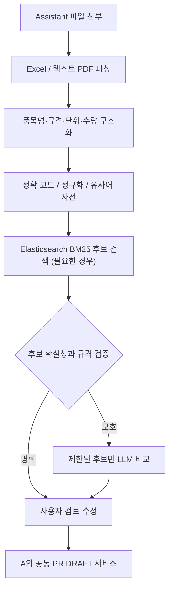

# 차곡ERP — 3일 차 기능 명세서 (FUNCTIONAL-SPEC)

> **버전:** v0.2 · 2026-11-17  
> **기준:** 통합 기획서 v3.3 / PRD v0.3 / MVP 범위표 v0.3 / 역할 분담서 v0.3 / 2일 차 ERP 흐름·업무 규칙 **v0.3**  
> **상태:** **팀 검토용 기능 명세 초안**. 기능 ID는 MVP 범위표의 기존 ID를 그대로 사용한다. API 경로·테이블·화면 ID·상세 상태값은 후속 명세에서 확정한다.  
> **개발:** A=구매 ERP·대화형 Agent·공통 디자인, B=입고/재고 ERP·Document AI·인증, 공통 운영=A+B.

## 1. 범위·규칙

- **P0:** 20주 내 반드시 구현·검증·통합 시연할 기능. 아래 P0는 **총 40개 기능/작업 항목**(ERP·보안·이력 15, Agent 7, 문서 AI·매칭 8, UI·운영·QA 10)이다. 이 중 UX·OPS·QA는 사용자 기능뿐 아니라 품질/운영 산출물도 포함한다.
- **P1:** P0 안정화 후 작업하는 선택 기능. **P2:** 장기 후보로 이번 일정에 완성 약속 없음.
- `input`은 화면/서비스에 필요한 업무 입력, `output`은 사용자가 확인할 결과 또는 서버 저장 결과를 뜻한다. 현재 **REST URL, DTO 필드명, DB 컬럼명까지 확정했다는 뜻이 아니다.**
- PR의 `DRAFT/SUBMITTED/APPROVED/REJECTED`, PO의 `OPEN/PARTIALLY_RECEIVED/RECEIVED` 등은 **차곡ERP 자체 상태 설계 초안**이다. SAP 원본 상태와 일치하지 않는다.
- **외부 업체에 주문 발송·실제 결제/대리결제·송장 대조·MES**는 P0 범위가 아니다. AI는 PR 초안까지만 생성·수정하고 승인/PO/GR/재고를 직접 확정하지 않는다.
- 실제 ERP 원본은 PostgreSQL, Elasticsearch는 검색 파생 인덱스다. 사용자 권한 및 업무 불변조건의 최종 판정은 ERP 서버에서 수행한다.

## 2. P0 — 기준정보·구매 ERP·입고/재고·공통 인증 (15개)

| 기능 ID · 이름 | 담당 · 우선순위 | 입력 | 출력/처리 결과 | 예외·검증 | 완료 기준 |
|---|---|---|---|---|---|
| **MAT-01** 품목 마스터 | A · P0 | 품목 코드·명칭·규격·기준단위·사용 상태 | 품목 생성/조회/수정·비활성화 및 품목 ID | 코드 중복, 필수값 누락, 사용 중 품목의 무결성 위반 | 유효 품목만 PR·PO·매칭에서 선택되고 중복 코드를 막는다 |
| **SUP-01** 공급업체·연락처 | A · P0 | 공급업체 코드·이름·전화/이메일·사용 상태 | 공급업체 저장·조회, PO 상세의 연락처 표시 | 중복 코드, 유효하지 않은 업체, 연락처 형식 오류 | PO에서 활성 공급업체 선택·전화/이메일 확인 가능, 실제 전송 없음 |
| **WH-01** 창고·저장위치 | B · P0 | 창고·저장위치 식별정보 및 사용 상태 | 창고/저장위치 생성·조회·수정, 선택 목록 | 잘못된 창고-저장위치 관계, 비활성 위치 | GR은 선택한 창고에 속한 유효한 저장위치에서만 등록된다 |
| **PR-01** PR 초안 생성·수정 | A · P0 | 작성자·품목 ID 목록·수량·기준단위·필요일(정책 확정 시), 초안 ID·버전 | 공통 `DRAFT` 저장·조회·수정, 버전 갱신 | 비활성 품목, 수량 0 이하, 소유권 위반, 버전 충돌, 중복 생성 | UI·Agent·문서 경로가 동일 PR 서비스로 다품목 초안을 저장·수정한다 |
| **PR-02** PR 제출·반려 후 재작업 | A · P0 | 초안 ID·버전·제출 명령 / 반려된 PR의 재작업 명령 | `SUBMITTED` 또는 `REJECTED → DRAFT`와 이력 | 본인 아닌 문서, 필수 항목 누락, 잘못된 상태 | DRAFT만 제출, 반려 사유 보존 후 수정·재제출 가능 |
| **APR-01** PR 헤더 일괄 승인·반려 | A · P0 | 승인자 인증 문맥·제출된 PR ID·결정·반려 사유 | `APPROVED`/`REJECTED`, 결정 이력 | 승인 권한 없음, 중복·경쟁 승인, 사유 없는 반려 | PR 헤더 전체 1회 승인/반려, **품목별 승인 없음**, 경쟁 요청에도 중복 승인 반영 없음 |
| **PO-01** PR 분할 PO 생성·조회 | A · P0 | 승인 PR, 공급업체 ID, PR 품목 참조, 발주 수량·단가 | 내부 PO 헤더·품목/금액·상태 생성, 상세 조회 | 미승인 PR, 동일 요청 중복 PO, PR 품목별 발주 가능 잔량 초과, 공급업체·품목 무효 | 승인된 PR 1개에서 공급업체별·수량별 여러 유효 PO 생성; **각 PR 품목 발주량 합계 ≤ 승인 수량**, 같은 요청키로 중복 PO 생성 없음 |
| **PO-02** PO 정보·인쇄 | A · P0 | PO ID 및 조회 권한 | 발주 내역, 업체 연락처, 품목·수량·단가·총액, 브라우저 인쇄 | 없는/권한 없는 PO, 데이터 미완성 | 화면에서 예상 금액·연락처 확인, 인쇄 가능; 외부 발송·실결제 호출 없음 |
| **PO-03** PO↔GR 잔량·상태 계약 | A · P0 (B와 계약) | PO 품목 ID 목록·입고 수량·요청 문맥 | 최신 잔량 검증·누적 입고량 반영, PO 상태 | 발주 품목 불일치, 잔량 초과, 완료 PO, 동시 요청 경합 | 원발주량 보존; B의 GR 트랜잭션 안에서 서비스로 누적량 원자적 변경 |
| **GR-01** 수동·부분 입고 | B · P0 (A 서비스 호출) | PO 품목·수량·창고/저장위치·입고 요청키 | `POSTED` GR 문서/품목, PO 누적량 반영, 재고 증가 | 0 이하 수량, 잔량 초과, 창고 관계 오류 | 100개 발주를 60개·40개로 나눠 입고하고 두 문서가 남는다 |
| **GR-02** 초과·중복·동시 입고 차단 | B 주도, A PO 검증 · P0 | 요청키·페이로드·PO 품목, 동시 요청 | 한 번만 적용된 GR/오류 결과 | 같은 키 다른 내용, 60+60 경쟁, 잠금 충돌 | 반복 요청으로 수량 중복 반영 없음; 경쟁 입고 후 누적량 ≤ 발주량 |
| **ST-01** 현재고·재고 원장 | B · P0 | 게시된 GR·품목·창고·저장위치·수량 | `StockMovement` 기록, `StockBalance` 갱신·조회 | 품목·위치 무효, 재고 저장 실패, 동시 행 생성 | PO 누적량·GR·원장·현재고가 한 DB 트랜잭션으로 성공/전체 롤백 |
| **SEC-01** 사용자·인증·공통 역할 | B · P0 | 사용자 계정·로그인 정보·권한 설정 | 로그인/로그아웃·신뢰할 수 있는 사용자 식별·권한 기반 | 인증 실패, 권한 없음, 만료된 인증 | ERP·AI 요청에 공통 인증 문맥이 제공되고 무인증 접근이 차단된다 |
| **SEC-02** 도메인별 상세 권한 | A/B 각 도메인 · P0 | 인증 문맥·대상 문서/창고·업무 명령 | 허용/거부, 변경 결과 | 타인 PR 수정, 승인자 아닌 승인, 창고 권한 없는 GR | 공통 인프라 외에 각 서비스가 소유권·상태·기능 권한을 재검증한다 |
| **AUD-01** 주요 변경 이력 | 해당 도메인 A/B · P0 | 사용자·문서 ID·상태 변경·발생 시각 | PR 승인/반려, PO 생성, GR 처리 이력 | 중복 이력, 저장 실패·일부만 기록 | 테스트에서 처리 주체·시각·이전/이후 상태를 추적할 수 있다 |

### 2.1 ERP 필수 수용 테스트 및 참조 규칙

- `PR(DRAFT/SUBMITTED)`로 PO 생성 → 거부. **BR-001**.
- PR `REJECTED` 시 사유 보존, DRAFT 재작업 뒤 재제출 가능. **BR-003**.
- PR 품목 승인 수량 100 → **PO 60 + PO 40은 허용**, 추가 PO 1은 거부. 별도 요청의 경쟁 PO 60+60은 총 100을 초과해 모두 성공하면 안 됨. **BR-005/024**.
- 발주 100개 → GR 60개 → GR 40개 → 누적 100·잔량 0·원장 2건·현재고 합계 +100(다른 이동이 없는 초기 상태 가정). **BR-006~012**.
- 잔량 40에서 41 입고 → 거부, DB 변경 없음. 동시 60+60은 모두 성공할 수 없음.
- PO 품목과 다르게 GR 품목을 보내거나 다른 창고의 저장위치를 넣으면 거부. **BR-019~022 (신규 제안, 팀 검토 필요)**.
- 재고 저장 중 오류 주입 → PO·GR·원장·현재고 전부 롤백. 트랜잭션 내부 외부 HTTP 호출 없음.

## 3. P0 — 통합 AI Assistant: 대화형 Agent·RAG (7개)

| 기능 ID · 이름 | 담당 · 우선순위 | 입력 | 출력/처리 결과 | 예외·검증 | 완료 기준 |
|---|---|---|---|---|---|
| **AG-01** 통합 Assistant 채팅 | A · P0 (B 문서 UI 연결) | 사용자 메시지·대화 ID·인증 문맥 | 채팅 응답, 재질문, 실행 상태, 파일 패널 진입 | 빈 입력, 대화 식별 실패, API 장애 | 단일 채팅 UI에서 일반 질문과 문서 분석 경로를 모두 사용 가능 |
| **AG-02** ERP 조회 Tool | A · P0 (B 재고 조회 계약) | 자연어 의도·품목/공급업체/재고/구매 이력 조회 인자 | 검증된 ERP 조회 결과·출처(조회 근거) | 없는 품목, 조회 권한 없음, 타임아웃 | 재고·공급업체·구매 내역을 인증된 ERP API로 조회하고 오류를 설명 |
| **AG-03** 구매 규정 RAG | A · P0 | 구매 규정 문서·시행일/버전·사용자 질문 | 규정 근거 및 출처와 연결된 답변 | 근거 부족, 오래된 규정, 문서 지시문 주입 | 근거 있는 답만 반환하고 근거 부족 시 유보; 시행일/출처 표시 |
| **AG-04** PR 초안 생성 | A · P0 | 사용자 요청, 추출된 품목 ID·수량·단위·필요 정보, 요청키 | PR DRAFT ID·항목·버전·확인 안내 | 품목/수량 불명, 권한 없음, 중복 호출, 상태 오류 | Agent가 직접 DB 변경하지 않고 A의 PR 저장 서비스를 호출해 초안 생성 |
| **AG-05** 후속 대화로 초안 수정 | A · P0 | 대화 문맥·draftId·version·표시 순서↔실제 항목 ID·수정 지시 | 수정된 PR DRAFT·새 버전 | “두 번째” 참조 모호, 기존 버전 변경, 소유권 위반 | "두 번째 제외, 첫 번째 수량 20"을 기존 DRAFT에 정확히 반영 |
| **AG-06** 실행 통제·중복 방지 | A · P0 (B 인증 계약) | 사용자 문맥·Tool 허용 목록·명령·멱등 요청키 | 허용 Tool 실행 또는 안전한 거부 | 승인/PO/GR/결제 실행 요구, 권한 위조, API 장애 | 비허용 Tool 실행 불가, 반복 PR 초안 생성 시 의도치 않은 중복 없음 |
| **AG-07** Agent 기본 평가 | A · P0 | 평가 질문/기대 Tool·정답/오류 기준·모델 호출 로그 | Tool 선택·업무 성공·오류·지연·토큰 비용 결과 | 평가셋 누락, 정답 불명, 민감정보 로그 노출 | 정상·모호·권한·충돌·장애 사례 평가표와 실측 결과 제공 |

### 3.1 Agent 처리 제약

- 단일 사용자 대화 내에서 `draftId`, `version`, 응답에 표시한 항목 ID 매핑을 유지한다. **DB의 PR DRAFT가 원본**이며 모델의 기억만을 신뢰하지 않는다.
- RAG 검색 결과와 문서 첨부 내용은 **참고 데이터**이지 ERP 승인/변경 권한의 근거가 아니다.
- RAG가 “승인 가능”이라고 답하더라도 최종 승인 규칙은 서버 업무 로직에서 판단한다.
- 사용자의 "지금 결제해 줘", "자동 승인해 줘" 등의 요청에는 P0에서 해당 Tool이 없음을 안내한다.

## 4. P0 — 통합 AI Assistant: Document AI·품목 매칭 (8개)

| 기능 ID · 이름 | 담당 · 우선순위 | 입력 | 출력/처리 결과 | 예외·검증 | 완료 기준 |
|---|---|---|---|---|---|
| **DOC-01** Excel·텍스트 PDF 첨부/파싱 | B · P0 (A Shell 연동) | 합의된 Excel·텍스트 PDF 파일·사용자 문맥 | 파일 검증·문서 텍스트/행 추출 | 지원 안 되는 형식, 빈 문서, 손상 파일, 업로드 제한 | 약속된 샘플 파일에서 품목 행을 읽고 오류를 안내; OCR 없음 |
| **DOC-02** 구조화 추출·필드 검증 | B · P0 | 파싱된 행/문장·필드 스키마 | 품목명·규격·단위·수량 후보와 누락/불일치 표시 | 수량 파싱 실패, 단위 누락, 필드 누락, LLM 불완전 출력 | 사용자 검토 가능한 구조화 결과를 만든다 |
| **MATCH-01** Rule-Based 우선 매칭 | B · P0 | 추출 품목코드·명칭·규격·약어/유사어 사전 | 정확/정규화 일치 후보 및 근거 | 동일 이름의 서로 다른 규격, 사전 충돌 | 코드·정규화·소규모 도메인 사전으로 1차 매칭, 잘못된 자동 확정 방지 |
| **MATCH-02** Elasticsearch BM25 검색 | B · P0 (A Material 원본 계약) | 정규화 텍스트·규격·품목 인덱스 | 관련 품목 상위 후보·검증할 속성 | 인덱스 미생성/지연, 품목 비활성, 검색 실패 | PostgreSQL 품목 원본으로 색인한 후보를 제공, 저장 직전 원본 재검증 |
| **MATCH-03** 필요 시 LLM Fallback | B · P0 | 모호한 후보 목록·추출 필드·제한된 후보 비교 프롬프트 | 후보 판단 근거 또는 사용자 확인 요청 | LLM 장애, 잘못된 규격 추론, 근거 부족 | 룰/검색으로 충분하지 않을 때만 호출, 모호하면 미확정 유지 |
| **DOC-03** 검토·수정 UI | B · P0 (A 공통 디자인) | 추출 결과·후보 품목·사용자 선택/수정 | 확인된 materialId·수량·기준단위 목록 | 미확정 후보, 불일치 단위, 비정상 수량 | 하나의 Assistant 내부 표/패널에서 품목 선택·수량 수정·오류 확인 가능 |
| **DOC-04** 공통 PR DRAFT 연계 | B · P0 (A PR 서비스 제공) | 확정 materialId·수량·단위·요청자 문맥/요청키 | 신규 PR DRAFT ID·버전 | 승인되지 않은 매칭, 비활성 품목, 중복 생성, 권한 위반 | 리뷰 완료 품목만 A PR 서비스로 저장하며 실패 시 일관된 오류 표시 |
| **DOC-05** 문서·매칭 기본 평가 | B · P0 | 정답 레이블 있는 문서 샘플·검색 정답·호출 로그 | 추출 정확도, Top-1, Recall@5, 오확정·비용·지연 측정 | 정답셋 부족, 테스트 데이터 편향 | 정형/비정형 샘플의 성공/실패 수치와 잘못 확정된 사례 보고 |

### 4.1 문서 AI 처리 단계

- 정확한 코드 매칭 후에도 **규격·단위 검증**을 생략하지 않는다. 사용자가 검토한 값만 PR 초안에 저장한다.
- LLM이 고른 후보 ID는 ERP의 원본 Material에 재확인하며, 외부 문서의 명령·링크는 신뢰된 지시로 취급하지 않는다.
- **Vector/Hybrid Search 비교 확대**는 P1, 스캔 PDF/이미지 OCR은 P2 후보로 P0에서 요구하지 않는다.

## 5. P0 — 사용자 화면·개발·운영·QA (10개)

| 기능 ID · 이름 | 담당 · 우선순위 | 입력 | 출력/처리 결과 | 예외·검증 | 완료 기준 |
|---|---|---|---|---|---|
| **UX-01** 공통 디자인 시스템 | A · P0 | PRD·사이트맵·주요 화면 요구·AI Studio 시안 | 공통 사이드바·헤더·폼·표·상태·컴포넌트 기준 | 화면마다 다른 용어/오류 표시, 모바일 부적합 영역 | A/B 화면이 공통 스타일을 따르고 업무 상태를 식별 가능 |
| **UI-01** 구매/PO 화면 | A · P0 | Material·Supplier·PR·승인·PO API 결과 | 목록·상세·입력·승인·PO 인쇄 화면 | 필수값/버전/권한 오류, 로딩·빈 결과 | 수동 PR부터 내부 PO까지 UI로 완료, 서버 상태와 일치 |
| **UI-02** 창고·GR·재고 화면 | B · P0 (A 디자인) | Warehouse·GR·StockBalance/Movement 조회·등록 | 입고 폼·부분 입고·재고/원장 화면 | 수량 초과, 저장위치 오류, 중복 요청, 로딩 | 사용자 화면에서 부분 입고 60/40과 잔량·현재고 확인 |
| **UI-03** 통합 AI Assistant 화면 | A Shell·채팅 / B 문서 패널 · P0 | 대화 메시지·파일·매칭 결과·수정 명령 | 단일 화면의 채팅·근거·추출/후보 표·PR 초안 | 문서 실패, Tool 실패, 미선택 품목, 재시도 | 별도 두 AI 앱이 아닌 한 화면에서 두 AI 시나리오 완료 |
| **UI-04** 로그인·접근 제어 화면 | B 기능 / A 디자인 · P0 | 계정 정보·인증 상태·보호 페이지 접근 | 로그인·로그아웃·권한 오류 화면 | 잘못된 자격, 로그인 만료, 금지 접근 | 인증이 없으면 보호 API·화면 접근 불가, 올바른 역할만 허용 |
| **OPS-01** CI/CD | A+B 공동 · P0 | 변경 코드·빌드/테스트 구성 | PR 빌드/테스트 결과·배포 파이프라인 | 빌드 실패, 테스트 실패, 비밀정보 유출 | 실제 파이프라인에서 실패를 감지하고 결과를 확인 가능 |
| **OPS-02** 통합 배포 | A+B 공동 · P0 | 프론트·ERP·AI·PostgreSQL·Elasticsearch 구성 | 실행 가능한 통합 서비스·배포 절차 | 서비스 기동 실패, 연결 오류, 환경 차이 | 배포 환경에서 ERP·Agent·문서 AI 시연 재현 |
| **OPS-03** 공통 로깅·모니터링 | A+B 공동 · P0 | 요청/오류·DB·AI 호출 비용·리소스 지표 | 추적 가능한 기본 로그와 오류·상태 확인 | 비밀번호/문서 원문·API Key 노출, 로그 누락 | 장애 발생 시 원인 확인, AI 호출 비용 기록, 민감정보 비노출 |
| **OPS-04** PostgreSQL 공통 운영 | A+B 공동 · P0 | DB 환경·마이그레이션·백업 자료 | DB 실행·스키마 반영·복원 절차 | 마이그레이션 충돌, 초기 데이터 분실 | 새 환경 재구성 및 백업/복구 검증 결과 보유 |
| **QA-01** 기능·종단 간 테스트 | 각 기능 소유자 + 공동 통합 · P0 | 정상·예외·경합·AI 정답 시나리오 | 자동화 결과와 미검증 목록 | 테스트 환경 미구성, Mock만 사용한 경합 테스트 | 핵심 거래/보안/AI 두 경로 테스트를 실제 환경에서 검증·기록 |

## 6. P1 / P2 기능 목록 — 범위만 등록, 상세 설계는 착수 전

| 범위 | 기능 | 소유 | 현재 원칙 |
|---|---|---|---|
| P1 | 입고 취소·역거래(원장 역이동) | B + A의 PO 수량 계약 | GR 삭제가 아니라 보정 거래 설계 후 적용 |
| P1 | Vector/Hybrid Search 성능·품질 비교 | B | BM25 기반이 먼저 완료되어야 함 |
| P1 | 매칭 실패 재처리·색인 재구축 | B | PostgreSQL 원본 기준 재색인 |
| P1 | Agent 문맥·오류 복구 고도화 | A | P0 후속 수정·안전 실행의 실측 결과 기반 |
| P1 | 공급업체·월별 예상 발주 금액 집계 | A | 지급액·회계비용으로 표시하지 않음 |
| P1 | PO 정식 PDF 출력 | A | P0 브라우저 인쇄 이후 |
| P1 | AI 평가 결과 UI | A/B | 기본 평가 데이터 확보 후 |
| P1 | SAP Sandbox 설계 차이 검증 | A/B | 실제 ERP 연동은 여전히 제외 |
| P1 | 모바일 반응형 개선 | A 디자인 + 각 UI 담당 | PC 업무 표 우선 |
| P2 | BOM·간소화 MRP·부족 자재 PR 연계 | 향후 협의 | **MES가 아님**. 이번 5개월 완료 범위 제외 |
| P2 | 다단계 결재·송장 검증·가상 지급 상태 | 향후 협의 | **실제 결제/대리결제 아님**, 이번 범위 제외 |
| P2 | OCR·스캔 PDF, Multi-Agent, 앱/PWA, 실제 SAP 연동 | 향후 협의 | 이번 범위 제외 |
| 제외 | 외부 자동 발주 전송·실구매·실결제·PG·MES 전체 | 해당 없음 | **기능 명세 및 구현 대상 아님** |

## 7. 기능별 선행 관계 및 모듈 경계

| 선행 기능/계약 | 의존 기능 | 책임·경계 |
|---|---|---|
| SEC-01 공통 사용자 문맥(B) | 모든 ERP·Agent·문서 AI | 클라이언트가 임의로 적은 userId를 신뢰하지 않음 |
| MAT-01(A) | PR/PO(A), MATCH-01/02(B) | PostgreSQL 원본 품목 ID·기준단위 계약 |
| SUP-01(A) | PO-01/02(A), AG-02(A) | 유효 공급업체·연락처 조회 계약 |
| WH-01(B) | GR-01(B), ST-01(B), AG-02(A) | 유효 창고/저장위치·재고 조회 계약 |
| PR-01(A) | AG-04/05(A), DOC-04(B) | PR DRAFT 저장/수정·버전·요청 멱등성 공통 계약 |
| PO-03(A) | GR-01/02(B), ST-01(B) | 한 PostgreSQL 트랜잭션 안에서 PO 잠금/갱신 서비스 호출 |
| MAT-01(A) → 검색 색인(B) | MATCH-02/03(B) | 검색 색인은 파생 데이터, PR 저장 시 ERP Material 재검증 |
| UX-01(A) | UI-01/02/03/04 | 화면 공통 디자인은 A, 각 화면 기능 구현은 A/B 분담 |
| UI-03(A/B) | AG-01/05(A), DOC-01/03(B) | 한 Assistant, 내부 Agent/Document 파이프라인 독립 |

## 8. 결정된 정책과 후속 세부 구현 항목

> **2026-11-17 A 결정 반영:** D-01~02 업무 범위와 D-03~11 권장 방향을 수용했다. 아래는 **결정된 방향과 여전히 남은 상세 구현 항목**을 함께 기록한다. B의 검토·서명은 별도다.

아래 항목 중 **업무 정책은 A가 선택한 방향**이고, 기술적 세부값·구현·B의 최종 검토는 별도로 남아 있다.

| 결정 ID | A가 수용한 정책 및 남은 상세사항 | 상세 설계 시점 |
|---|---|---|
| D-01 | **A 확정 방향: PR 1:N PO 분할 발주**, PO당 공급업체 1곳, PR 품목별 초과 발주 금지. ID/FK/요청키 상세는 ERD·API에서 정의 | ERD·API 전 |
| D-02 | **A 확정 방향: PR 헤더 전체 일괄 승인·반려, 품목별 승인 제외.** 자기 승인/역할 겸직 세부는 권한 매트릭스에서 검토 | 권한 매트릭스 |
| D-03 | 품목별 기준단위·Decimal 수량·KRW, 환산 제외 방향 수용. **정밀도·반올림 세부는 미확정** | ERD/API 전 |
| D-04 | `OPENING` 원장으로 개시 재고 기록 방향 수용. 저장위치 기본값·구현 상세 미확정 | ERD 전 |
| D-05 | PO 헤더→품목 잠금·요청키 UNIQUE·단일 트랜잭션·같은 키 기존 결과 방향 수용. 상세 설계는 후속 | API·기술 설계 전 |
| D-06 | 사용자 입력 수량 임계값을 P0 기준으로 수용. 기준 없으면 재질문 | Agent Tool 계약 전 |
| D-07 | XLSX 1~2종·텍스트 PDF 1종으로 한정. 파일 크기 제한은 PoC에서 정의 | Document AI PoC 전 |
| D-08 | 시연 구매 규정 1종, 조항 ID·시행일·버전 관리 수용; 출처/관리 상세는 RAG PoC에서 정의 | RAG PoC 전 |
| D-09 | Spring Security 서버 세션·HttpOnly 쿠키 우선 수용. CSRF/AI 서비스 인증·역할 다중부여는 후속 설계 | 인증·AI 계약 전 |
| D-10 | Rust·모델은 PoC 후 결정, ES는 DB 커밋 후 색인+실패 재처리 방향 수용 | 기술 PoC 전 |
| D-11 | 핵심 계약 먼저 정하고 OpenAPI·ERD·화면 명세는 점진적으로 확정 | 2주 차 API·ERD·화면 명세 |

### D-01 구현 시 중요한 불변식(PO-01 확정 범위)

- `RequisitionItem` 한 개를 여러 `PurchaseOrderItem`이 참조할 수 있다. 한 PO 헤더는 공급업체 한 곳을 참조한다.
- `orderedByPrItem = Σ(유효 PO item.orderedQty)`; `remainingToOrder = PR item.requestedQty - orderedByPrItem`이며 `remainingToOrder >= 0`을 유지한다.
- PO 생성 명령은 PR 품목별 최신 잔량을 **DB 잠금 이후** 재계산하고, PO 헤더·품목을 한 트랜잭션에 저장한다.
- 같은 PR의 **서로 다른 요청키로 만든 서로 다른 PO는 정상 생성**이다. 동일 요청키 재시도에서만 중복 생성하지 않는다.
- PR의 `APPROVED` 상태는 분할 발주 중에도 유지하며, 미발주/발주 완료 여부는 별도 파생 조회값으로 계산한다.
- PO 취소·미입고 발주 수량의 재배분은 P0 미지원. GR은 각 PO별로 독립 처리한다.

## 9. 3일 차 확인 체크리스트

- [ ] 40개 P0 기능/작업 항목이 **MVP 기능 범위표와 1:1 대응**하는지 확인
- [ ] 구매(담당 A)·입고/재고(담당 B)·공통 인증(B)·공통 디자인(A)·운영 4영역(A+B)의 담당 확인
- [ ] Agent·Document AI는 **한 화면에서 사용**, 내부 파이프라인은 분리하는 조건 확인
- [ ] PO/GR 품목 단위 참조, 부분 입고·초과/중복/동시 입고 방지·전체 롤백 조건 확인
- [ ] 외부 발주·실결제·대리결제·다단계 결재·송장·MES를 P0로 넣지 않았는지 확인
- [ ] `D-01~11` 중 상세값과 B 검토가 필요한 계약을 2주 차 ERD·API·화면 설계 이슈로 전환

**팀 검토:** A __________ / B __________ / 검토일 __________ / 수정할 기능 ID __________

> 부록: [기능 누락 점검표](FUNCTION-COVERAGE.md), [2일 차 ERP 흐름](../business/04-ERP-WORKFLOW.md), [SAP EDMX 반영 조사](../references/05-SAP-REFERENCE.md), [ERP 업무 규칙](../business/06-ERP-BUSINESS-RULES.md)
